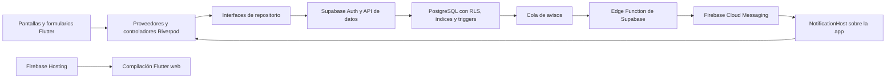
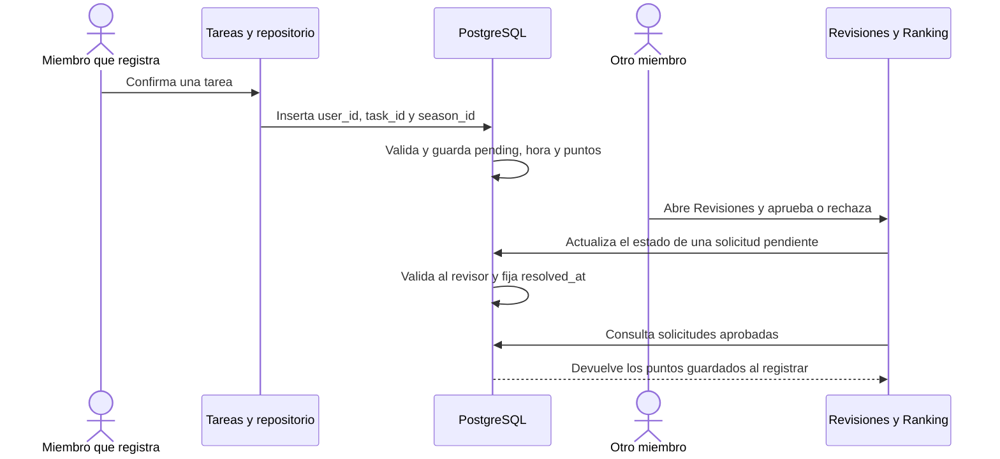

# Manual técnico de Casa en Juego

## 1. Qué resuelve

Casa en Juego organiza las tareas domésticas de un grupo familiar. Un miembro
registra una tarea, otro confirma o rechaza el trabajo y el ranking muestra
los puntos de las tareas aprobadas en el ciclo activo. La administración
define el catálogo y los ciclos. Mi actividad conserva el historial personal.

El alcance actual es un solo grupo de miembros con cuentas creadas en Supabase.
Para la entrega del domingo 22 de noviembre de 2026 se usa como referencia la
rúbrica de Desarrollo Móvil. La consulta del miércoles 18 define qué servicios
Firebase deben integrarse y cómo se evaluarán el mapa y el pago.

## 2. Arquitectura y tecnologías



| Componente | Responsabilidad | Dónde estudiarlo |
|---|---|---|
| Flutter y Dart | Pantallas para Android, iOS y web. Los módulos se organizan por funcionalidad. | [lib/main.dart](../lib/main.dart), [pubspec.yaml](../pubspec.yaml) |
| Riverpod | Estado de formularios, sesión, consultas, acciones, reintentos e invalidación de datos. | Carpetas `providers/` de cada módulo y proveedores locales de los formularios |
| go_router | Navegación, restauración de sesión y protección de páginas administrativas. | [app_router.dart](../lib/core/router/app_router.dart) |
| Supabase Auth | Sesión con correo y contraseña. El perfil familiar y el rol se leen de PostgreSQL. | [auth_repository.dart](../lib/features/auth/repositories/auth_repository.dart) |
| Supabase PostgreSQL | Datos de negocio y autorización. RLS significa seguridad por fila. Se complementa con permisos por columna, restricciones e índices. | [phase_2.sql](../supabase/phase_2.sql), [migraciones](../supabase/migrations/) |
| Firebase | FCM transporta avisos en móvil y Hosting aloja la compilación web. | [push_gateway.dart](../lib/features/notifications/repositories/push_gateway.dart), [firebase.json](../firebase.json) |
| fl_chart | Barras horizontales de contribución en el ranking. | [contribution_chart.dart](../lib/features/leaderboard/presentation/widgets/contribution_chart.dart) |

`main()` inicializa Supabase, intenta inicializar Firebase para push móvil y
monta `ProviderScope`. El resultado de la inicialización se inyecta con
`pushRuntimeReadyProvider`. `CasaEnJuegoApp` combina el tema, el router y
`NotificationHost`. La guía de push explica los pasos de despliegue.

En `lib/features/`, `presentation/` contiene las pantallas, `providers/`
coordina el estado, `repositories/` encapsula el acceso a datos y `models/`
describe los objetos que intercambian. En `core/` están el router, el tema, la
configuración y el proveedor del cliente Supabase. Las pruebas pueden sustituir
las interfaces de repositorio por implementaciones de prueba.

## 3. Autenticación, rutas y perfil

1. `LoginPage._submit()` valida los campos, quita el foco y llama a
   `AuthController.signIn()`. El controlador usa `AsyncValue` para deshabilitar
   envíos simultáneos y mostrar errores recuperables.
2. `SupabaseAuthRepository.signIn()` llama a `signInWithPassword()`.
   `watchUser()` observa los cambios de sesión y obtiene el perfil asociado.
   `currentUserProvider` expone el resultado a la app.
3. El router lleva al usuario a `/session` mientras se valida el perfil, a
   `/login` si no hay sesión y a `/tasks` después del acceso. Las rutas
   `/admin` requieren rol de administrador. Las políticas SQL también
   verifican el rol al escribir.
4. `ProfileController.setNotifications()` actualiza la preferencia guardada en
   PostgreSQL y sincroniza el estado de avisos. Perfil muestra nombre, correo,
   rol, iniciales y acceso a Mi actividad.
5. `AuthController.signOut()` solicita a `NotificationSession.disconnect()`
   desvincular el dispositivo y luego cierra la sesión local de Supabase. Si la
   desvinculación falla, la app muestra un error y permite reintentar.

Enlaces de estudio: [controlador de acceso](../lib/features/auth/providers/auth_providers.dart),
[controlador de perfil](../lib/features/profile/providers/profile_providers.dart)
y [pantalla de perfil](../lib/features/profile/presentation/profile_page.dart).

## 4. Tareas, revisiones, historial y ranking



| Módulo y métodos | Comportamiento |
|---|---|
| [Tareas](../lib/features/tasks/repositories/tasks_repository.dart), `loadDashboard()`, `submitTask()` | Carga el ciclo activo, el catálogo, las solicitudes relevantes y el estado de los límites diarios con una RPC. El envío solo escribe referencias; la base establece el estado, la hora y los puntos. `TaskSubmissionController.submit()` protege la acción de envíos simultáneos y refresca el tablero. |
| [Revisiones](../lib/features/reviews/repositories/reviews_repository.dart), `loadInbox()`, `resolve()` | Lista las solicitudes pendientes de otros miembros del ciclo activo. Solo cambia solicitudes todavía pendientes. El controlador de revisiones invalida las lecturas afectadas después de resolver. |
| [Mi actividad](../lib/features/activity/repositories/activity_repository.dart), `loadPage()` | Carga el historial del usuario con filtro por estado y paginación. `loadMore()` conserva las páginas ya recibidas y comprueba que el resultado siga perteneciendo a la búsqueda activa al terminar. |
| [Ranking](../lib/features/leaderboard/repositories/leaderboard_repository.dart), `loadLeaderboard()` | Carga los miembros y las solicitudes aprobadas del ciclo activo, paginando consultas. Los puntos se obtienen de `points_snapshot`. La UI muestra podio y gráfica de aportaciones. |
| [Administración](../lib/features/admin/repositories/admin_repository.dart), `loadDashboard()`, `loadTasks()`, `saveTask()`, `closeSeason()`, `startSeason()` | Consulta el resumen y el catálogo, crea y edita tareas, cierra el ciclo activo y permite comenzar otro. `AdminActionController._run()` verifica el rol, serializa acciones e invalida datos relacionados al completarlas. |

### Modelo de datos

| Tabla | Datos y reglas |
|---|---|
| `users` | Identidad enlazada a Supabase Auth, nombre, correo, rol y preferencia de avisos. |
| `tasks` | Nombre, icono, puntos, estado activo y opción de una vez al día. Desactivar una tarea la oculta del catálogo y preserva su historial. |
| `seasons` | Nombre, fechas y estado del ciclo. Un índice único parcial limita la base a un ciclo activo. Un ciclo cerrado conserva sus fechas. |
| `task_logs` | Solicitud vinculada al usuario, tarea y ciclo. Guarda estados, fechas, revisor, puntos históricos y si se aplicó límite diario. El revisor debe ser otro miembro y una solicitud solo se puede resolver una vez. |
| `push_devices` y `push_jobs` | Registro FCM por usuario/dispositivo y cola de entregas con estado, reintentos y caducidad. El acceso a dispositivos se gestiona con RPC autenticadas. |

`private.validate_task_log()` asegura las reglas de escritura en el servidor.
Para tareas limitadas, el límite es por usuario, tarea y día en
`America/Mexico_City`, incluso al cambiar de ciclo. Una solicitud rechazada
permite volver a registrar. La protección combina bloqueo transaccional e
índices para solicitudes concurrentes. `get_task_submission_status()` devuelve
el estado del usuario actual para que Flutter pueda reflejarlo en el catálogo.

Enlaces de estudio: [esquema base](../supabase/phase_2.sql),
[puntos históricos](../supabase/migrations/20261022_add_points_snapshot.sql)
y [límite diario](../supabase/migrations/20261022_add_daily_task_limits.sql).

## 5. Avisos móviles

1. `FirebasePushGateway` solicita permisos, registra un identificador de
   instalación FCM (FID) y adapta los mensajes a `PushNotice`. Usa
   `onMessage` para el primer plano, `onMessageOpenedApp` cuando se toca un
   aviso en segundo plano y `getInitialMessage()` al abrir desde cerrada.
2. `NotificationSession.start()` activa las suscripciones una vez.
   `syncUser()` coordina cambios de sesión, permiso, preferencia y registro.
   En Supabase, las RPC `register_push_device` y `unregister_push_device`
   vinculan o desvinculan el FID de la cuenta actual.
3. La inserción o resolución de una tarea encola avisos. La Edge Function
   `send-task-notifications` reclama trabajos, comprueba nuevamente el estado
   y el destinatario, llama a FCM y registra el resultado. Los recordatorios
   usan la misma cola y se programan a las 18:00 y 20:00 de Ciudad de México.
4. `NotificationHost` comprueba el destinatario y la preferencia. En primer
   plano muestra un aviso de tres segundos e invalida proveedores de tareas,
   revisiones, ranking y actividad. Al tocar un aviso abre la ruta asociada.

Los mensajes actuales son privados y esperan `kind`, `recipient_id` y
`notification_id`. Una notificación genérica de Firebase Console puede
mostrarse en la bandeja de Android con la app en segundo plano, pero la app
descarta ese mensaje en su parser si carece del formato esperado. La prueba de
entrega desde consola todavía está pendiente. También quedan pendientes Topics
y la validación del ciclo de vida en dispositivos. iOS requiere configuración
APNs y el push móvil actual se inicializa solo en Android e iOS.

Enlaces de estudio: [NotificationHost](../lib/features/notifications/presentation/notification_host.dart),
[sesión de avisos](../lib/features/notifications/services/notification_session.dart),
[Edge Function](../supabase/functions/send-task-notifications/handler.ts),
[guía de push](push_notifications_setup.md)
y [guía de recordatorios](inactivity_reminders_setup.md).

## 6. Formularios con Riverpod

En [LoginPage](../lib/features/auth/presentation/login_page.dart) se sustituyó
una llamada a `setState`. `_passwordVisibilityProvider` inicia con contraseña
oculta, y `_PasswordVisibility.toggle()` invierte el estado. El campo se
redibuja mediante `ref.watch`. El flujo de autenticación permanece en
`AuthController`.

```dart
final showPassword = ref.watch(_passwordVisibilityProvider);
// El TextFormField usa obscureText: !showPassword.
ref.read(_passwordVisibilityProvider.notifier).toggle();
```

En [TaskEditorPage](../lib/features/admin/presentation/task_editor_page.dart)
se sustituyeron siete llamadas a `setState`. `_TaskFormController.build()`
inicializa el borrador con la tarea editada o con los valores de alta.
`update()` recibe los cambios de nombre, puntos, icono, estado, frecuencia o
error de validación. Cada formulario tiene su propia instancia del proveedor
`autoDispose`. Esto permite editar una tarea sin compartir el borrador con
otro formulario y liberar el estado cuando se sale. `_save()` valida el
formulario, crea un `TaskDraft` y delega el guardado a administración.

```dart
final form = ref.watch(_formProvider); // Alimenta la vista previa.
final controller = ref.read(_formProvider.notifier);
// En el campo de nombre:
onChanged: (name) => controller.update(name: name),
```

Los formularios conservan claves de Flutter para validar los campos. Tener
un `ConsumerStatefulWidget` permite gestionar el ciclo de vida del formulario.
El estado editable se actualiza por Riverpod.

## 7. Rúbrica del proyecto final

| Requisito | Estado en este repositorio |
|---|---|
| Problemática, objetivo y alcance | Parcial. Hay un [planteamiento](../planteamiento.md). Falta incluir evidencia del problema y el alcance acordado con el maestro. |
| Firebase Database y sincronización | Parcial. PostgreSQL guarda los datos y Flutter refresca las consultas al cambiar el estado, navegar o recibir avisos. Pendiente una suscripción a cambios de datos y la decisión del maestro sobre Supabase, Realtime Database o Firestore. |
| Firebase Storage y caché local de imágenes | Pendiente. Perfil usa iniciales y el catálogo usa iconos locales. Falta subir y guardar imágenes para uso sin conexión. |
| FCM desde consola, Topics y tres estados | Parcial. Hay escuchador global y rutas al tocar avisos privados. Faltan Topics, envío de consola en la demo y comprobación en Android. |
| Firebase Auth, alta por correo y dos proveedores | Parcial. Supabase Auth permite acceder con correo y contraseña para cuentas creadas previamente. Faltan alta desde la app, verificación, reenvío, recuperación y dos proveedores federados. Firebase Auth depende del alcance que acepte el maestro. |
| Perfil y avatar sincronizado | Parcial. Perfil muestra datos e iniciales. Falta foto compartida con Tareas, foto del proveedor y permiso de edición para cuentas de correo. |
| Estado con Riverpod | Implementado. Las ocho llamadas explícitas a `setState` fueron sustituidas. La búsqueda en `lib/` tampoco encontró usos explícitos de `ValueNotifier`. |
| Tipografía, tema dinámico y onboarding | Pendiente. Hay un tema oscuro fijo. |
| Responsividad y widget avanzado | Parcial. Hay límites de ancho y pruebas en pantallas pequeñas. La adaptación a escritorio debe validarse. La gráfica de Ranking es candidata al 10% si el maestro la acepta. |
| Sensor y mapa nativo | Pendiente. Biometría para confirmar el cierre de ciclo es una propuesta. El propósito y la ubicación del mapa dependen del alcance acordado. |
| Pagos o suscripciones | Pendiente. Stripe PaymentSheet es una opción para mostrar un formulario nativo de pago en modo de pruebas. También falta definir si se evaluará pedido simulado o tres planes. |
| Entrega y estabilidad | Parcial. Hay Git, pruebas y documentación. Faltan el reporte final, APK de entrega y ensayo completo. |

## 8. Cómo ejecutar y probar

```powershell
flutter pub get
flutter devices
flutter run -d ID_DEL_ANDROID
flutter test
dart analyze
```

- **Dispositivos.** Usar el Pixel 8 del emulador o el teléfono RMX3840 para
  pruebas nativas, en especial FCM. Para revisar dos sesiones en paralelo,
  usar el Android con la app web en un perfil o navegador distinto de Chrome
  o Edge.
- **Caso principal.** Acceder como un miembro y registrar una tarea. Cerrar
  sesión y entrar con otra cuenta, abrir Revisiones y aprobar. Volver a la
  primera cuenta y revisar Mi actividad y Ranking. Repetir con rechazo.
  Ambas cuentas pueden alternarse en el mismo dispositivo.
- **Servicios.** El proyecto tiene configuración Supabase por defecto.
  `SUPABASE_URL` y `SUPABASE_PUBLISHABLE_KEY` pueden sustituirse mediante
  `--dart-define` si existe un proyecto de pruebas. Los secretos del servidor
  y las claves privadas quedan fuera del cliente. Docker es opcional y se
  usaría para levantar Supabase local. El desarrollo normal usa Supabase remoto.
- **Firebase Console.** La primera prueba puede dirigirse únicamente al
  identificador de la instalación de Android desde el botón de prueba de
  Messaging. Comprobar recepción en la bandeja en segundo plano. Preparar
  después el flujo de Topics y el manejo genérico en primer plano.
- **Pruebas de código.** `test/widget_test.dart` cubre acceso y sesión.
  `test/admin_test.dart` cubre permisos de administrador y edición.
  `test/notifications_test.dart` cubre preferencias, desvinculación y rutas
  de avisos. Estas pruebas usan repositorios o gateways de prueba.

Para la publicación web, consultar [Firebase Hosting](firebase_hosting_setup.md).
Para la activación real de avisos y las pruebas SQL y Deno, consultar las
[instrucciones de push](push_notifications_setup.md).

## 9. Decisiones pendientes y mantenimiento

Conviene conservar Supabase mientras se valida la rúbrica. Las interfaces de
repositorio permiten reutilizar la UI si cambia el proveedor. Migrar el flujo
principal implica portar consultas, relaciones, roles, reglas de revisión,
límites diarios y concurrencia. Si el maestro acepta demostrar Firebase
Database en un módulo acotado, conviene acordar ese alcance antes de
implementar un segundo modelo de datos.

**Registro del 14 de noviembre de 2026.** Se migró a Riverpod el estado de
visibilidad de contraseña y del editor de tareas. El cambio final de esta
iteración se limita a esos dos formularios y este manual.

En cada cambio del proyecto, actualizar este archivo en la misma revisión.
Explicar el flujo o método afectado, dónde vive en el código, qué requisito
cubre y cómo se verificó. Actualizar los diagramas, extractos y la tabla de
la rúbrica cuando cambie el comportamiento o su estado.
