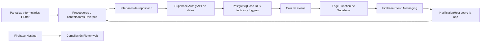
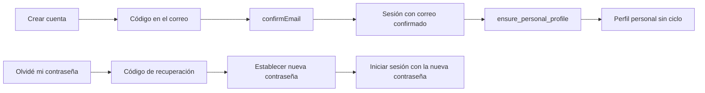
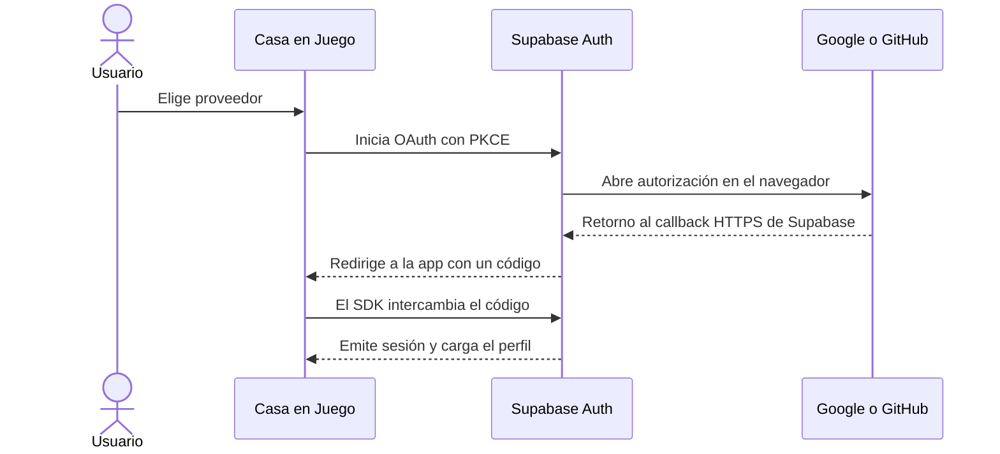
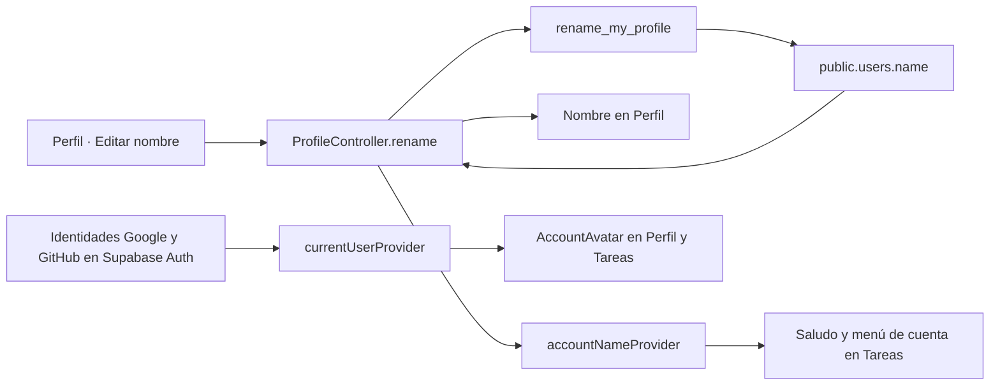
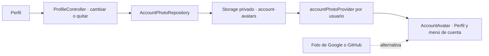
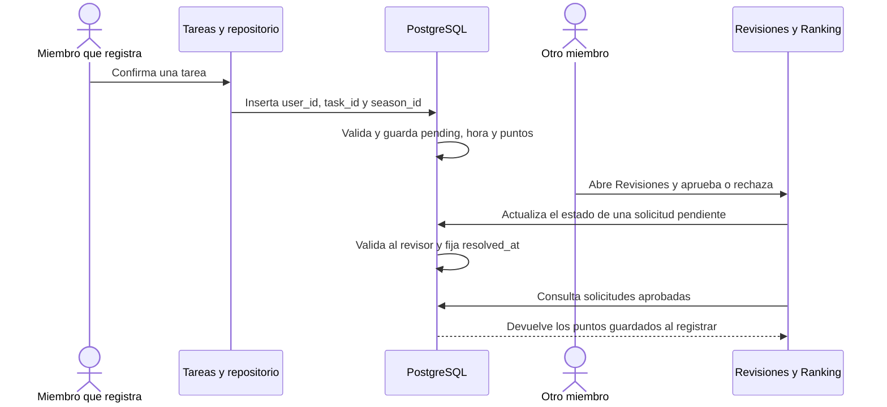
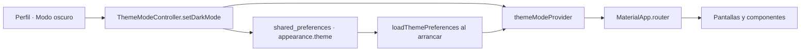

# Manual técnico de Casa en Juego

## 1. Qué resuelve

Casa en Juego organiza las tareas domésticas de un grupo familiar. Un miembro
registra una tarea, otro confirma o rechaza el trabajo y el ranking muestra
los puntos de las tareas aprobadas en el ciclo activo. La administración
define el catálogo y los ciclos. Mi actividad conserva el historial personal.

El ciclo es la unidad que se crea, comparte y cierra. Cada cuenta tiene
como máximo una membresía activa. Las tareas, resultados e historial se
conservan al terminar y cada ciclo nuevo empieza con su propio catálogo.
El maestro aprobó usar Supabase para datos y autenticación, y Firebase para
avisos. La entrega es el domingo 22 de noviembre de 2026. El mapa y el pago
siguen pendientes.

## 2. Arquitectura y tecnologías



| Componente | Responsabilidad | Dónde estudiarlo |
|---|---|---|
| Flutter y Dart | Pantallas para Android, iOS y web. Los módulos se organizan por funcionalidad. | [lib/main.dart](../lib/main.dart), [pubspec.yaml](../pubspec.yaml) |
| Riverpod | Estado de formularios, sesión, consultas, acciones, reintentos e invalidación de datos. | Carpetas `providers/` de cada módulo y proveedores locales de los formularios |
| go_router | Navegación, restauración de sesión y protección de páginas administrativas. | [app_router.dart](../lib/core/router/app_router.dart) |
| Supabase Auth | Sesión con correo y contraseña. El perfil familiar y el rol se leen de PostgreSQL. | [auth_repository.dart](../lib/features/auth/repositories/auth_repository.dart) |
| Supabase PostgreSQL | Datos de negocio y autorización. RLS significa seguridad por fila. Se complementa con permisos por columna, restricciones e índices. | [phase_2.sql](../supabase/phase_2.sql), [migraciones](../supabase/migrations/) |
| Firebase | FCM transporta avisos en móvil y Hosting aloja la compilación web. | [push_gateway.dart](../lib/features/notifications/repositories/push_gateway.dart), [firebase.json](../firebase.json) |
| fl_chart | Barras horizontales de contribución en el ranking. | [contribution_chart.dart](../lib/features/leaderboard/presentation/widgets/contribution_chart.dart) |

`main()` inicializa Supabase, intenta inicializar Firebase para push móvil y
monta `ProviderScope`. El resultado de la inicialización se inyecta con
`pushRuntimeReadyProvider`. `CasaEnJuegoApp` combina el tema, el router y
`NotificationHost`. La guía de push explica los pasos de despliegue.

En `lib/features/`, `presentation/` contiene las pantallas, `providers/`
coordina el estado, `repositories/` encapsula el acceso a datos y `models/`
describe los objetos que intercambian. En `core/` están el router, el tema, la
configuración y el proveedor del cliente Supabase. Las pruebas pueden sustituir
las interfaces de repositorio por implementaciones de prueba.

## 3. Autenticación, rutas y perfil

1. `LoginPage._submit()` valida los campos, quita el foco y llama a
   `AuthController.signIn()`. El controlador usa `AsyncValue` para deshabilitar
   envíos simultáneos y mostrar errores recuperables.
2. `SupabaseAuthRepository.signIn()` llama a `signInWithPassword()`.
   `watchUser()` observa los cambios de sesión, exige un correo confirmado y
   carga el perfil asociado. Si el perfil todavía no existe, llama a la RPC
   `ensure_personal_profile()`. `currentUserProvider` expone el resultado.
3. El router lleva al usuario a `/session` mientras se valida el perfil, a
   `/login` si no hay sesión, a `/tasks` para miembros de un ciclo activo y a
   `/profile` para cuentas personales sin ciclo. Registro y recuperación
   son rutas públicas. Una cuenta sin membresía activa puede abrir `/admin`
   para crear un ciclo. Las rutas `/admin/tasks` requieren el rol de
   administrador del ciclo activo. `/profile/ciclos` y `/tasks/activity`
   siguen disponibles después del cierre.
4. `ProfileController.setNotifications()` actualiza la preferencia guardada en
   PostgreSQL y sincroniza el estado de avisos. Perfil muestra nombre, correo,
   rol, avatar e información del grupo cuando corresponde.
5. `AuthController.signOut()` solicita a `NotificationSession.disconnect()`
   desvincular el dispositivo y luego cierra la sesión local de Supabase. Si la
   desvinculación falla, la app muestra un error y permite reintentar.

Enlaces de estudio: [controlador de acceso](../lib/features/auth/providers/auth_providers.dart),
[controlador de perfil](../lib/features/profile/providers/profile_providers.dart)
y [pantalla de perfil](../lib/features/profile/presentation/profile_page.dart).

### Registro, confirmación y recuperación por correo

[EmailAccountPage](../lib/features/auth/presentation/email_account_page.dart)
usa [EmailAccountController](../lib/features/auth/providers/email_account_provider.dart)
para indicar el paso actual, bloquear envíos duplicados y presentar errores.
`signUp()` envía el nombre y las credenciales a Supabase Auth.
`resendSignUpCode()` reenvía la confirmación. `confirmEmail()` valida el
código de un solo uso y abre la sesión. El formulario valida el correo,
ocho caracteres de contraseña como mínimo y coincidencia entre las dos entradas.



La [migración de cuentas personales](../supabase/migrations/20261114000100_add_personal_accounts.sql)
marca como miembros los perfiles existentes y hace que los nuevos nazcan sin
membresía. La RPC toma el identificador y correo de Supabase Auth. El cliente
puede proponer un nombre, pero la base decide el rol. Las políticas RLS solo
dejan que una cuenta sin grupo vea su propio perfil. El grupo existente
mantiene su acceso a datos y sus permisos de administrador.

[PasswordRecovery](../lib/features/auth/repositories/password_recovery.dart)
pide el código a Auth, lo valida con tipo `recovery` y usa la sesión temporal
para cambiar la contraseña. Esas peticiones se hacen aparte del cliente que
mantiene la sesión de la app, para que el código de recuperación no inicie
sesión ni sincronice una sesión temporal entre pestañas. Al terminar se
solicita el cierre de esa sesión y la interfaz vuelve al acceso normal.

#### Activación en Supabase

1. Aplicar la migración de cuentas personales en SQL Editor sobre la base
   existente. Ejecutar solo esa migración para este cambio.
2. En **Authentication → Emails → Set up SMTP**, configurar un proveedor
   SMTP con el remitente y las credenciales que indique el servicio de correo.
   El envío integrado de Supabase solo entrega a direcciones del equipo del
   proyecto. Desde el 3 de junio de 2026, los proyectos gratuitos nuevos
   que usan ese envío también tienen bloqueada la edición de plantillas.
3. Con el SMTP personalizado habilitado, volver a **Templates** y editar
   **Confirm sign up** y **Reset password**. Usar `{{ .Token }}` en el cuerpo
   e indicar que se introduzca el código en Casa en Juego. Retirar
   `{{ .ConfirmationURL }}` de ambas plantillas.
4. En la configuración del proveedor de correo, mantener activada la
   confirmación de correo y después habilitar el registro de usuarios nuevos.
5. En Android o web, crear una cuenta de prueba, verificar que se pueda
   reenviar y confirmar el código, comprobar que solo abra Perfil y probar
   que la contraseña anterior falle y la nueva funcione después de recuperarla.
   Repetir el acceso con una cuenta familiar previa para comprobar su permiso.

Referencias: [restricción de plantillas en el plan gratuito](https://supabase.com/changelog/46599-changes-to-email-template-customisation-on-free-tier),
[configuración SMTP](https://supabase.com/docs/guides/auth/auth-smtp)
y [plantillas de correo de Supabase](https://supabase.com/docs/guides/auth/auth-email-templates).

### Acceso con Google y GitHub

[SocialSignInButtons](../lib/features/auth/presentation/widgets/social_sign_in_buttons.dart)
muestra ambos proveedores en el login. `AuthController.signInWithProvider()`
comparte el estado de carga con el acceso por correo. El
[lanzador OAuth](../lib/features/auth/repositories/oauth_sign_in.dart) abre el
navegador con `signInWithOAuth()`. Al abrirse el navegador la app todavía
espera la sesión de Supabase. Al volver, el SDK intercambia el código
mediante PKCE y `watchUser()` carga el perfil. Una cuenta nueva llega a
Perfil sin ciclo. Supabase puede vincular proveedores a la misma cuenta si
comparten un correo verificado.

Los botones usan `OutlinedButton.icon` con imágenes PNG empaquetadas en
[`assets/brand/`](../assets/brand/). Google usa su G multicolor con fondo
blanco. GitHub usa la versión negra del Invertocat en el tema claro y la
blanca en el oscuro. Las imágenes son decorativas para el lector de pantalla.
El texto del botón identifica la acción y el proveedor. Los archivos vienen
de los [recursos de marca de Google](https://developers.google.com/identity/branding-guidelines)
y del [kit de marca de GitHub](https://brand.github.com/foundations/logo).



#### Activar los proveedores

1. Aplica la migración de cuentas personales descrita arriba. En Supabase,
   abre **Authentication → Sign In / Providers**. Copia la **Callback URL**
   del proveedor. Tiene el formato
   `https://<referencia-del-proyecto>.supabase.co/auth/v1/callback`.
   Mantén activa la opción **Allow new users to sign up** si vas a probar
   con una cuenta que todavía no existe en Supabase Auth.
2. En **Google Cloud**, crea o usa un cliente OAuth de tipo **Aplicación
   web** y registra esa URL en **Authorized redirect URIs**. Si la pantalla
   de consentimiento está restringida a usuarios de prueba, agrega las
   cuentas que usarán la demo. En **GitHub → Developer settings → OAuth
   Apps**, registra la misma URL en **Authorization callback URL**.
3. En **Authentication → Sign In / Providers**, habilita Google y GitHub y
   pega el **Client ID** y el **Client Secret** de cada uno. El secreto se
   configura en Supabase. Flutter usa la clave publicable del proyecto.
4. En **Authentication → URL Configuration**, agrega a **Redirect URLs**
   los destinos que vas a usar. Son las direcciones de regreso que acepta
   Supabase después de autenticar con el proveedor.
   - Android e iOS: `casaenjuego://auth/callback`.
   - Web publicada: `https://casaenjuego.web.app/`.
   - Chrome local: `http://localhost:8080/`. Inicia Flutter con
     `flutter run -d chrome --web-port=8080`.
5. Recompila o reinicia Android después del cambio de manifiesto. Prueba un
   acceso por proveedor y vuelve a la app. Comprueba que una cuenta nueva
   llegue a Perfil sin ciclo y una cuenta familiar existente conserve su
   acceso al iniciar sesión con el mismo correo verificado. Comprueba
   también que puedas volver al login si cancelas en el navegador.

El callback de Google y GitHub apunta al servidor de Supabase. La URL
`casaenjuego://auth/callback` abre la app móvil y está registrada en
[AndroidManifest.xml](../android/app/src/main/AndroidManifest.xml) y
[Info.plist](../ios/Runner/Info.plist). En web, el retorno usa el mismo
origen donde se inició OAuth.

[Configuración de Google](https://supabase.com/docs/guides/auth/social-sign-in/auth-google)
· [Configuración de GitHub](https://supabase.com/docs/guides/auth/social-sign-in/auth-github)
· [URL de retorno en Supabase](https://supabase.com/docs/guides/auth/redirect-urls).

### Nombre editable y foto del proveedor

En **Perfil → Editar nombre**, el formulario valida un nombre de 1 a 100
caracteres. `ProfileController.rename()` envía el nombre al repositorio,
espera la confirmación de Supabase y publica el valor guardado en
`accountNameProvider`. Así se actualizan el saludo de Tareas y las iniciales
del menú de cuenta. El proveedor vuelve a leer el nombre cuando cambia de
cuenta. El guardado en curso termina aunque se navegue a Tareas.



La RPC [`rename_my_profile`](../supabase/migrations/20261114000200_rename_personal_profile.sql)
obtiene el dueño con `auth.uid()`, comprueba que su correo esté confirmado y
actualiza solo `public.users.name` de esa sesión. No toma identificadores de
usuario del cliente. Para habilitar la edición en el ambiente remoto, ejecuta
una vez esa migración en **Supabase → SQL Editor** después de la migración de
cuentas personales.

[`providerAvatarUrl()`](../lib/features/auth/models/provider_avatar.dart)
lee `picture` o `avatar_url` desde las identidades OAuth de Google y GitHub,
con prioridad para el proveedor social principal cuando está disponible.
[`AccountAvatar`](../lib/features/auth/presentation/widgets/account_avatar.dart)
muestra la imagen HTTPS en Perfil y el menú de Tareas. Mientras carga, si no
hay foto o si la petición falla, muestra las iniciales. En web permite
mostrar la imagen con un elemento HTML si el CDN bloquea la descarga directa
por CORS. Google y GitHub pueden iniciar sesión en el mismo perfil cuando
Supabase vincula ambas identidades por correo verificado.

Para comprobarlo, cambia el nombre desde Perfil y abre Tareas con una cuenta
que pertenezca al grupo. Después, vuelve a iniciar sesión con Google o GitHub
y verifica que el nombre se conserve y que la misma foto aparezca en ambos
lugares si el proveedor entregó una.
[Identidades de Supabase](https://supabase.com/docs/guides/auth/identities)
· [Vinculación de identidades](https://supabase.com/docs/guides/auth/auth-identity-linking)
· [Imágenes de red en Flutter](https://api.flutter.dev/flutter/widgets/Image/Image.network.html).

### Foto de perfil personalizada

Desde **Perfil → Agregar foto** puedes elegir un JPG, PNG o WebP de hasta
2 MB. `file_selector.openFile()` abre el selector de documentos de Android
(`ACTION_OPEN_DOCUMENT`) o el diálogo de archivos del navegador. En Android
puede mostrar Descargas y proveedores como Drive, según el dispositivo.
[`ProfilePhoto.pick()`](../lib/features/profile/models/profile_photo.dart)
valida el tamaño, la firma del archivo y que la primera imagen se pueda
decodificar. Cancelar conserva la foto actual. Cuando ya hay una foto propia,
**Cambiar foto** la reemplaza y **Quitar foto** borra el archivo.



[`SupabaseAccountPhotoRepository`](../lib/features/auth/repositories/account_photo_repository.dart)
usa la ruta `<id de usuario>/avatar`. `save()` hace un *upsert* en esa ruta
y `remove()` la elimina mediante la API de Storage. Así el reemplazo
mantiene un solo objeto por cuenta. Al terminar, el controlador invalida
[`accountPhotoProvider`](../lib/features/auth/providers/account_photo_providers.dart).
El proveedor vuelve a descargar los bytes con la sesión autenticada y evita
reutilizar la versión anterior de la caché. `AccountAvatar` prueba primero
la foto propia, después la del proveedor vinculado y por último las iniciales.
Si falla la carga, se muestra la alternativa disponible. Al deslizar hacia
abajo desde Perfil, la actualización general vuelve a consultar la foto.

La [migración de fotos](../supabase/migrations/20261114000300_add_account_avatars.sql)
crea el bucket privado con el límite de 2 MB y los tres tipos MIME. La política
RLS compara la ruta exacta con `auth.uid()` y permite a cada cuenta
autenticada leer, subir, reemplazar y borrar su propio objeto. El archivo se
comparte entre las formas de acceso vinculadas a la misma cuenta.
[Buckets privados de Supabase](https://supabase.com/docs/guides/storage/buckets/fundamentals)
· [Selector de archivos de Flutter](https://pub.dev/packages/file_selector).

1. Ejecuta la migración una vez en **Supabase → SQL Editor → New query**.
   Confirma en **Storage** que aparece el bucket privado `account-avatars`.
2. Ejecuta `flutter pub get` y reinicia la app para cargar el selector. Prueba
   **Agregar foto**, **Cambiar foto** y **Quitar foto** en Chrome y en Android.
3. Cierra sesión y vuelve a entrar antes de quitar la foto para comprobar que
   persiste. Con una cuenta vinculada, prueba el otro proveedor. Si la cuenta
   pertenece al grupo, revisa también el icono en Tareas.
4. Al quitar la foto, comprueba que se recupera la foto del proveedor o las
   iniciales. Prueba cancelar el selector y el rechazo de un archivo que
   supere los 2 MB.

## 4. Tareas, revisiones, historial y ranking

### Crear o iniciar un ciclo

Una cuenta con correo confirmado y sin ciclo activo puede abrir
**Perfil → Administración → Crear ciclo**. El [formulario compartido](../lib/features/admin/presentation/widgets/cycle_form_dialog.dart)
pide nombre y una **fecha de fin prevista** en el calendario de Material,
localizado en español de México con `flutter_localizations`. La selección
empieza en mañana según el calendario del dispositivo. El formulario muestra
los días previstos y **Administración** muestra la fecha y la duración
guardadas. El cierre se confirma manualmente desde ese panel.

```mermaid
flowchart LR
    Profile["Perfil sin ciclo activo"] --> Start["Administración · Crear ciclo"]
    Closed["Administración · Resultado del ciclo cerrado"] --> Next["Crear siguiente ciclo"]
    Start --> Form["CycleFormDialog · Nombre y calendario"]
    Next --> Form
    Form --> Controller["ProfileController.createFirstCycle"]
    Controller --> RPC["create_first_cycle"]
    RPC --> Lock["Bloquea el perfil con FOR UPDATE"]
    Lock --> Group["Crea el ámbito interno del ciclo"]
    Group --> Catalog["Copia las tareas iniciales"]
    Group --> Season["Crea el ciclo activo"]
    Season --> Role["Asigna al creador como administrador"]
    Role --> Refresh["Recarga el perfil y habilita sus rutas"]
```



[`ProfileRepository.createFirstCycle()`](../lib/features/profile/repositories/profile_repository.dart)
envía `p_name` y `p_planned_end_date` en formato `AAAA-MM-DD`. La RPC
obtiene la cuenta con `auth.uid()` y hace las escrituras en una sola
transacción. El bloqueo del perfil impide crear dos ciclos simultáneos
para la misma cuenta.
Al guardar, el controlador invalida `currentUserProvider` para leer la
membresía y el rol de la base. El panel se actualiza con el ciclo activo.

Tras el cierre, Administración muestra los resultados del último ciclo
cerrado. `SeasonSummary.results` suma solo los puntos aprobados y asigna
la misma posición en los empates. La tarjeta identifica al ganador o a
los participantes empatados en primer lugar. Con cero puntos aprobados
indica que no hubo ganador. **Crear siguiente ciclo** usa el mismo
formulario y la misma RPC. Desde **Perfil → Historial de ciclos** cualquier
participante puede consultar un ciclo anterior y ver su resultado y tareas,
incluidas las que nadie registró. **Mi actividad** conserva las solicitudes
propias de todos sus ciclos.

Cada ciclo nuevo tiene su propio ámbito de datos y su propio catálogo.
`cycle_group_id` sigue siendo el nombre de la clave técnica en PostgreSQL.
Una cuenta tiene un único valor activo de esa clave en su perfil. Al cerrar,
se vacía esa clave, se desactiva `is_household_member` y se retira el rol
`admin`. El acceso histórico se evalúa por ciclo en
`private.season_participants`, incluso cuando la cuenta ya participa en otro.

La [migración de creación de ciclos](../supabase/migrations/20261115000100_add_cycle_creation.sql)
agrupó las primeras cuentas y conservó sus identificadores e historial.
El trigger `check_task_log_cycle_group()` exige que el autor, la tarea y
el ciclo coincidan antes de calcular puntos. Los avisos y recordatorios
también limitan sus destinatarios a la membresía activa.

La [migración de fecha prevista](../supabase/migrations/20261115000200_add_cycle_planned_end_date.sql)
añade `seasons.planned_end_date` con tipo `date`. El trigger
`private.validate_season()` valida que sea posterior al día de inicio en
`America/Mexico_City` y calcula `planned_duration_days` con la diferencia
entre ambas fechas. `end_date` se asigna al cerrar el ciclo y registra la
fecha y hora reales. Los ciclos existentes conservan los días originales.
La RPC anterior que recibe `p_duration_days` sigue disponible para clientes
que todavía la usan.

La [migración de catálogo inicial y siguiente ciclo](../supabase/migrations/20261115000300_add_next_cycle_and_default_tasks.sql)
guarda una copia del catálogo del grupo original en
`private.cycle_task_templates`. En el proyecto actual, ese catálogo contiene
las cinco tareas iniciales. Se conservan nombre, puntos, icono, estado y
frecuencia. `private.seed_cycle_group_tasks()` copia la plantilla dentro de
la transacción de cada ciclo nuevo. Las altas, ediciones y desactivaciones se
quedan en el ciclo donde se hicieron. El catálogo registra los valores al
cerrar y cada solicitud conserva el nombre y los puntos que tenía al enviarse.

La [migración de ciclos independientes](../supabase/migrations/20261115000400_add_independent_cycles.sql)
registra a los participantes históricos usando las membresías existentes y
los autores y revisores de las solicitudes. Los ciclos antiguos compartían
catálogo, por lo que el archivo de los ya cerrados se reconstruye con el
catálogo y los nombres disponibles en el momento de migrar. Las ediciones
anteriores que el sistema ya no guardaba no se pueden reconstruir. Para los
cierres posteriores se guarda una copia del catálogo en la misma transacción
que libera a los miembros.

Ejecuta las migraciones pendientes una vez en **Supabase → SQL Editor**.
La de creación requiere las de cuentas personales, límites diarios y
recordatorios push. La de fecha prevista se ejecuta después de la de
creación y antes de la de catálogo inicial. Ejecuta después la de ciclos
independientes. Desde una cuenta sin ciclo activo,
abre Administración desde Perfil, crea un ciclo y verifica la fecha y las
tareas iniciales. Edita una tarea, cierra el ciclo e inicia otro. Comprueba
que el ciclo nuevo empieza con cero puntos y con las tareas originales.
Desde Historial de ciclos, comprueba que el anterior conserva el ganador
y la tarea editada. Comprueba también que una cuenta ajena al ciclo no
pueda abrir sus resultados.
[`personal_accounts_test.cjs`](../supabase/tests/personal_accounts_test.cjs)
comprueba la creación, el aislamiento de los administradores, el catálogo
inicial y los destinatarios de avisos en una base PostgreSQL local.

### Unirse a un ciclo con código

En **Administración → Código de invitación**, el administrador copia el
código de su ciclo activo. Desde otra cuenta confirmada y sin ciclo activo,
abre **Perfil → Unirme con código** y pégalo. La app recarga el perfil y abre
Tareas con permisos de miembro. El código admite minúsculas, espacios y
guiones. El mismo código se puede compartir con varios miembros durante el ciclo.

La [migración de invitaciones](../supabase/migrations/20261115000500_add_cycle_invites.sql)
se ejecuta después de la de ciclos independientes. Guarda un código aleatorio
de 12 caracteres hexadecimales por ciclo en `private.cycle_invites`.
`get_or_create_cycle_invite()` valida que la cuenta administre ese ciclo
activo y devuelve el mismo código en consultas sucesivas. Al ingresar,
`join_cycle_by_code()` bloquea primero el ciclo activo y después el perfil.
El bloqueo serializa el ingreso con el cierre y con otros intentos de la
misma cuenta. Si ya ingresó a ese ciclo, reintentar devuelve el mismo
identificador. Una membresía activa en otro ciclo bloquea el ingreso.

La función asigna el rol de miembro y el trigger existente registra el
acceso histórico. El código deja de servir al cerrar porque la búsqueda
solo acepta ciclos activos. Para la prueba, copia el código en una cuenta
administradora, ingresa desde una segunda cuenta y comprueba que puede
ver las tareas. Cierra el ciclo y verifica que el código se rechaza y que
la segunda cuenta puede consultar el resultado en **Historial de ciclos**.

### Registro y revisión de tareas



| Módulo y métodos | Comportamiento |
|---|---|
| [Tareas](../lib/features/tasks/repositories/tasks_repository.dart), `loadDashboard()`, `submitTask()` | Carga el ciclo activo, el catálogo, las solicitudes relevantes y el estado de los límites diarios con una RPC. El envío solo escribe referencias; la base establece el estado, la hora y los puntos. `TaskSubmissionController.submit()` protege la acción de envíos simultáneos y refresca el tablero. |
| [Revisiones](../lib/features/reviews/repositories/reviews_repository.dart), `loadInbox()`, `resolve()` | Lista las solicitudes pendientes de otros miembros del ciclo activo. Solo cambia solicitudes todavía pendientes. El controlador de revisiones invalida las lecturas afectadas después de resolver. |
| [Mi actividad](../lib/features/activity/repositories/activity_repository.dart), `loadPage()` | Carga el historial del usuario con filtro por estado y paginación. `loadMore()` conserva las páginas ya recibidas y comprueba que el resultado siga perteneciendo a la búsqueda activa al terminar. |
| [Ranking](../lib/features/leaderboard/repositories/leaderboard_repository.dart), `loadLeaderboard()` | Carga los miembros y las solicitudes aprobadas del ciclo activo, paginando consultas. Los puntos se obtienen de `points_snapshot`. La UI muestra podio y gráfica de aportaciones. |
| [Administración](../lib/features/admin/repositories/admin_repository.dart), `loadDashboard()`, `loadTasks()`, `saveTask()`, `closeSeason()` | Consulta el resumen y el catálogo activo, crea y edita tareas y cierra el ciclo. `AdminActionController._run()` verifica el rol, serializa acciones e invalida los datos relacionados al completarlas. |
| [Historial de ciclos](../lib/features/admin/presentation/cycle_history_page.dart), `loadClosedCycles()`, `loadClosedCycle()` | Lista los ciclos cerrados visibles para la cuenta y carga el resumen y la copia del catálogo del ciclo elegido. |

### Modelo de datos

| Tabla | Datos y reglas |
|---|---|
| `private.cycle_groups` | Ámbito interno que aísla cada catálogo nuevo. Los ciclos migrados pueden conservar un ámbito compartido. |
| `private.season_participants` | Relación entre un ciclo y sus participantes. Conserva la autorización de lectura después del cierre. |
| `private.season_task_archive` | Copia del catálogo de un ciclo cerrado, con puntos, icono, frecuencia y estado de cada tarea. Se accede por una RPC de solo lectura. |
| `users` | Perfil y preferencia de avisos. Conserva por separado el rol y la asignación del ciclo activo. |
| `tasks` | Catálogo editable del ciclo activo. Desactivar una tarea preserva sus solicitudes. |
| `seasons` | Ciclo con nombre, inicio, fin previsto, duración calculada, cierre real y estado. El cliente crea ciclos desde la RPC y solo actualiza `status` al finalizar. |
| `task_logs` | Solicitudes vinculadas a cuenta, tarea y ciclo. Guardan estado, fechas, revisor, puntos y etiquetas históricas. El revisor debe ser otro miembro. |
| `push_devices` y `push_jobs` | Registro FCM por usuario/dispositivo y cola de entregas con estado, reintentos y caducidad. El acceso a dispositivos se gestiona con RPC autenticadas. |

`private.validate_task_log()` asegura las reglas de escritura en el servidor.
Para tareas limitadas, el límite es por usuario, tarea y día en
`America/Mexico_City`. Las copias nuevas de la plantilla tienen otros
identificadores de tarea. Una solicitud rechazada
permite volver a registrar. La protección combina bloqueo transaccional e
índices para solicitudes concurrentes. `get_task_submission_status()` devuelve
el estado del usuario actual para que Flutter pueda reflejarlo en el catálogo.

Enlaces de estudio: [esquema base](../supabase/phase_2.sql),
[puntos históricos](../supabase/migrations/20261022_add_points_snapshot.sql)
y [límite diario](../supabase/migrations/20261022_add_daily_task_limits.sql).

### Referencia de Supabase

La clave publicable identifica el proyecto. Al iniciar sesión, el cliente
adjunta el JWT y PostgreSQL evalúa la operación como el rol
`authenticated`. `auth.uid()` obtiene el identificador de esa sesión.
Los permisos SQL determinan qué acciones y columnas puede usar ese rol.
Después, RLS determina sobre qué filas puede actuar. `USING` filtra las
filas existentes que se pueden leer o modificar. `WITH CHECK` comprueba
la fila que se intenta insertar o el resultado de una actualización.

La política de lectura de ciclos muestra cómo cambia el permiso al cerrar.
El resultado histórico se comprueba por identificador de ciclo.

```sql
alter policy seasons_read on public.seasons using (
  (status = 'active' and cycle_group_id = (select private.current_cycle_group_id()))
  or (status = 'closed' and private.is_cycle_participant(id))
);
```

| Política efectiva | Permiso y condición |
|---|---|
| `users_read` | La cuenta lee su propio perfil. Los miembros activos verificados leen los perfiles de su mismo ámbito. Los nombres archivados se leen de las solicitudes sin abrir los perfiles de los exparticipantes. |
| `users_preferences` | La cuenta actualiza solo su propia fila. El permiso por columna limita esa escritura a `notifications_enabled`. El rol se asigna mediante la RPC. |
| `tasks_read` | La membresía activa determina el catálogo que se puede consultar. El catálogo cerrado se obtiene con `get_closed_cycle_catalog()`. |
| `tasks_insert` | El administrador inserta columnas de edición de tareas dentro de su ámbito. El valor por defecto de `cycle_group_id` se resuelve en el servidor. |
| `tasks_update` | El administrador edita tareas de su ciclo. `USING` comprueba la fila inicial y `WITH CHECK` la fila resultante. El permiso por columna impide reasignar una tarea a otro catálogo. |
| `seasons_read` | Un miembro verificado lee su ciclo activo. Cada participante puede leer sus ciclos cerrados. |
| `seasons_update` | Un administrador cambia el estado de su ciclo activo. El trigger permite únicamente el cierre. La política `seasons_insert` se retiró al pasar la creación a la RPC. |
| `task_logs_read` | Se aplica el acceso al ciclo que contiene la solicitud. **Mi actividad** añade el filtro por solicitante para mostrar las solicitudes de la propia cuenta. |
| `task_logs_insert` | Permite enviar una solicitud pendiente como autor autenticado en un ciclo activo visible. El trigger comprueba que autor, tarea y ciclo pertenezcan al mismo ámbito. |
| `task_logs_review` | Un miembro distinto del solicitante resuelve una petición pendiente de su ciclo activo. El servidor asigna el revisor y exige que el resultado sea aprobado o rechazado. |
| `Users manage their own account avatar` | El rol autenticado puede leer, subir, reemplazar o borrar el archivo `<auth.uid()>/avatar` en `account-avatars`. |
| `push_devices` y `push_jobs` | Tienen RLS activo y los clientes carecen de permisos directos. Los dispositivos se registran con RPC. La cola se procesa con `service_role`. |

Una RPC es una función de PostgreSQL que la app llama mediante la API de
Supabase. Una función `SECURITY INVOKER` conserva los permisos de quien la
llama. Una función `SECURITY DEFINER` actúa con los permisos de su
propietario, por lo que debe verificar la identidad y el ámbito antes de
leer o escribir. Las funciones privilegiadas del proyecto fijan
`search_path = ''` y califican las referencias con su esquema. El
permiso `EXECUTE` se concede solo a los roles que necesitan invocarlas.

La RPC del catálogo archivado usa este patrón. El identificador del ciclo
sirve para buscar el catálogo y la comprobación de participante usa la
identidad autenticada en el servidor.

```sql
from private.season_task_archive task
where task.season_id = p_season_id
  and private.is_cycle_participant(p_season_id);
```

| Función | Quién la usa y qué hace |
|---|---|
| `public.ensure_personal_profile()` | Flutter la llama cuando falta el perfil. Lee el correo confirmado de Auth e inserta el perfil personal. `ON CONFLICT DO NOTHING` conserva un perfil existente. |
| `public.rename_my_profile(p_name)` | Perfil solicita el cambio de nombre. La función limpia y valida el texto y modifica solamente la cuenta autenticada con correo confirmado. |
| `private.is_member()`, `private.is_admin()`, `private.current_cycle_group_id()` | Las políticas y el registro de dispositivos comprueban membresía, rol y ámbito de la sesión. Las consultas privilegiadas evitan recursión al evaluar las políticas de `users`. |
| `public.create_first_cycle(p_name, p_planned_end_date)` | Administración envía el nombre y fin previsto. La función privada que invoca bloquea el perfil con `FOR UPDATE`, verifica la ausencia de membresía, crea un ámbito y un ciclo y asigna el rol de administrador. Una firma previa acepta días para la creación compatible. |
| `private.seed_cycle_group_tasks()` | El trigger de inserción del ámbito copia el catálogo de la plantilla. La copia forma parte de la misma transacción que la creación del ciclo. |
| `private.record_active_cycle_membership()` | El trigger de `users` registra al participante en la temporada activa cuando se asigna el ámbito. Si el ámbito carece de ciclo activo, revierte la asignación. |
| `private.validate_season()` | El trigger asigna el inicio real, valida el fin previsto y calcula la duración. En el cierre fija el fin real y conserva la planificación. |
| `private.release_cycle_memberships()` | Después de cerrar, archiva el catálogo y libera todas las cuentas del ciclo. La actualización de estado y sus efectos se confirman o revierten juntos. |
| `private.is_cycle_participant(p_season_id)`, `public.get_closed_cycle_catalog(p_season_id)` | La política de lectura y la RPC de historial consultan la participación. Una cuenta ajena obtiene cero filas del catálogo, aun si conoce el identificador. |
| `public.get_or_create_cycle_invite(p_season_id)` | Solo el administrador del ciclo activo obtiene o crea su código. La tabla privada de códigos carece de acceso directo del cliente. |
| `public.join_cycle_by_code(p_code)` | Verifica que el código corresponda a un ciclo activo y que la cuenta tenga el correo confirmado. Si la cuenta está libre, asigna el rol de miembro dentro de la misma transacción. |
| `private.lock_open_cycle_for_catalog()`, `private.check_task_log_cycle_group()` | El primero serializa las ediciones del catálogo con el cierre. El segundo verifica las referencias de una solicitud antes de calcular los puntos. |
| `private.validate_task_log()`, `private.record_task_log_labels()` | Los triggers asignan hora, revisor y puntos y conservan los nombres usados en el historial. Los clientes envían las referencias o el estado permitido. |
| `public.get_task_submission_status()` | Tareas obtiene la hora del servidor, el próximo reinicio diario y las tareas bloqueadas para esa sesión. Se ejecuta con RLS. |
| `public.register_push_device()`, `public.unregister_push_device()` | Vinculan el token a la cuenta autenticada activa o lo desvinculan de la propia cuenta. |
| `private.enqueue_task_push()`, `private.enqueue_inactivity_reminders()` | Encolan avisos de solicitudes, resoluciones y recordatorios para los dispositivos y miembros elegibles. |
| `public.claim_push_jobs()`, `public.get_push_reminder_context()`, `private.push_reminder_context()` | El worker reclama trabajos con arrendamiento y comprueba la vigencia y el destinatario. Solo `service_role` puede invocar las dos RPC. |
| `private.wake_push_worker()` | El trigger de la cola solicita la entrega usando la URL y el secreto de Vault. Cron recupera trabajos si esa solicitud falla. |

Empieza por el [esquema base](../supabase/phase_2.sql) y lee las migraciones
en orden. Una migración posterior puede reemplazar una función o alterar
una política. El [test SQL de cuentas y ciclos](../supabase/tests/personal_accounts_test.cjs)
ejecuta esos scripts con roles de base de datos y comprueba casos permitidos
y denegados. Incluye la edición del catálogo activo, el cierre, la
liberación de participantes y el acceso al historial con y sin participación.

## 5. Avisos móviles

1. `FirebasePushGateway` solicita permisos, registra un identificador de
   instalación FCM (FID) y adapta los mensajes a `PushNotice`. Usa
   `onMessage` para el primer plano, `onMessageOpenedApp` cuando se toca un
   aviso en segundo plano y `getInitialMessage()` al abrir desde cerrada.
2. `NotificationSession.start()` activa las suscripciones una vez.
   `syncUser()` coordina cambios de sesión, permiso, preferencia y registro.
   En Supabase, las RPC `register_push_device` y `unregister_push_device`
   vinculan o desvinculan el FID de la cuenta actual.
3. La inserción o resolución de una tarea encola avisos para miembros de su
   grupo. La Edge Function
   `send-task-notifications` reclama trabajos, comprueba nuevamente el estado
   y el destinatario, llama a FCM y registra el resultado. Los recordatorios
   usan la misma cola y se programan a las 18:00 y 20:00 de Ciudad de México.
4. `NotificationHost` comprueba el destinatario y la preferencia. En primer
   plano muestra un aviso de tres segundos e invalida proveedores de tareas,
   revisiones, ranking y actividad. Al tocar un aviso abre la ruta asociada.

Los avisos privados esperan `kind`, `recipient_id` y `notification_id`.
Al recibir un mensaje en primer plano, `PushNotice.fromForeground()`
prueba primero ese formato. Si el mensaje carece de los campos reservados y
contiene título o cuerpo, lo muestra como aviso general. Un aviso privado
incompleto se descarta. Los avisos generales carecen de acción de navegación
y dejan visible la pantalla actual.

Con la app en segundo plano o cerrada, Android muestra las notificaciones
generales en la bandeja. Al tocarlas, Android abre la app en su flujo
habitual. El listener de aperturas de Flutter sigue procesando los avisos
privados para llevar al usuario a la ruta correspondiente. Los Topics y la
prueba de entrega real en Android quedan pendientes. iOS requiere APNs.

Enlaces de estudio: [NotificationHost](../lib/features/notifications/presentation/notification_host.dart),
[sesión de avisos](../lib/features/notifications/services/notification_session.dart),
[Edge Function](../supabase/functions/send-task-notifications/handler.ts),
[guía de push](push_notifications_setup.md)
y [guía de recordatorios](inactivity_reminders_setup.md).

### Probar un aviso general desde Firebase Console

1. En el RMX3840 o Pixel 8 con Google Play Services, inicia sesión con una
   cuenta en un ciclo activo. En Perfil, activa **Avisos de revisión**,
   concede el permiso de Android y espera el estado **Avisos activos en este
   dispositivo**.
2. En **Supabase → SQL Editor**, consulta el FID de esa instalación.
   La columna se llama `token` por compatibilidad con el registro anterior.
   Sustituye el correo y comprueba que la hora corresponda al Android de
   prueba.

   ```sql
   select device.token as fid, device.updated_at
   from public.push_devices device
   join public.users profile on profile.id = device.user_id
   where profile.email = 'tu-correo-de-prueba@example.com'
     and device.platform = 'android'
   order by device.updated_at desc;
   ```

3. En **Firebase Console → Messaging → New campaign → Notifications**,
   escribe un título y un texto. Elige **Send test message**, pega el FID
   y pulsa **Test**. Usa el botón de prueba para dirigir el mensaje a esa
   instalación.
4. Envía un aviso en cada estado. Con la app abierta, comprueba el mensaje
   dentro de la pantalla. Con la app en segundo plano y luego cerrada desde
   Recientes, comprueba la bandeja y toca la notificación para abrir la app.
   La prueba de cierre se hace desde Recientes. Si activas **Forzar
   detención** desde los ajustes de Android, vuelve a abrir la app antes de
   probar FCM.

[Prueba de FCM desde consola](https://firebase.google.com/docs/cloud-messaging/flutter/get-started#send-a-test-notification-message)
· [Recepción según el estado de la app](https://firebase.google.com/docs/cloud-messaging/flutter/receive-messages).

## 6. Formularios con Riverpod

En [LoginPage](../lib/features/auth/presentation/login_page.dart) se sustituyó
una llamada a `setState`. `_passwordVisibilityProvider` inicia con contraseña
oculta, y `_PasswordVisibility.toggle()` invierte el estado. El campo se
redibuja mediante `ref.watch`. El flujo de autenticación permanece en
`AuthController`.

```dart
final showPassword = ref.watch(_passwordVisibilityProvider);
// El TextFormField usa obscureText: !showPassword.
ref.read(_passwordVisibilityProvider.notifier).toggle();
```

En [TaskEditorPage](../lib/features/admin/presentation/task_editor_page.dart)
se sustituyeron siete llamadas a `setState`. `_TaskFormController.build()`
inicializa el borrador con la tarea editada o con los valores de alta.
`update()` recibe los cambios de nombre, puntos, icono, estado, frecuencia o
error de validación. Cada formulario tiene su propia instancia del proveedor
`autoDispose`. Esto permite editar una tarea sin compartir el borrador con
otro formulario y liberar el estado cuando se sale. `_save()` valida el
formulario, crea un `TaskDraft` y delega el guardado a administración.

```dart
final form = ref.watch(_formProvider); // Alimenta la vista previa.
final controller = ref.read(_formProvider.notifier);
// En el campo de nombre:
onChanged: (name) => controller.update(name: name),
```

Los formularios conservan claves de Flutter para validar los campos. Tener
un `ConsumerStatefulWidget` permite gestionar el ciclo de vida del formulario.
El estado editable se actualiza por Riverpod.

## 7. Tipografía y apariencia

[AppTheme](../lib/core/theme/app_theme.dart) construye dos instancias de
`ThemeData` con Material 3. `AppTheme._build()` define el esquema de colores
para cada brillo. Las pantallas consumen `context.appColors` para superficies,
texto y errores, y `context.statusColors` para estados aprobados y pendientes.
`AppStatusColors` es una `ThemeExtension` para que Flutter interpole estos
colores junto con el tema principal. Los iconos personalizados y la gráfica
también toman su color del tema activo.

Las dos paletas usan **DM Sans** como familia principal. El archivo variable
está incluido en [assets/fonts/dm_sans](../assets/fonts/dm_sans/) y se registra
en [pubspec.yaml](../pubspec.yaml). Flutter puede cargarlo sin pedir la fuente
a un servidor. El proyecto incluye [su licencia OFL](../assets/fonts/dm_sans/OFL.txt).



El interruptor de [Perfil](../lib/features/profile/presentation/profile_page.dart)
llama a `setDarkMode()`. El controlador actualiza Riverpod de inmediato y
guarda la selección localmente en orden. `loadThemePreferences()` lee el
valor antes de arrancar la interfaz. La preferencia es del dispositivo o
navegador y se mantiene al cambiar de cuenta. La app empieza en oscuro si
todavía no hay una selección guardada o si falla la lectura.

```dart
theme: AppTheme.light,
darkTheme: AppTheme.dark,
themeMode: ref.watch(themeModeProvider),
```

Para revisar el flujo, abre **Perfil → Modo oscuro**, cambia de tema, visita
Tareas o Ranking y vuelve a abrir la app. La prueba en
[`test/profile_test.dart`](../test/profile_test.dart) comprueba el cambio
global, la familia tipográfica y la restauración del valor guardado.

## 8. Rúbrica del proyecto final

| Requisito | Estado en este repositorio |
|---|---|
| Problemática, objetivo y alcance | Parcial. Hay un [planteamiento](../planteamiento.md). Falta incluir evidencia del problema y el alcance acordado con el maestro. |
| Firebase Database y sincronización | Parcial. PostgreSQL guarda los datos y Flutter refresca las consultas al cambiar el estado, navegar o recibir avisos. Pendiente una suscripción a cambios de datos y la decisión del maestro sobre Supabase, Realtime Database o Firestore. |
| Firebase Storage y caché local de imágenes | Pendiente. Perfil usa iniciales y el catálogo usa iconos locales. Falta subir y guardar imágenes para uso sin conexión. |
| FCM desde consola, Topics y tres estados | Parcial. Hay escuchador global, aviso general en primer plano y rutas para los avisos privados. Pendientes Topics y prueba de envío directo en Android en los tres estados. |
| Auth, alta por correo y dos proveedores | Implementado en código. Incluye registro, verificación, reenvío, recuperación por correo y acceso con Google y GitHub mediante Supabase Auth. Falta configurar y validar el entorno remoto. |
| Perfil y avatar sincronizado | Implementado. Nombre editable y foto opcional que se puede subir, reemplazar o quitar. Perfil y Tareas muestran la foto de la cuenta con retorno a la imagen OAuth o a las iniciales. |
| Creación y acceso a ciclos | Implementados la creación, el ingreso mediante código y el historial tras el cierre. Cada cuenta tiene una sola membresía activa. Queda pendiente la salida individual durante un ciclo activo. |
| Estado con Riverpod | Implementado. Las ocho llamadas explícitas a `setState` fueron sustituidas. La búsqueda en `lib/` tampoco encontró usos explícitos de `ValueNotifier`. |
| Tipografía y tema dinámico | Implementados. DM Sans viene incluida con la app y Perfil permite cambiar y recordar el modo claro u oscuro. |
| Onboarding | Pendiente. |
| Responsividad y widget avanzado | Parcial. Hay límites de ancho y pruebas en pantallas pequeñas. La adaptación a escritorio debe validarse. La gráfica de Ranking es candidata al 10% si el maestro la acepta. |
| Sensor y mapa nativo | Pendiente. Biometría para confirmar el cierre de ciclo es una propuesta. El propósito y la ubicación del mapa dependen del alcance acordado. |
| Pagos o suscripciones | Pendiente. Stripe PaymentSheet es una opción para mostrar un formulario nativo de pago en modo de pruebas. También falta definir si se evaluará pedido simulado o tres planes. |
| Entrega y estabilidad | Parcial. Hay Git, pruebas y documentación. Faltan el reporte final, APK de entrega y ensayo completo. |

## 9. Cómo ejecutar y probar

```powershell
flutter pub get
flutter devices
flutter run -d ID_DEL_ANDROID
flutter test
dart analyze
```

- **Dispositivos.** Usar el Pixel 8 del emulador o el teléfono RMX3840 para
  pruebas nativas, en especial FCM. Para revisar dos sesiones en paralelo,
  usar el Android con la app web en un perfil o navegador distinto de Chrome
  o Edge.
- **Caso principal.** Acceder como un miembro y registrar una tarea. Cerrar
  sesión y entrar con otra cuenta, abrir Revisiones y aprobar. Volver a la
  primera cuenta y revisar Mi actividad y Ranking. Repetir con rechazo.
  Ambas cuentas pueden alternarse en el mismo dispositivo.
- **Servicios.** El proyecto tiene configuración Supabase por defecto.
  `SUPABASE_URL` y `SUPABASE_PUBLISHABLE_KEY` pueden sustituirse mediante
  `--dart-define` si existe un proyecto de pruebas. Los secretos del servidor
  y las claves privadas quedan fuera del cliente. Docker es opcional y se
  usaría para levantar Supabase local. El desarrollo normal usa Supabase remoto.
- **Firebase Console.** Seguir la prueba de aviso general de la sección de
  avisos móviles. Enviar un mensaje por FID en cada estado de la app.
- **Pruebas de código.** `test/widget_test.dart` cubre acceso y sesión.
  `test/admin_test.dart` cubre permisos de administrador y edición.
  `test/notifications_test.dart` cubre preferencias, desvinculación y rutas
  de avisos. Estas pruebas usan repositorios o gateways de prueba.

Para la publicación web, consultar [Firebase Hosting](firebase_hosting_setup.md).
Para la activación real de avisos y las pruebas SQL y Deno, consultar las
[instrucciones de push](push_notifications_setup.md).

## 10. Decisiones pendientes y mantenimiento

Supabase se mantiene para base de datos, autenticación y fotos de perfil.
El ingreso por código asigna el rol de miembro y respeta una sola membresía
activa por cuenta. Quedan pendientes el enlace de invitación y la salida
individual durante un ciclo activo.

**Registro del 15 de noviembre de 2026.** Se añadió la creación del primer
ciclo desde Perfil y el aislamiento de datos y avisos por grupo.
La fecha de fin prevista se elige en el calendario y se guarda por
separado del cierre real.
Se reunió la creación inicial y la de ciclos siguientes en Administración
con el mismo formulario, se destacó el resultado del último cierre y se
agregó el catálogo inicial por grupo.
Después se hizo independiente cada ciclo nuevo y se añadieron la liberación
de membresías al cerrar y las pantallas de historial con catálogo archivado.
Se añadió el ingreso por código para cuentas sin membresía activa.
Se añadió la visualización de avisos generales de Firebase Console en
primer plano y se documentó la prueba de entrega en Android.

**Registro del 14 de noviembre de 2026.** Se migró a Riverpod el estado de
visibilidad de contraseña y del editor de tareas. Después se añadió DM Sans
y el cambio claro/oscuro persistente desde Perfil. También se añadió el flujo
de registro y recuperación por código y la separación entre perfil personal
y acceso al grupo familiar. Se agregó acceso OAuth con Google y GitHub con
retorno a Flutter en móvil y web. Después se incorporaron los iconos oficiales
a los botones de acceso, el nombre editable y la foto de los proveedores en
Perfil y Tareas. Se añadió la foto personal opcional en Supabase Storage
con sustitución y eliminación desde Perfil. Se retiró el botón de reintento
de carga del avatar.

En cada cambio del proyecto, actualizar este archivo en la misma revisión.
Explicar el flujo o método afectado, dónde vive en el código, qué requisito
cubre y cómo se verificó. Actualizar los diagramas, extractos y la tabla de
la rúbrica cuando cambie el comportamiento o su estado.
