# Manual técnico de Casa en Juego

## 1. Qué resuelve

Casa en Juego organiza las tareas domésticas de un grupo familiar. Un miembro
registra una tarea, otro confirma o rechaza el trabajo y el ranking muestra
los puntos de las tareas aprobadas en el ciclo activo. La administración
define el catálogo y los ciclos. Mi actividad conserva el historial personal.

El ciclo es la unidad que se crea, comparte y cierra. Cada cuenta tiene
como máximo una membresía activa. Las tareas, resultados e historial se
conservan al terminar y cada ciclo nuevo empieza con su propio catálogo.
El maestro aprobó usar Supabase para datos y autenticación, y Firebase para
avisos. La entrega es el domingo 22 de noviembre de 2026. La pantalla de
Planes presenta Casa, Familia y Comunidad. Familia y Comunidad integran
suscripciones de prueba de Stripe con formulario nativo en Android. El mapa Android de lugares útiles utiliza un catálogo local de Celaya y requiere
configurar una clave de Google Maps. La cancelación de suscripciones dentro
de la app forma parte del trabajo pendiente.

## 2. Arquitectura y tecnologías

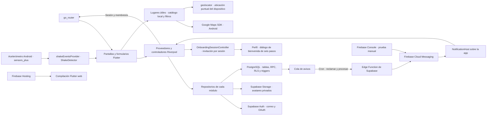

| Componente | Responsabilidad | Dónde estudiarlo |
|---|---|---|
| Flutter y Dart | Pantallas para Android, iOS y web. Los módulos se organizan por funcionalidad. | [lib/main.dart](../lib/main.dart), [pubspec.yaml](../pubspec.yaml) |
| Stripe y flutter_stripe | PaymentSheet captura la tarjeta en Android y Stripe gestiona la suscripción de prueba. | [Guía de Stripe](stripe_test_setup.md), [family_payment_repository.dart](../lib/features/plans/repositories/family_payment_repository.dart) |
| google_maps_flutter 2.19.0 y geolocator 14.1.2 | Mapa nativo Android, marcadores del catálogo de Celaya y lectura puntual de ubicación con permisos. | [Configuración del mapa](maps_setup.md), `lib/features/places/` |
| sensors_plus 7.1.1 | Lee aceleración sin gravedad en Android; los impulsos generan sugerencias locales de tareas. | `providers/shake_provider.dart`, `services/shake_detector.dart` del módulo Tareas |
| Riverpod | Estado de formularios, sesión, consultas, acciones, reintentos e invalidación de datos. | Carpetas `providers/` de cada módulo y proveedores locales de los formularios |
| go_router | Navegación, restauración de sesión y protección de páginas administrativas. | [app_router.dart](../lib/core/router/app_router.dart) |
| Supabase Auth | Sesión con correo y contraseña, Google y GitHub. El nombre editable y la membresía se leen de PostgreSQL. | [auth_repository.dart](../lib/features/auth/repositories/auth_repository.dart) |
| Supabase Storage | Guarda la foto de perfil opcional en un bucket privado. | [account_photo_repository.dart](../lib/features/auth/repositories/account_photo_repository.dart) |
| Supabase PostgreSQL | Datos de negocio y autorización. RLS significa seguridad por fila. Se complementa con permisos por columna, restricciones e índices. | [phase_2.sql](../supabase/phase_2.sql), [migraciones](../supabase/migrations/) |
| Firebase | FCM transporta avisos en móvil y Hosting aloja la compilación web. | [push_gateway.dart](../lib/features/notifications/repositories/push_gateway.dart), [firebase.json](../firebase.json) |
| fl_chart | Barras horizontales de contribución en el ranking. | [contribution_chart.dart](../lib/features/leaderboard/presentation/widgets/contribution_chart.dart) |

`main()` inicializa Supabase, intenta inicializar Firebase para push móvil y
monta `ProviderScope`. El resultado de la inicialización se inyecta con
`pushRuntimeReadyProvider`. `CasaEnJuegoApp` combina el tema, el router y
`NotificationHost`. La guía de push explica los pasos de despliegue.

En `lib/features/`, `presentation/` contiene las pantallas, `providers/`
coordina el estado, `repositories/` encapsula el acceso a datos y `models/`
describe los objetos que intercambian. En `core/` están el router, el tema, la
configuración y el proveedor del cliente Supabase. Las pruebas pueden sustituir
las interfaces de repositorio por implementaciones de prueba.

## 3. Autenticación, rutas y perfil

1. `LoginPage._submit()` valida los campos, quita el foco y llama a
   `AuthController.signIn()`. El controlador usa `AsyncValue` para deshabilitar
   envíos simultáneos y mostrar errores recuperables.
2. `SupabaseAuthRepository.signIn()` llama a `signInWithPassword()`.
   `watchUser()` observa los cambios de sesión, exige un correo confirmado y
   carga el perfil asociado. Si el perfil todavía no existe, llama a la RPC
   `ensure_personal_profile()`. `currentUserProvider` expone el resultado.
3. El router lleva al usuario a `/session` mientras se valida el perfil, a
   `/login` si no hay sesión, a `/tasks` para miembros de un ciclo activo y a
   `/profile` para cuentas personales sin ciclo. Registro y recuperación
   son rutas públicas. Una cuenta sin membresía activa puede abrir `/admin`
   para crear un ciclo. Las rutas `/admin/tasks` requieren el rol de
   administrador del ciclo activo. `/profile/ciclos` y `/tasks/activity`
   siguen disponibles después del cierre. `/plans` está disponible para
   cualquier cuenta autenticada, incluso antes de crear o unirse a un ciclo.
4. `ProfileController.setNotifications()` actualiza la preferencia guardada en
   PostgreSQL y sincroniza el estado de avisos. Perfil muestra nombre, correo,
   rol, avatar e información del ciclo activo cuando corresponde.
5. `AuthController.signOut()` solicita a `NotificationSession.disconnect()`
   desvincular el dispositivo y luego cierra la sesión local de Supabase. Si la
   desvinculación falla, la app muestra un error y permite reintentar.

Enlaces de estudio: [controlador de acceso](../lib/features/auth/providers/auth_providers.dart),
[controlador de perfil](../lib/features/profile/providers/profile_providers.dart)
y [pantalla de perfil](../lib/features/profile/presentation/profile_page.dart).

### Registro, confirmación y recuperación por correo

[EmailAccountPage](../lib/features/auth/presentation/email_account_page.dart)
usa [EmailAccountController](../lib/features/auth/providers/email_account_provider.dart)
para indicar el paso actual, bloquear envíos duplicados y presentar errores.
`signUp()` envía el nombre y las credenciales a Supabase Auth.
`resendSignUpCode()` reenvía la confirmación. `confirmEmail()` valida el
código de un solo uso y abre la sesión. El formulario valida el correo,
ocho caracteres de contraseña como mínimo y coincidencia entre las dos entradas.

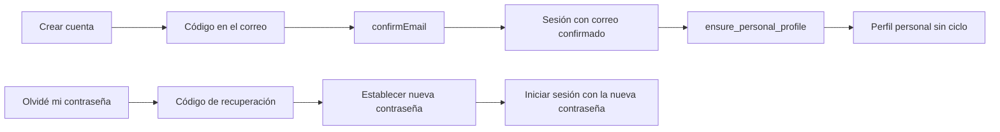

La [migración de cuentas personales](../supabase/migrations/20261114000100_add_personal_accounts.sql)
marca como miembros los perfiles existentes y hace que los nuevos nazcan sin
membresía. La RPC toma el identificador y correo de Supabase Auth. El cliente
puede proponer un nombre, pero la base decide el rol. Las políticas RLS solo
dejan que una cuenta sin grupo vea su propio perfil. El grupo existente
mantiene su acceso a datos y sus permisos de administrador.

[PasswordRecovery](../lib/features/auth/repositories/password_recovery.dart)
pide el código a Auth, lo valida con tipo `recovery` y usa la sesión temporal
para cambiar la contraseña. Esas peticiones se hacen aparte del cliente que
mantiene la sesión de la app, para que el código de recuperación no inicie
sesión ni sincronice una sesión temporal entre pestañas. Al terminar se
solicita el cierre de esa sesión y la interfaz vuelve al acceso normal.

#### Activación en Supabase

1. Aplicar la migración de cuentas personales en SQL Editor sobre la base
   existente. Ejecutar solo esa migración para este cambio.
2. En **Authentication → Emails → Set up SMTP**, configurar un proveedor
   SMTP con el remitente y las credenciales que indique el servicio de correo.
   El envío integrado de Supabase solo entrega a direcciones del equipo del
   proyecto. Desde el 3 de junio de 2026, los proyectos gratuitos nuevos
   que usan ese envío también tienen bloqueada la edición de plantillas.
3. Con el SMTP personalizado habilitado, volver a **Templates** y editar
   **Confirm sign up** y **Reset password**. Usar `{{ .Token }}` en el cuerpo
   e indicar que se introduzca el código en Casa en Juego. Retirar
   `{{ .ConfirmationURL }}` de ambas plantillas.
4. En la configuración del proveedor de correo, mantener activada la
   confirmación de correo y después habilitar el registro de usuarios nuevos.
5. En Android o web, crear una cuenta de prueba, verificar que se pueda
   reenviar y confirmar el código, comprobar que solo abra Perfil y probar
   que la contraseña anterior falle y la nueva funcione después de recuperarla.
   Repetir el acceso con una cuenta familiar previa para comprobar su permiso.

Referencias: [restricción de plantillas en el plan gratuito](https://supabase.com/changelog/46599-changes-to-email-template-customisation-on-free-tier),
[configuración SMTP](https://supabase.com/docs/guides/auth/auth-smtp)
y [plantillas de correo de Supabase](https://supabase.com/docs/guides/auth/auth-email-templates).

### Acceso con Google y GitHub

[SocialSignInButtons](../lib/features/auth/presentation/widgets/social_sign_in_buttons.dart)
muestra ambos proveedores en el login. `AuthController.signInWithProvider()`
comparte el estado de carga con el acceso por correo. El
[lanzador OAuth](../lib/features/auth/repositories/oauth_sign_in.dart) abre el
navegador con `signInWithOAuth()`. Al abrirse el navegador la app todavía
espera la sesión de Supabase. Al volver, el SDK intercambia el código
mediante PKCE y `watchUser()` carga el perfil. Una cuenta nueva llega a
Perfil sin ciclo. Supabase puede vincular proveedores a la misma cuenta si
comparten un correo verificado.

Los botones usan `OutlinedButton.icon` con imágenes PNG empaquetadas en
[`assets/brand/`](../assets/brand/). Google usa su G multicolor con fondo
blanco. GitHub usa la versión negra del Invertocat en el tema claro y la
blanca en el oscuro. Las imágenes son decorativas para el lector de pantalla.
El texto del botón identifica la acción y el proveedor. Los archivos vienen
de los [recursos de marca de Google](https://developers.google.com/identity/branding-guidelines)
y del [kit de marca de GitHub](https://brand.github.com/foundations/logo).

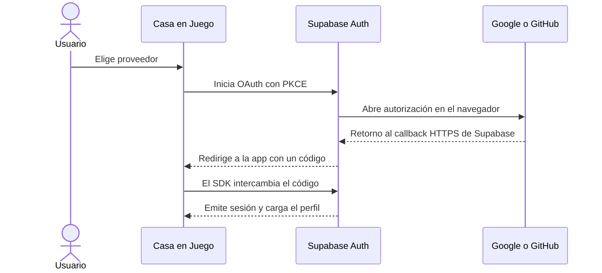

#### Activar los proveedores

1. Aplica la migración de cuentas personales descrita arriba. En Supabase,
   abre **Authentication → Sign In / Providers**. Copia la **Callback URL**
   del proveedor. Tiene el formato
   `https://<referencia-del-proyecto>.supabase.co/auth/v1/callback`.
   Mantén activa la opción **Allow new users to sign up** si vas a probar
   con una cuenta que todavía no existe en Supabase Auth.
2. En **Google Cloud**, crea o usa un cliente OAuth de tipo **Aplicación
   web** y registra esa URL en **Authorized redirect URIs**. Si la pantalla
   de consentimiento está restringida a usuarios de prueba, agrega las
   cuentas que usarán la demo. En **GitHub → Developer settings → OAuth
   Apps**, registra la misma URL en **Authorization callback URL**.
3. En **Authentication → Sign In / Providers**, habilita Google y GitHub y
   pega el **Client ID** y el **Client Secret** de cada uno. El secreto se
   configura en Supabase. Flutter usa la clave publicable del proyecto.
4. En **Authentication → URL Configuration**, agrega a **Redirect URLs**
   los destinos que vas a usar. Son las direcciones de regreso que acepta
   Supabase después de autenticar con el proveedor.
   - Android e iOS: `casaenjuego://auth/callback`.
   - Web publicada: `https://casaenjuego.web.app/`.
   - Chrome local: `http://localhost:8080/`. Inicia Flutter con
     `flutter run -d chrome --web-port=8080`.
5. Recompila o reinicia Android después del cambio de manifiesto. Prueba un
   acceso por proveedor y vuelve a la app. Comprueba que una cuenta nueva
   llegue a Perfil sin ciclo y una cuenta familiar existente conserve su
   acceso al iniciar sesión con el mismo correo verificado. Comprueba
   también que puedas volver al login si cancelas en el navegador.

El callback de Google y GitHub apunta al servidor de Supabase. La URL
`casaenjuego://auth/callback` abre la app móvil y está registrada en
[AndroidManifest.xml](../android/app/src/main/AndroidManifest.xml) y
[Info.plist](../ios/Runner/Info.plist). En web, el retorno usa el mismo
origen donde se inició OAuth.

[Configuración de Google](https://supabase.com/docs/guides/auth/social-sign-in/auth-google)
· [Configuración de GitHub](https://supabase.com/docs/guides/auth/social-sign-in/auth-github)
· [URL de retorno en Supabase](https://supabase.com/docs/guides/auth/redirect-urls).

### Nombre editable y foto del proveedor

En **Perfil → Editar nombre**, el formulario valida un nombre de 1 a 100
caracteres. `ProfileController.rename()` envía el nombre al repositorio,
espera la confirmación de Supabase y publica el valor guardado en
`accountNameProvider`. Así se actualizan el saludo de Tareas y las iniciales
del menú de cuenta. El proveedor vuelve a leer el nombre cuando cambia de
cuenta. El guardado en curso termina aunque se navegue a Tareas.

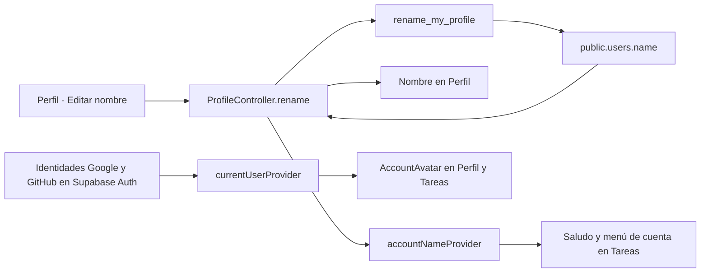

La RPC [`rename_my_profile`](../supabase/migrations/20261114000200_rename_personal_profile.sql)
obtiene el dueño con `auth.uid()`, comprueba que su correo esté confirmado y
actualiza solo `public.users.name` de esa sesión. No toma identificadores de
usuario del cliente. Para habilitar la edición en el ambiente remoto, ejecuta
una vez esa migración en **Supabase → SQL Editor** después de la migración de
cuentas personales.

[`providerAvatarUrl()`](../lib/features/auth/models/provider_avatar.dart)
lee `picture` o `avatar_url` desde las identidades OAuth de Google y GitHub,
con prioridad para el proveedor social principal cuando está disponible.
[`AccountAvatar`](../lib/features/auth/presentation/widgets/account_avatar.dart)
muestra la imagen HTTPS en Perfil y el menú de Tareas. Mientras carga, si no
hay foto o si la petición falla, muestra las iniciales. En web permite
mostrar la imagen con un elemento HTML si el CDN bloquea la descarga directa
por CORS. Google y GitHub pueden iniciar sesión en el mismo perfil cuando
Supabase vincula ambas identidades por correo verificado.

Para comprobarlo, cambia el nombre desde Perfil y abre Tareas con una cuenta
que pertenezca al grupo. Después, vuelve a iniciar sesión con Google o GitHub
y verifica que el nombre se conserve y que la misma foto aparezca en ambos
lugares si el proveedor entregó una.
[Identidades de Supabase](https://supabase.com/docs/guides/auth/identities)
· [Vinculación de identidades](https://supabase.com/docs/guides/auth/auth-identity-linking)
· [Imágenes de red en Flutter](https://api.flutter.dev/flutter/widgets/Image/Image.network.html).

### Foto de perfil y caché local

Las cuentas creadas con correo y contraseña pueden elegir un JPG, PNG o
WebP de hasta 2 MB en **Perfil → Agregar foto**. Las cuentas creadas con
Google o GitHub muestran el avatar del proveedor o sus iniciales.
Supabase registra el proveedor de alta en `app_metadata.provider`.
La regla sigue el origen de la cuenta si se vinculan varias formas de
acceso. `watchUser()` lo traduce a `AppUser.canEditPhoto` y Perfil usa ese
valor para mostrar los controles y autorizar la acción del controlador.

`file_selector.openFile()` abre el selector de documentos de Android
(`ACTION_OPEN_DOCUMENT`) o el diálogo de archivos del navegador. En Android
puede mostrar Descargas y proveedores como Drive, según el dispositivo.
[`ProfilePhoto.pick()`](../lib/features/profile/models/profile_photo.dart)
valida el tamaño, la firma del archivo y que la primera imagen se pueda
decodificar. Cancelar conserva la foto actual. Cuando ya hay una foto propia,
**Cambiar foto** la reemplaza y **Quitar foto** borra el archivo.

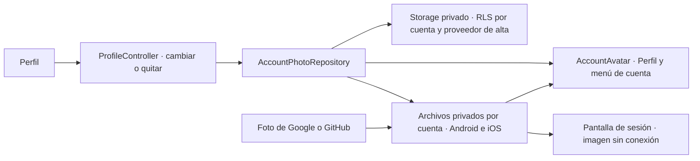

[`SupabaseAccountPhotoRepository`](../lib/features/auth/repositories/account_photo_repository.dart)
usa la ruta `<id de usuario>/avatar`. `save()` hace un *upsert* en esa ruta
y `remove()` la elimina mediante la API de Storage. Así el reemplazo
mantiene un solo objeto por cuenta. Al terminar, el controlador invalida
[`accountPhotoProvider`](../lib/features/auth/providers/account_photo_providers.dart).
El repositorio serializa lecturas y escrituras para que una descarga anterior
no reponga la foto reemplazada. Usa el servidor en línea y recupera la copia
local si la descarga falla por conexión. Un 404 o una eliminación confirmada
borran la copia local. Al deslizar hacia abajo en Perfil se vuelve a consultar
la foto.

En Android e iOS, [`AccountPhotoCache`](../lib/features/auth/repositories/account_photo_cache.dart)
guarda un archivo de foto personalizada y otro de proveedor por cuenta
en la carpeta de soporte de la aplicación, obtenida con `path_provider`.
`providerAvatarPhotoProvider` reutiliza la foto OAuth hasta por un día
y vuelve a buscarla al cambiar la URL o caducar ese periodo. Si el proveedor
está inaccesible, recupera la copia de la misma URL. `AccountAvatar` elige
foto propia cuando el origen permite editar, foto OAuth o iniciales.
En Chrome y Edge, el avatar se sigue cargando con conexión.

Al reabrir sin internet, si Supabase restaura una sesión confirmada y falla
la consulta del perfil por conexión, `OfflineProfileFailure` lleva el
identificador de esa cuenta a `SessionPage`. La pantalla usa solo archivos
locales y permite reintentar cuando regrese la conexión. El acceso a datos
del ciclo sigue requiriendo validar la sesión y el perfil en línea.

La [migración de fotos](../supabase/migrations/20261114000300_add_account_avatars.sql)
crea el bucket privado con el límite de 2 MB y los tres tipos MIME.
La [migración de permisos del avatar](../supabase/migrations/20261116000100_restrict_account_avatar_edits.sql)
añade `private.can_manage_account_avatar()` a la política. Storage exige
la ruta exacta `<auth.uid()>/avatar`, correo confirmado y
`auth.users.raw_app_meta_data.provider = 'email'`. El servidor evalúa ese
valor con los datos de Auth. Los objetos antiguos de cuentas OAuth quedan
almacenados y fuera del acceso de la app.
[Buckets privados de Supabase](https://supabase.com/docs/guides/storage/buckets/fundamentals)
· [Proveedor de alta en Supabase](https://supabase.com/docs/guides/auth/users)
· [Selector de archivos de Flutter](https://pub.dev/packages/file_selector).

1. En **Supabase → SQL Editor → New query**, pega y ejecuta
   `20261116000100_restrict_account_avatar_edits.sql`. El bucket
   `account-avatars` ya existe en instalaciones que tenían fotos.
2. Ejecuta `flutter pub get` y reinicia la compilación de la app. Con una
   cuenta creada por correo, agrega, cambia y quita la foto. Revisa Perfil
   y Tareas si la cuenta participa en un ciclo.
3. En Android, carga una foto y déjala visible. Sin cerrar sesión, activa
   modo avión, cierra Casa en Juego desde Recientes y vuelve a abrirla.
   En la pantalla de conexión debe verse el avatar guardado. Recupera
   internet y pulsa **Reintentar**. Comprueba que una foto eliminada ya no
   se ve al repetir el paso sin conexión.
4. Con internet, entra con una cuenta creada mediante Google o GitHub y
   comprueba su foto y la ausencia de los botones de edición. Usa una cuenta
   de un correo distinto al de la primera para comprobar el aislamiento.
   Si ambas formas de acceso comparten la cuenta, se aplica el proveedor
   de alta que muestra Supabase Auth.

## 4. Tareas, revisiones, historial y ranking

### Crear o iniciar un ciclo

Una cuenta con correo confirmado y sin ciclo activo puede abrir
**Perfil → Administración → Crear ciclo**. El [formulario compartido](../lib/features/admin/presentation/widgets/cycle_form_dialog.dart)
pide nombre y una **fecha de fin prevista** en el calendario de Material,
localizado en español de México con `flutter_localizations`. La selección
empieza en mañana según el calendario del dispositivo. El formulario muestra
los días previstos y **Administración** muestra la fecha y la duración
guardadas. El cierre se confirma manualmente desde ese panel.

```mermaid
flowchart LR
    Profile["Perfil sin ciclo activo"] --> Start["Administración · Crear ciclo"]
    Closed["Administración · Resultado del ciclo cerrado"] --> Next["Crear siguiente ciclo"]
    Start --> Form["CycleFormDialog · Nombre y calendario"]
    Next --> Form
    Form --> Controller["ProfileController.createFirstCycle"]
    Controller --> RPC["create_first_cycle"]
    RPC --> Lock["Bloquea el perfil con FOR UPDATE"]
    Lock --> Group["Crea el ámbito interno del ciclo"]
    Group --> Catalog["Copia las tareas iniciales"]
    Group --> Season["Crea el ciclo activo"]
    Season --> Role["Asigna al creador como administrador"]
    Role --> Refresh["Recarga el perfil y habilita sus rutas"]
```

[`ProfileRepository.createFirstCycle()`](../lib/features/profile/repositories/profile_repository.dart)
envía `p_name` y `p_planned_end_date` en formato `AAAA-MM-DD`. La RPC
obtiene la cuenta con `auth.uid()` y hace las escrituras en una sola
transacción. El bloqueo del perfil impide crear dos ciclos simultáneos
para la misma cuenta.
Al guardar, el controlador invalida `currentUserProvider` para leer la
membresía y el rol de la base. El panel se actualiza con el ciclo activo.

Tras el cierre, Administración muestra los resultados del último ciclo
cerrado. `SeasonSummary.results` suma solo los puntos aprobados y asigna
la misma posición en los empates. La tarjeta identifica al ganador o a
los participantes empatados en primer lugar. Con cero puntos aprobados
indica que no hubo ganador. **Crear siguiente ciclo** usa el mismo
formulario y la misma RPC. Desde **Perfil → Historial de ciclos** cualquier
participante puede consultar un ciclo anterior y ver su resultado y tareas,
incluidas las que nadie registró. **Mi actividad** conserva las solicitudes
propias de todos sus ciclos.

Cada ciclo nuevo tiene su propio ámbito de datos y su propio catálogo.
Empieza con los cinco registros de la plantilla y cero puntos. El creador
es el único miembro al inicio y queda como administrador de ese ciclo.
Si quiere volver a jugar con las mismas personas, estas ingresan con el
código del ciclo nuevo.
`cycle_group_id` sigue siendo el nombre de la clave técnica en PostgreSQL.
Una cuenta tiene un único valor activo de esa clave en su perfil. Al cerrar,
se vacía esa clave, se desactiva `is_household_member` y se retira el rol
`admin`. El acceso histórico se evalúa por ciclo en
`private.season_participants`, incluso cuando la cuenta ya participa en otro.

La [migración de creación de ciclos](../supabase/migrations/20261115000100_add_cycle_creation.sql)
agrupó las primeras cuentas y conservó sus identificadores e historial.
El trigger `check_task_log_cycle_group()` exige que el autor, la tarea y
el ciclo coincidan antes de calcular puntos. Los avisos y recordatorios
también limitan sus destinatarios a la membresía activa.

La [migración de fecha prevista](../supabase/migrations/20261115000200_add_cycle_planned_end_date.sql)
añade `seasons.planned_end_date` con tipo `date`. El trigger
`private.validate_season()` valida que sea posterior al día de inicio en
`America/Mexico_City` y calcula `planned_duration_days` con la diferencia
entre ambas fechas. `end_date` se asigna al cerrar el ciclo y registra la
fecha y hora reales. Los ciclos existentes conservan los días originales.
La RPC anterior que recibe `p_duration_days` sigue disponible para clientes
que todavía la usan.

La [migración de catálogo inicial y siguiente ciclo](../supabase/migrations/20261115000300_add_next_cycle_and_default_tasks.sql)
guarda una copia del catálogo del grupo original en
`private.cycle_task_templates`. En el proyecto actual, ese catálogo contiene
las cinco tareas iniciales. Se conservan nombre, puntos, icono, estado y
frecuencia. `private.seed_cycle_group_tasks()` copia la plantilla dentro de
la transacción de cada ciclo nuevo. Las altas, ediciones y desactivaciones se
quedan en el ciclo donde se hicieron. El catálogo registra los valores al
cerrar y cada solicitud conserva el nombre y los puntos que tenía al enviarse.

La [migración de ciclos independientes](../supabase/migrations/20261115000400_add_independent_cycles.sql)
registra a los participantes históricos usando las membresías existentes y
los autores y revisores de las solicitudes. Los ciclos antiguos compartían
catálogo, por lo que el archivo de los ya cerrados se reconstruye con el
catálogo y los nombres disponibles en el momento de migrar. Las ediciones
anteriores que el sistema ya no guardaba no se pueden reconstruir. Para los
cierres posteriores se guarda una copia del catálogo en la misma transacción
que libera a los miembros.

Ejecuta las migraciones pendientes una vez en **Supabase → SQL Editor**.
La de creación requiere las de cuentas personales, límites diarios y
recordatorios push. La de fecha prevista se ejecuta después de la de
creación y antes de la de catálogo inicial. Ejecuta después la de ciclos
independientes. Desde una cuenta sin ciclo activo,
abre Administración desde Perfil, crea un ciclo y verifica la fecha y las
tareas iniciales. Edita una tarea, cierra el ciclo e inicia otro. Comprueba
que el ciclo nuevo empieza con cero puntos y con las tareas originales.
Desde Historial de ciclos, comprueba que el anterior conserva el ganador
y la tarea editada. Comprueba también que una cuenta ajena al ciclo no
pueda abrir sus resultados.
[`personal_accounts_test.cjs`](../supabase/tests/personal_accounts_test.cjs)
comprueba la creación, el aislamiento de los administradores, el catálogo
inicial y los destinatarios de avisos en una base PostgreSQL local.

### Unirse a un ciclo con código

En **Administración → Código de invitación**, el administrador copia el
código de su ciclo activo. Desde otra cuenta confirmada y sin ciclo activo,
abre **Perfil → Unirme con código** y pégalo. La app recarga el perfil y abre
Tareas con permisos de miembro. El código admite minúsculas, espacios y
guiones. El mismo código se puede compartir con varios miembros durante el ciclo.

La [migración de invitaciones](../supabase/migrations/20261115000500_add_cycle_invites.sql)
se ejecuta después de la de ciclos independientes. Guarda un código aleatorio
de 12 caracteres hexadecimales por ciclo en `private.cycle_invites`.
`get_or_create_cycle_invite()` valida que la cuenta administre ese ciclo
activo y devuelve el mismo código en consultas sucesivas. Al ingresar,
`join_cycle_by_code()` bloquea primero el ciclo activo y después el perfil.
El bloqueo serializa el ingreso con el cierre y con otros intentos de la
misma cuenta. Si ya ingresó a ese ciclo, reintentar devuelve el mismo
identificador. Una membresía activa en otro ciclo bloquea el ingreso.

La función asigna el rol de miembro y el trigger existente registra el
acceso histórico. El código deja de servir al cerrar porque la búsqueda
solo acepta ciclos activos. Para la prueba, copia el código en una cuenta
administradora, ingresa desde una segunda cuenta y comprueba que puede
ver las tareas. Cierra el ciclo y verifica que el código se rechaza y que
la segunda cuenta puede consultar el resultado en **Historial de ciclos**.

### Registro y revisión de tareas

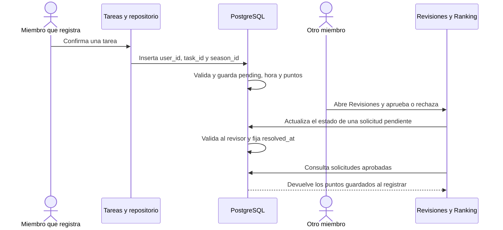

| Módulo y métodos | Comportamiento |
|---|---|
| [Tareas](../lib/features/tasks/repositories/tasks_repository.dart), `loadDashboard()`, `submitTask()` | Carga el ciclo activo, el catálogo, las solicitudes relevantes y el estado de los límites diarios con una RPC. El envío solo escribe referencias; la base establece el estado, la hora y los puntos. `TaskSubmissionController.submit()` protege la acción de envíos simultáneos y refresca el tablero. |
| [Revisiones](../lib/features/reviews/repositories/reviews_repository.dart), `loadInbox()`, `resolve()` | Lista las solicitudes pendientes de otros miembros del ciclo activo. Solo cambia solicitudes todavía pendientes. El controlador de revisiones invalida las lecturas afectadas después de resolver. |
| [Mi actividad](../lib/features/activity/repositories/activity_repository.dart), `loadPage()` | Carga el historial del usuario con filtro por estado y paginación. `loadMore()` conserva las páginas ya recibidas y comprueba que el resultado siga perteneciendo a la búsqueda activa al terminar. |
| [Ranking](../lib/features/leaderboard/repositories/leaderboard_repository.dart), `loadLeaderboard()` | Carga los miembros y las solicitudes aprobadas del ciclo activo, paginando consultas. Los puntos se obtienen de `points_snapshot`. La UI muestra podio y gráfica de aportaciones. |
| [Administración](../lib/features/admin/repositories/admin_repository.dart), `loadDashboard()`, `loadTasks()`, `saveTask()`, `closeSeason()` | Consulta el resumen y el catálogo activo, crea y edita tareas y cierra el ciclo. `AdminActionController._run()` verifica el rol, serializa acciones e invalida los datos relacionados al completarlas. |
| [Historial de ciclos](../lib/features/admin/presentation/cycle_history_page.dart), `loadClosedCycles()`, `loadClosedCycle()` | Lista los ciclos cerrados visibles para la cuenta y carga el resumen y la copia del catálogo del ciclo elegido. |

### Modelo de datos

| Tabla | Datos y reglas |
|---|---|
| `private.cycle_groups` | Ámbito interno que aísla cada catálogo nuevo. Los ciclos migrados pueden conservar un ámbito compartido. |
| `private.season_participants` | Relación entre un ciclo y sus participantes. Conserva la autorización de lectura después del cierre. |
| `private.season_task_archive` | Copia del catálogo de un ciclo cerrado, con puntos, icono, frecuencia y estado de cada tarea. Se accede por una RPC de solo lectura. |
| `users` | Perfil y preferencia de avisos. Conserva por separado el rol y la asignación del ciclo activo. |
| `tasks` | Catálogo editable del ciclo activo. Desactivar una tarea preserva sus solicitudes. |
| `seasons` | Ciclo con nombre, inicio, fin previsto, duración calculada, cierre real y estado. El cliente crea ciclos desde la RPC y solo actualiza `status` al finalizar. |
| `task_logs` | Solicitudes vinculadas a cuenta, tarea y ciclo. Guardan estado, fechas, revisor, puntos y etiquetas históricas. El revisor debe ser otro miembro. |
| `push_devices` y `push_jobs` | Registro FCM por usuario/dispositivo y cola de entregas con estado, reintentos y caducidad. El acceso a dispositivos se gestiona con RPC autenticadas. |

`private.validate_task_log()` asegura las reglas de escritura en el servidor.
Para tareas limitadas, el límite es por usuario, tarea y día en
`America/Mexico_City`. Las copias nuevas de la plantilla tienen otros
identificadores de tarea. Una solicitud rechazada
permite volver a registrar. La protección combina bloqueo transaccional e
índices para solicitudes concurrentes. `get_task_submission_status()` devuelve
el estado del usuario actual para que Flutter pueda reflejarlo en el catálogo.

Enlaces de estudio: [esquema base](../supabase/phase_2.sql),
[puntos históricos](../supabase/migrations/20261022_add_points_snapshot.sql)
y [límite diario](../supabase/migrations/20261022_add_daily_task_limits.sql).

### Referencia de Supabase

La clave publicable identifica el proyecto. Al iniciar sesión, el cliente
adjunta el JWT y PostgreSQL evalúa la operación como el rol
`authenticated`. `auth.uid()` obtiene el identificador de esa sesión.
Los permisos SQL determinan qué acciones y columnas puede usar ese rol.
Después, RLS determina sobre qué filas puede actuar. `USING` filtra las
filas existentes que se pueden leer o modificar. `WITH CHECK` comprueba
la fila que se intenta insertar o el resultado de una actualización.

La política de lectura de ciclos muestra cómo cambia el permiso al cerrar.
El resultado histórico se comprueba por identificador de ciclo.

```sql
alter policy seasons_read on public.seasons using (
  (status = 'active' and cycle_group_id = (select private.current_cycle_group_id()))
  or (status = 'closed' and private.is_cycle_participant(id))
);
```

| Política efectiva | Permiso y condición |
|---|---|
| `users_read` | La cuenta lee su propio perfil. Los miembros activos verificados leen los perfiles de su mismo ámbito. Los nombres archivados se leen de las solicitudes sin abrir los perfiles de los exparticipantes. |
| `users_preferences` | La cuenta actualiza solo su propia fila. El permiso por columna limita esa escritura a `notifications_enabled`. El rol se asigna mediante la RPC. |
| `tasks_read` | La membresía activa determina el catálogo que se puede consultar. El catálogo cerrado se obtiene con `get_closed_cycle_catalog()`. |
| `tasks_insert` | El administrador inserta columnas de edición de tareas dentro de su ámbito. El valor por defecto de `cycle_group_id` se resuelve en el servidor. |
| `tasks_update` | El administrador edita tareas de su ciclo. `USING` comprueba la fila inicial y `WITH CHECK` la fila resultante. El permiso por columna impide reasignar una tarea a otro catálogo. |
| `seasons_read` | Un miembro verificado lee su ciclo activo. Cada participante puede leer sus ciclos cerrados. |
| `seasons_update` | Un administrador cambia el estado de su ciclo activo. El trigger permite únicamente el cierre. La política `seasons_insert` se retiró al pasar la creación a la RPC. |
| `task_logs_read` | Se aplica el acceso al ciclo que contiene la solicitud. **Mi actividad** añade el filtro por solicitante para mostrar las solicitudes de la propia cuenta. |
| `task_logs_insert` | Permite enviar una solicitud pendiente como autor autenticado en un ciclo activo visible. El trigger comprueba que autor, tarea y ciclo pertenezcan al mismo ámbito. |
| `task_logs_review` | Un miembro distinto del solicitante resuelve una petición pendiente de su ciclo activo. El servidor asigna el revisor y exige que el resultado sea aprobado o rechazado. |
| `Users manage their own account avatar` | Una cuenta creada por correo y con el correo confirmado puede leer, subir, reemplazar o borrar su propio archivo `<auth.uid()>/avatar`. |
| `push_devices` y `push_jobs` | Tienen RLS activo y los clientes carecen de permisos directos. Los dispositivos se registran con RPC. La cola se procesa con `service_role`. |

Una RPC es una función de PostgreSQL que la app llama mediante la API de
Supabase. Una función `SECURITY INVOKER` conserva los permisos de quien la
llama. Una función `SECURITY DEFINER` actúa con los permisos de su
propietario, por lo que debe verificar la identidad y el ámbito antes de
leer o escribir. Las funciones privilegiadas del proyecto fijan
`search_path = ''` y califican las referencias con su esquema. El
permiso `EXECUTE` se concede solo a los roles que necesitan invocarlas.

La RPC del catálogo archivado usa este patrón. El identificador del ciclo
sirve para buscar el catálogo y la comprobación de participante usa la
identidad autenticada en el servidor.

```sql
from private.season_task_archive task
where task.season_id = p_season_id
  and private.is_cycle_participant(p_season_id);
```

| Función | Quién la usa y qué hace |
|---|---|
| `public.ensure_personal_profile()` | Flutter la llama cuando falta el perfil. Lee el correo confirmado de Auth e inserta el perfil personal. `ON CONFLICT DO NOTHING` conserva un perfil existente. |
| `public.rename_my_profile(p_name)` | Perfil solicita el cambio de nombre. La función limpia y valida el texto y modifica solamente la cuenta autenticada con correo confirmado. |
| `private.can_manage_account_avatar()` | La política de Storage verifica en Auth que la cuenta autenticada tenga correo confirmado y que su proveedor de alta sea `email`. |
| `private.is_member()`, `private.is_admin()`, `private.current_cycle_group_id()` | Las políticas y el registro de dispositivos comprueban membresía, rol y ámbito de la sesión. Las consultas privilegiadas evitan recursión al evaluar las políticas de `users`. |
| `public.create_first_cycle(p_name, p_planned_end_date)` | Administración envía el nombre y fin previsto. La función privada que invoca bloquea el perfil con `FOR UPDATE`, verifica la ausencia de membresía, crea un ámbito y un ciclo y asigna el rol de administrador. Una firma previa acepta días para la creación compatible. |
| `private.seed_cycle_group_tasks()` | El trigger de inserción del ámbito copia el catálogo de la plantilla. La copia forma parte de la misma transacción que la creación del ciclo. |
| `private.record_active_cycle_membership()` | El trigger de `users` registra al participante en la temporada activa cuando se asigna el ámbito. Si el ámbito carece de ciclo activo, revierte la asignación. |
| `private.validate_season()` | El trigger asigna el inicio real, valida el fin previsto y calcula la duración. En el cierre fija el fin real y conserva la planificación. |
| `private.release_cycle_memberships()` | Después de cerrar, archiva el catálogo y libera todas las cuentas del ciclo. La actualización de estado y sus efectos se confirman o revierten juntos. |
| `private.is_cycle_participant(p_season_id)`, `public.get_closed_cycle_catalog(p_season_id)` | La política de lectura y la RPC de historial consultan la participación. Una cuenta ajena obtiene cero filas del catálogo, aun si conoce el identificador. |
| `public.get_or_create_cycle_invite(p_season_id)` | Solo el administrador del ciclo activo obtiene o crea su código. La tabla privada de códigos carece de acceso directo del cliente. |
| `public.join_cycle_by_code(p_code)` | Verifica que el código corresponda a un ciclo activo y que la cuenta tenga el correo confirmado. Si la cuenta está libre, asigna el rol de miembro dentro de la misma transacción. |
| `private.lock_open_cycle_for_catalog()`, `private.check_task_log_cycle_group()` | El primero serializa las ediciones del catálogo con el cierre. El segundo verifica las referencias de una solicitud antes de calcular los puntos. |
| `private.validate_task_log()`, `private.record_task_log_labels()` | Los triggers asignan hora, revisor y puntos y conservan los nombres usados en el historial. Los clientes envían las referencias o el estado permitido. |
| `public.get_task_submission_status()` | Tareas obtiene la hora del servidor, el próximo reinicio diario y las tareas bloqueadas para esa sesión. Se ejecuta con RLS. |
| `public.register_push_device()`, `public.unregister_push_device()` | Vinculan el token a la cuenta autenticada activa o lo desvinculan de la propia cuenta. |
| `private.enqueue_task_push()`, `private.enqueue_inactivity_reminders()` | Encolan avisos de solicitudes, resoluciones y recordatorios para los dispositivos y miembros elegibles. |
| `public.claim_push_jobs()`, `public.get_push_reminder_context()`, `private.push_reminder_context()` | El worker reclama trabajos con arrendamiento y comprueba la vigencia y el destinatario. Solo `service_role` puede invocar las dos RPC. |
| `private.wake_push_worker()` | El trigger de la cola solicita la entrega usando la URL y el secreto de Vault. Cron recupera trabajos si esa solicitud falla. |

Empieza por el [esquema base](../supabase/phase_2.sql) y lee las migraciones
en orden. Una migración posterior puede reemplazar una función o alterar
una política. El [test SQL de cuentas y ciclos](../supabase/tests/personal_accounts_test.cjs)
ejecuta esos scripts con roles de base de datos y comprueba casos permitidos
y denegados. Incluye la edición del catálogo activo, el cierre, la
liberación de participantes y el acceso al historial con y sin participación.

### Sensor Android: agitar para sugerir una tarea

Se incorpora `sensors_plus: 7.1.1`. Se conserva Riverpod y no se añade ninguna
llamada a `setState` ni `ValueNotifier`. El sensor únicamente propone una tarea;
no llama a Supabase ni modifica solicitudes, puntos o reglas del ciclo.
El mapa se implementa como bloque independiente del sensor de movimiento.

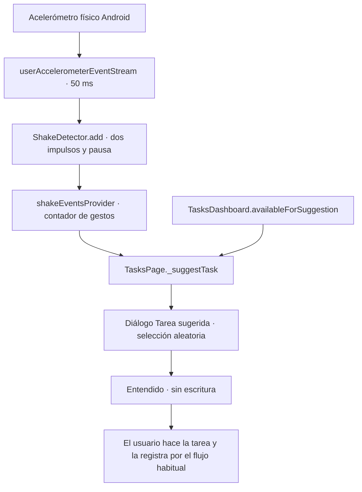

**Lectura y detección.** `userAccelerationProvider` expone el stream nativo de
aceleración sin gravedad en m/s², solicitado cada 50 ms. `shakeEventsProvider`
solo lo abre en Android; web e iOS reciben un estado no disponible. Escucha los
ejes x, y, z y usa un reloj monótono `Stopwatch`, independiente de la hora civil.
`ShakeDetector.add()` compara `x² + y² + z²` con `12²`: cada impulso requiere
superar 12 m/s² y regresar por debajo del umbral antes de otro impulso. Dos
impulsos separados entre 80 y 600 ms generan un gesto. Se ignoran nuevos gestos
durante dos segundos. Los valores son un filtro de interacción, no una medición
de actividad doméstica ni una prueba de que se realizó una tarea.

**Selección y presentación.** `TasksDashboard.availableForSuggestion` devuelve
solo tareas activas de un ciclo vigente y sin bloqueo diario según el estado
ya consultado al servidor. `_suggestTask()` vuelve a leer ese tablero, evita
carga/error y elige con `Random().nextInt(tasks.length)`. Verifica la ruta
actual, el estado de primer plano y `_sheetOpen`. Este último también protege
la confirmación de registro, de modo que no se apilan diálogos ni se interrumpe
un envío. El diálogo incluye el icono, nombre e instrucción para registrar la
tarea después de hacerla. Cerrar o tocar Entendido no tiene efectos en la BD.

**Ciclo de vida.** La pantalla solo observa el provider si es la ruta actual,
el tablero está disponible y hay candidatos. `autoDispose` cancela el stream
al dejar de observarlo. El provider usa `AppLifecycleListener` para detener la
suscripción al perder el primer plano y reabrirla con un detector nuevo al
volver; se liberan listener, stream y controlador al descartarlo. No mantiene
un servicio de sensores en segundo plano ni guarda las lecturas.

**Falta de soporte.** Los errores del plugin o de la plataforma se convierten
en `AsyncError`, sin reintentos automáticos continuos. La pantalla muestra
«Agitar no está disponible. Puedes elegir una tarea de la lista». El registro
manual permanece operativo. Si todas las tareas están bloqueadas, el ciclo
terminó o el catálogo está vacío, no se abre el sensor ni se ofrece una
sugerencia. Android es el alcance validable de esta etapa; iOS no inicia la
lectura y no se afirma una prueba realizada en esa plataforma.

**Cómo probar el dispositivo real.** Después de `flutter pub get`, detén y
vuelve a ejecutar `flutter run` en el RMX3840 o instala el APK actualizado.
Hot reload no registra un plugin nativo nuevo. En Tareas, con un ciclo activo y
una tarea disponible, agita dos o tres veces y comprueba el diálogo. Ciérralo
y verifica que no aparezcan nuevas solicitudes ni puntos. Repite con una tarea
limitada ya enviada, con un formulario abierto y tras volver del segundo plano.
En un emulador Android puede simularse aceleración mediante sus controles de
sensores; Chrome no reemplaza la comprobación del acelerómetro del celular.

`test/shake_suggestion_test.dart` cubre reposo y movimiento insuficiente,
impulsos separados, pausa entre gestos, filtrado del catálogo, sugerencia sin
registro, ausencia de diálogos apilados, registro manual ante fallo y
cancelación/reanudación de la lectura al cambiar el estado de la aplicación.
El responsable confirmó que el gesto funciona en el RMX3840; las lecturas de
las pruebas automatizadas se sustituyen por streams controlados.

Verificación local de esta etapa: 147 pruebas Flutter aprobadas, análisis Dart
sin hallazgos, APK de depuración compilado con el plugin nativo y compilación
web completada. La integración
no requiere nuevas tablas, secretos, migraciones ni despliegues de Supabase.

Referencia: [sensors_plus](https://pub.dev/packages/sensors_plus).

## 5. Avisos móviles

1. `FirebasePushGateway` solicita permisos, registra un identificador de
   instalación FCM (FID) y adapta los mensajes a `PushNotice`. Usa
   `onMessage` para el primer plano, `onMessageOpenedApp` cuando se toca un
   aviso en segundo plano y `getInitialMessage()` al abrir desde cerrada.
2. `NotificationSession.start()` activa las suscripciones una vez.
   `syncUser()` coordina cambios de sesión, permiso, preferencia y registro.
   En Supabase, las RPC `register_push_device` y `unregister_push_device`
   vinculan o desvinculan el FID de la cuenta actual.
3. La inserción o resolución de una tarea encola avisos para miembros de su
   ciclo activo. La Edge Function
   `send-task-notifications` reclama trabajos, comprueba nuevamente el estado
   y el destinatario, llama a FCM y registra el resultado. Los recordatorios
   usan la misma cola y se programan a las 18:00 y 20:00 de Ciudad de México.
4. `NotificationHost` comprueba el destinatario y la preferencia. En primer
   plano muestra un aviso de tres segundos e invalida proveedores de tareas,
   revisiones, ranking y actividad. Al tocar un aviso abre la ruta asociada.

Los avisos privados esperan `kind`, `recipient_id` y `notification_id`.
Al recibir un mensaje en primer plano, `PushNotice.fromForeground()`
prueba primero ese formato. Si el mensaje carece de los campos reservados y
contiene título o cuerpo, lo muestra como aviso general. Un aviso privado
incompleto se descarta. Los avisos generales carecen de acción de navegación
y dejan visible la pantalla actual.

Con la app en segundo plano o cerrada, Android muestra las notificaciones
generales en la bandeja. Al tocarlas, Android abre la app en su flujo
habitual. El listener de aperturas de Flutter sigue procesando los avisos
privados para llevar al usuario a la ruta correspondiente. El responsable
del proyecto reportó la prueba del aviso generado por una actividad
enviada a revisión en Android, en los tres estados. Sigue pendiente la
validación documentada de los tres estados y de la baja del tema.
El responsable ya reportó la recepción de Avisos generales desde consola.
iOS requiere APNs.

Enlaces de estudio: [NotificationHost](../lib/features/notifications/presentation/notification_host.dart),
[sesión de avisos](../lib/features/notifications/services/notification_session.dart),
[Edge Function](../supabase/functions/send-task-notifications/handler.ts),
[guía de push](push_notifications_setup.md)
y [guía de recordatorios](inactivity_reminders_setup.md).

### Suscripción a Avisos generales

En **Perfil → Avisos generales**, cualquier cuenta puede activar la
suscripción al Topic de Firebase `avisos_generales` si FCM está disponible
en el dispositivo. Empieza desactivada y la preferencia se guarda por
cuenta en ese dispositivo con `SharedPreferencesAsync`. La opción es
independiente de **Avisos de revisión** y de tener un ciclo activo.

`GeneralNoticesController.setEnabled()` solicita el cambio a
`NotificationSession.setGeneralNotices()`. Al activar, la sesión verifica
el permiso de Android, registra la instalación con FCM y llama al método
`setGeneralNotices()` del gateway. Solo guarda el cambio si Firebase
acepta la operación. Al cerrar sesión, la app retira la suscripción del
dispositivo. Si vuelve la misma cuenta, `syncUser()` aplica su preferencia
guardada y vuelve a suscribir cuando cambia el identificador de FCM.

La difusión por tema se reserva para anuncios generales. Los avisos de
revisión y los recordatorios conservan sus destinatarios individuales y
su validación en Supabase. El Topic no requiere migraciones ni nuevas
credenciales.

Para probar el tema en el RMX3840, activa **Avisos generales** y concede
el permiso de notificaciones. En **Firebase Console → Messaging**, crea
un mensaje de notificación y destínalo al tema `avisos_generales` en la
selección de destinatarios. Publica un mensaje con la app abierta, otro
en segundo plano y otro después de cerrarla desde Recientes. Desactiva el
interruptor y repite el envío al tema para comprobar la baja. La opción
**Send test message** del flujo siguiente dirige el aviso a un dispositivo
por FID y comprueba la entrega directa.

[Suscripciones a Topics](https://firebase.google.com/docs/cloud-messaging/manage-topic-subscriptions)
· [Envío desde Firebase Console](https://firebase.google.com/docs/cloud-messaging/send/firebase-console).

### Probar un aviso general desde Firebase Console

1. En el RMX3840 o Pixel 8 con Google Play Services, inicia sesión con una
   cuenta en un ciclo activo. En Perfil, activa **Avisos de revisión**,
   concede el permiso de Android y espera el estado **Avisos activos en este
   dispositivo**.
2. En **Supabase → SQL Editor**, consulta el FID de esa instalación.
   La columna se llama `token` por compatibilidad con el registro anterior.
   Sustituye el correo y comprueba que la hora corresponda al Android de
   prueba.

   ```sql
   select device.token as fid, device.updated_at
   from public.push_devices device
   join public.users profile on profile.id = device.user_id
   where profile.email = 'tu-correo-de-prueba@example.com'
     and device.platform = 'android'
   order by device.updated_at desc;
   ```

3. En **Firebase Console → Messaging → New campaign → Notifications**,
   escribe un título y un texto. Elige **Send test message**, pega el FID
   y pulsa **Test**. Usa el botón de prueba para dirigir el mensaje a esa
   instalación.
4. Envía un aviso en cada estado. Con la app abierta, comprueba el mensaje
   dentro de la pantalla. Con la app en segundo plano y luego cerrada desde
   Recientes, comprueba la bandeja y toca la notificación para abrir la app.
   La prueba de cierre se hace desde Recientes. Si activas **Forzar
   detención** desde los ajustes de Android, vuelve a abrir la app antes de
   probar FCM.

[Prueba de FCM desde consola](https://firebase.google.com/docs/cloud-messaging/flutter/get-started#send-a-test-notification-message)
· [Recepción según el estado de la app](https://firebase.google.com/docs/cloud-messaging/flutter/receive-messages).

## 6. Formularios con Riverpod

En [LoginPage](../lib/features/auth/presentation/login_page.dart) se sustituyó
una llamada a `setState`. `_passwordVisibilityProvider` inicia con contraseña
oculta, y `_PasswordVisibility.toggle()` invierte el estado. El campo se
redibuja mediante `ref.watch`. El flujo de autenticación permanece en
`AuthController`.

```dart
final showPassword = ref.watch(_passwordVisibilityProvider);
// El TextFormField usa obscureText: !showPassword.
ref.read(_passwordVisibilityProvider.notifier).toggle();
```

En [TaskEditorPage](../lib/features/admin/presentation/task_editor_page.dart)
se sustituyeron siete llamadas a `setState`. `_TaskFormController.build()`
inicializa el borrador con la tarea editada o con los valores de alta.
`update()` recibe los cambios de nombre, puntos, icono, estado, frecuencia o
error de validación. Cada formulario tiene su propia instancia del proveedor
`autoDispose`. Esto permite editar una tarea sin compartir el borrador con
otro formulario y liberar el estado cuando se sale. `_save()` valida el
formulario, crea un `TaskDraft` y delega el guardado a administración.

```dart
final form = ref.watch(_formProvider); // Alimenta la vista previa.
final controller = ref.read(_formProvider.notifier);
// En el campo de nombre:
onChanged: (name) => controller.update(name: name),
```

Los formularios conservan claves de Flutter para validar los campos. Tener
un `ConsumerStatefulWidget` permite gestionar el ciclo de vida del formulario.
El estado editable se actualiza por Riverpod.

## 7. Tipografía y apariencia

[AppTheme](../lib/core/theme/app_theme.dart) construye dos instancias de
`ThemeData` con Material 3. `AppTheme._build()` define el esquema de colores
para cada brillo. Las pantallas consumen `context.appColors` para superficies,
texto y errores, y `context.statusColors` para estados aprobados y pendientes.
`AppStatusColors` es una `ThemeExtension` para que Flutter interpole estos
colores junto con el tema principal. Los iconos personalizados y la gráfica
también toman su color del tema activo.

Las dos paletas usan **DM Sans** como familia principal. El archivo variable
está incluido en [assets/fonts/dm_sans](../assets/fonts/dm_sans/) y se registra
en [pubspec.yaml](../pubspec.yaml). Flutter puede cargarlo sin pedir la fuente
a un servidor. El proyecto incluye [su licencia OFL](../assets/fonts/dm_sans/OFL.txt).

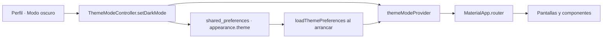

El interruptor de [Perfil](../lib/features/profile/presentation/profile_page.dart)
llama a `setDarkMode()`. El controlador actualiza Riverpod de inmediato y
guarda la selección localmente en orden. `loadThemePreferences()` lee el
valor antes de arrancar la interfaz. La preferencia es del dispositivo o
navegador y se mantiene al cambiar de cuenta. La app empieza en oscuro si
todavía no hay una selección guardada o si falla la lectura.

```dart
theme: AppTheme.light,
darkTheme: AppTheme.dark,
themeMode: ref.watch(themeModeProvider),
```

Para revisar el flujo, abre **Perfil → Modo oscuro**, cambia de tema, visita
Tareas o Ranking y vuelve a abrir la app. La prueba en
[`test/profile_test.dart`](../test/profile_test.dart) comprueba el cambio
global, la familia tipográfica y la restauración del valor guardado.

### Barra superior de las pantallas

[`AppPageBar`](../lib/core/theme/app_page_bar.dart) reúne los encabezados
de Tareas, Revisiones, Ranking, Perfil y las pantallas secundarias que
usan barra superior. Usa `Scaffold.appBar` para mantener el encabezado
visible durante el desplazamiento. La barra mide 80 píxeles lógicos y
centra su contenido en una columna de hasta 600, con 20 de margen lateral.
El título usa `titleLarge` en negrita y el subtítulo opcional usa
`labelSmall` de 10 píxeles lógicos. Los dos heredan DM Sans del tema.

Cada pantalla aporta su título, subtítulo y, si aplica, el botón de regreso
o el menú de cuenta. Tareas sigue leyendo el saludo de `accountNameProvider`
y el avatar de `AccountMenu`. Ranking familiar usa un solo título visible.
Al modificar la altura, la tipografía o los márgenes globales del
encabezado, editar `AppPageBar`.

Los márgenes inferiores de Inicio de sesión, Tareas, Ranking y Perfil
se controlan desde el `padding` de sus vistas desplazables. En Revisiones
el espaciado inferior forma parte de cada tarjeta. El nombre del ciclo en
Tareas se muestra en un `Text` dentro de la columna del panel.

### Pantalla de Planes

[`PlansPage`](../lib/features/plans/presentation/plans_page.dart) presenta
un catálogo local con tres modalidades. Casa, gratuita, representa las
funciones disponibles. Familia cuesta $39 MXN al mes y anuncia hasta tres
ciclos simultáneos. Comunidad cuesta $69 MXN al mes y anuncia hasta diez
ciclos y resúmenes de participación. Los precios y beneficios de pago
forman parte de la propuesta académica. La pantalla lo explica antes
de las tarjetas.

`PlansPage.build()` monta el encabezado compartido con `AccountMenu`, que
muestra la foto o las iniciales de la cuenta y permite cerrar sesión,
y la lista desplazable
limitada a 600 píxeles lógicos y la barra inferior. `_PlanCard.build()`
recibe nombre, precio, beneficios y etiqueta del botón y dibuja cada
tarjeta con el tema activo. El plan leído desde Stripe muestra **Plan actual**.
Si no hay una suscripción activa se marca Casa y Android habilita **Probar pago**
en Familia y Comunidad. Si la hay, ambas contrataciones quedan desactivadas
y la otra modalidad muestra **Otro plan activo**.
Los datos del catálogo son constantes y se renderizan desde el mismo archivo.

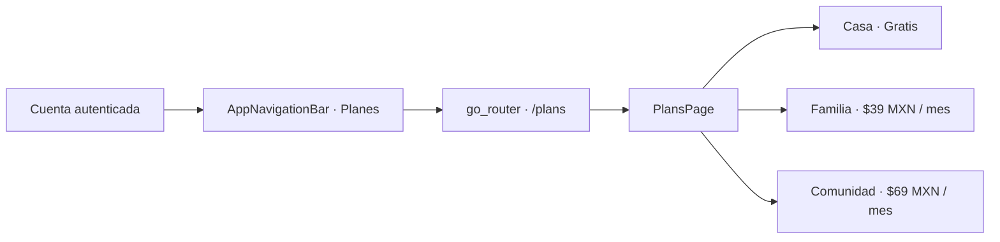

`AppNavigationBar` conserva los índices de Tareas (0), Ranking (1),
Revisiones (2) y Perfil (3), y añade Planes (4). Con ciclo activo muestra
cinco destinos. Sin ciclo muestra Perfil y Planes, traduce esos dos
destinos a los índices 3 y 4 y omite la consulta de pendientes de revisión.
El router mantiene la comprobación de sesión para el acceso directo.

El alcance acordado promociona los beneficios de pago y conserva una sola
membresía activa por cuenta. Las suscripciones de prueba se gestionan en Stripe.

Para probar esta etapa, abre Planes desde el celular o Chrome. Comprueba
las tres tarjetas, los precios y el regreso
a Perfil. Repite con una cuenta sin ciclo activo y con ambos temas.
`test/plans_test.dart` cubre esos recorridos a 320 y 1100 píxeles y
comprueba que una visita sin sesión a `/plans` vuelva al login.
La verificación del 21 de noviembre terminó con el análisis Dart sin
hallazgos, 134 pruebas Flutter aprobadas y compilaciones locales de web
y APK de depuración completadas.

### Identificar el plan actual

`currentPlanProvider` depende de `currentUserProvider.future`, por lo que
cambiar de cuenta vuelve a consultar su propio plan. Es `autoDispose`: al
salir de Planes se descarta la consulta y al regresar se vuelve a solicitar.
`StripeFamilyPaymentRepository.currentPlan()` envía `{"action":"status"}`
a la misma Edge Function. El servidor valida la sesión, busca el cliente por
`metadata.supabase_user_id` y lee sus suscripciones, sin crear datos ni cobros.
La modalidad se reconoce por `metadata.plan` (`familia` o `comunidad`) y los
estados `active` o `trialing`. Si ninguna cumple esas condiciones devuelve
`casa`. Cancelar al final del período conserva el plan mientras esté activo.

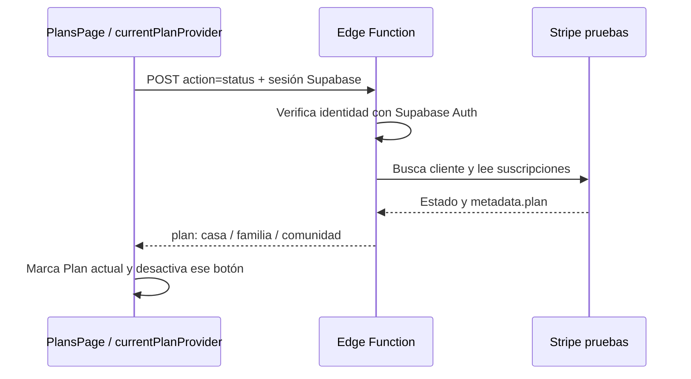

La pantalla no marca Casa mientras espera o si hay un error; muestra la
consulta o permite Reintentar y bloquea el pago hasta conocer el plan.
Después de un pago completado o una respuesta `alreadyActive`, el controlador
invalida `currentPlanProvider`. El estado persistente proviene de Stripe,
sin tablas nuevas, almacenamiento local del plan ni webhook. Para refrescar tras un cambio en el panel de
Stripe basta salir de Planes y volver a entrar. El despliegue del handler debe
preceder a la actualización de la app, pues versiones antiguas del servidor
no reconocen la acción de consulta.

Verificación de este ajuste: 138 pruebas Flutter y cinco pruebas del handler
aprobadas; comprobación de tipos Deno aprobada. Se probaron la restauración
de cada modalidad, el cambio de tarjeta después del pago y la consulta sin
operaciones de escritura en Stripe. La comprobación del plan en el teléfono
requiere desplegar primero la actualización del handler.

### Recuperar el pago tras eliminar el cliente de Stripe

La cuenta de Supabase y el cliente de Stripe son entidades distintas.
Al eliminar el cliente en Stripe, la consulta del plan deja de encontrarlo
y devuelve Casa. Sin embargo, Stripe puede conservar la respuesta original
de un POST con la misma clave de idempotencia aunque el objeto se haya
eliminado. Repetir la creación sin comprobarlo devolvía un `cus_…` eliminado,
y la siguiente consulta de suscripciones fallaba. La clave de suscripción
anterior tampoco distinguía entre dos clientes sucesivos de la misma cuenta.

`createHandler()` conserva la búsqueda por metadata. Cuando necesita crear
un cliente, consulta también `GET customers/{id}` para verificar su estado
actual. Si devuelve `deleted: true`, deriva la siguiente clave estable del
identificador eliminado y vuelve a crear/verificar. El recorrido permite hasta
cinco generaciones por solicitud para limitar las llamadas remotas; si se
agotan devuelve un mensaje recuperable. Repetir una petición usa la misma
clave de esa generación, sin recurrir a claves aleatorias para cada intento.
Las claves de nuevas suscripciones incluyen ahora el `customer.id` vigente,
para no recuperar una factura de un cliente anterior. No se elimina información
en Stripe ni se modifica Auth, la base de datos o el código Flutter.

Se añadió una regresión con respuestas simuladas de Stripe: la versión anterior
fallaba después de la primera eliminación. La corrección permite pagar,
eliminar al cliente y volver a pagar en varias generaciones y con ambos planes;
reabrir mientras hay una suscripción activa sigue sin crear otra. Las diez
pruebas del handler y la comprobación de tipos Deno pasaron. El responsable
confirmó el pago real del sandbox de Comunidad antes de este ajuste; falta
verificar la recuperación en su proyecto tras desplegar `handler.ts`.

Referencias: [idempotencia de Stripe](https://docs.stripe.com/api/idempotent_requests),
[consulta de clientes eliminados](https://docs.stripe.com/api/customers/retrieve).

### Pago nativo de Familia y Comunidad con Stripe

`PlansPage` observa `familyPaymentProvider` y muestra los resultados como
avisos. `FamilyPaymentController.checkout(plan)` recibe la modalidad y bloquea envíos simultáneos
y la contratación si `currentPlanProvider` no indica Casa.
Mantiene la operación mientras se espera la respuesta y publica el resultado
solo si la cuenta continúa siendo la misma. `familyPaymentSupportedProvider`
habilita los botones en Android. La web conserva el catálogo.

`StripeFamilyPaymentRepository.checkout(plan)` rechaza Casa (gratuito) y envía
`{"action":"checkout","plan":"familia"}` o `"comunidad"` a la Edge Function
`create-family-subscription`, configura Stripe con la clave publicable de
prueba y abre `initPaymentSheet()` / `presentPaymentSheet()`. Los datos de
tarjeta se capturan mediante el SDK nativo y viajan a Stripe. El repositorio
distingue pago completado, cancelación de la hoja, suscripción ya activa
y errores recuperables.

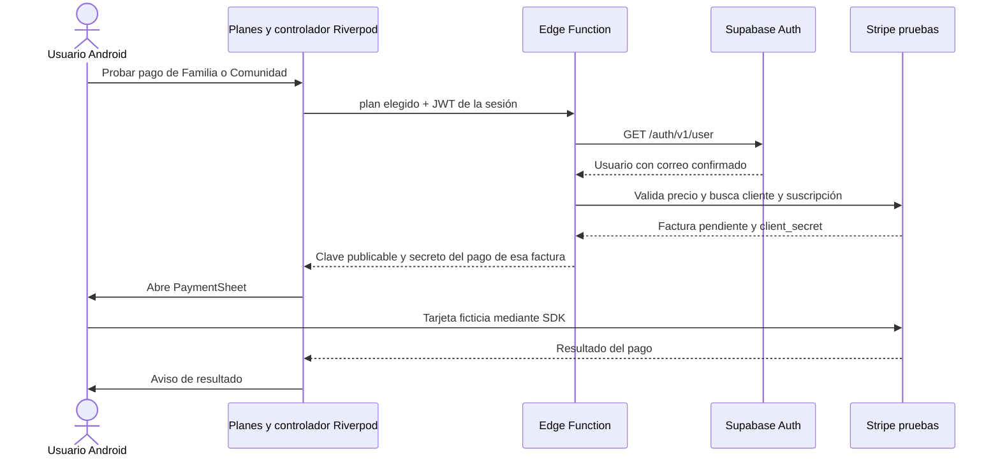

En la función, `createHandler()` valida la sesión en Auth y selecciona
el precio desde `STRIPE_PRICE_FAMILIA` o `STRIPE_PRICE_COMUNIDAD`, según
la modalidad permitida. Comprueba que sea activo, de pruebas, por 3900 o
6900 centavos MXN, respectivamente, y recurrente cada mes. Un plan desconocido
o Casa se rechaza antes de consultar Stripe. El importe y el precio enviados
por el cliente no se utilizan. Los secretos que empiecen con
claves de producción se rechazan. La búsqueda de clientes usa
`metadata.supabase_user_id`. Los POST incluyen claves de idempotencia y
la factura de una suscripción incompleta se reutiliza al reabrir el pago.
Una suscripción `active` o `trialing` de cualquiera de las dos modalidades
se busca antes de elegir una factura pendiente y devuelve ese estado sin
crear otra. Si existe una factura `incomplete` del otro plan, o estados
como `past_due`, se responde 409 para revisar/cancelar desde Stripe. Se
permite crear otro plan después de una cancelación inmediata. Cancelar
al final del período mantiene la suscripción activa hasta su término.
La clave de idempotencia de nuevas suscripciones incluye la cuenta, el
cliente actual de Stripe y la última suscripción conocida de pago, compartida
entre modalidades, para
reducir duplicados incluso si se solicita otro plan simultáneamente.
El mismo plan incompleto se reutiliza antes de intentar crear uno nuevo.

La función usa la API de Stripe `2025-06-30.basil`. Crea la suscripción
con `payment_behavior=default_incomplete`, guarda el método para sus
renovaciones y expande `latest_invoice.confirmation_secret`. La respuesta
contiene la credencial del pago concreto y la clave publicable. Las respuestas
llevan `Cache-Control: no-store` y los errores omiten detalles privados
del proveedor.

En Android, `MainActivity` hereda de `FlutterFragmentActivity` y los temas
de arranque y ejecución heredan de AppCompat, como requiere el SDK.
La verificación JWT del gateway se desactiva solo para esta función y el
handler valida explícitamente el JWT contra Supabase Auth.

El primer pago se procesa en el sandbox y Stripe conserva la suscripción
y sus facturas. La app consulta el plan en Stripe; el webhook
y la cancelación desde Casa en Juego quedan para una etapa posterior.
Los pasos de despliegue, secretos y tarjetas ficticias están en la
[guía de configuración de Stripe](stripe_test_setup.md).

La verificación local de esta etapa completó el análisis Dart, 135 pruebas
Flutter, la comprobación de tipos de Deno y cuatro pruebas del handler.
También se compilaron el APK de depuración y la versión web. La sesión de
la CLI de Supabase estaba sin configurar. Posteriormente el responsable
confirmó el pago de Familia en el celular, su registro en Stripe y la consulta
del plan. Para Comunidad hay que agregar `STRIPE_PRICE_COMUNIDAD` y desplegar
las versiones actuales de `index.ts` y `handler.ts` antes de actualizar la app.

Los nombres `family_payment_*`, `FamilyPaymentController`,
`StripeFamilyPaymentRepository` y `create-family-subscription` se conservan
por compatibilidad y para evitar una reorganización innecesaria; ahora todos
admiten Familia y Comunidad mediante el argumento `AccountPlan`. No se añade
otro repositorio, otra función remota, dependencias, tablas ni migraciones.
Los beneficios anunciados siguen siendo demostrativos: ambos pagos se registran
en Stripe, pero la app conserva una sola membresía de ciclo por cuenta.

Verificación local del minibloque Comunidad: 139 pruebas Flutter aprobadas,
9 pruebas del handler aprobadas, análisis Dart sin hallazgos y comprobación
de tipos Deno aprobada. Los tests comprueban el precio de Comunidad elegido
en el servidor, la reutilización de facturas, el bloqueo entre ambos planes
en estados activos, la revisión de pagos pendientes y la contratación tras
cancelar. Flutter comprueba ambos recorridos de pago, el bloqueo de ambos
botones y la consulta del plan. El responsable confirmó después el pago de Comunidad y la recuperación del
flujo tras eliminar al cliente de pruebas, con el handler actualizado.

## 8. Rúbrica del proyecto final

| Requisito | Estado en este repositorio |
|---|---|
| Problemática, objetivo y alcance | Parcial. Hay un [planteamiento](../planteamiento.md). Falta incluir evidencia del problema y el alcance acordado con el maestro. |
| Base de datos y sincronización | Supabase PostgreSQL aprobado por el maestro para datos y autenticación. Flutter vuelve a consultar después de las operaciones y en puntos de refresco de cada pantalla; los avisos privados también pueden invalidar consultas. La app carece de una suscripción general a Supabase Realtime. |
| Almacenamiento y caché local de imágenes | Supabase Storage privado guarda la foto personal. Android e iOS conservan la copia por cuenta y la muestran al reabrir sin conexión cuando hay una sesión guardada. El uso de Supabase Storage se considera aceptado en la auditoría del proyecto. |
| FCM desde consola, Topics y tres estados | Hay escuchador global y suscripción al Topic `avisos_generales`. El responsable reportó recepción desde Firebase Console. Falta registrar evidencia de los tres estados y de la baja del tema. |
| Auth, alta por correo y dos proveedores | Implementado. Incluye registro, verificación, reenvío, recuperación por correo y acceso con Google y GitHub mediante Supabase Auth. El responsable del proyecto reportó que funcionaron el correo y ambos proveedores en su entorno. |
| Perfil y avatar sincronizado | Nombre editable, restricción de edición a cuentas creadas por correo y caché local implementados. El responsable reportó que las fotos y el uso sin conexión funcionaron en el celular. |
| Creación y acceso a ciclos | Implementados la creación, el ingreso mediante código y el historial tras el cierre. Cada cuenta tiene una sola membresía activa. Queda pendiente la salida individual durante un ciclo activo. |
| Estado con Riverpod | Implementado. Las ocho llamadas explícitas a `setState` fueron sustituidas. La búsqueda en `lib/` tampoco encontró usos explícitos de `ValueNotifier`. |
| Tipografía y tema dinámico | Implementados. DM Sans viene incluida con la app y Perfil permite cambiar y recordar el modo claro u oscuro. |
| Bienvenida | Implementada: diálogo guiado de seis pasos, automático al entrar sin ciclo en cada nueva sesión y manual desde Perfil → Ver tutorial. Incluye navegación, omisión, adaptación a texto grande y reinicio por sesión sin persistencia. |
| Responsividad y widget avanzado | Parcial. Hay límites de ancho y pruebas en pantallas pequeñas. La adaptación a escritorio debe validarse. La gráfica de Ranking es candidata al 10% si el maestro la acepta. |
| Sensor nativo | Implementado: acelerómetro Android para sugerir tareas al agitar, con filtros, manejo de errores y ciclo de vida. El responsable confirmó que funciona en el RMX3840. Biometría no forma parte del alcance elegido. |
| Mapa nativo | Código implementado: Google Maps Android, ubicación puntual, catálogo fijo de Celaya, filtros y manejo de errores/permisos. Clave configurada y mapa visible en el RMX3840, confirmado por el responsable. No usa Places API ni búsquedas comerciales. |
| Pagos o suscripciones | Catálogo de tres modalidades y suscripciones Familia y Comunidad con PaymentSheet para Android. El responsable confirmó pagos de Familia y Comunidad, consulta del plan y recuperación del pago tras eliminar al cliente de pruebas. Las cancelaciones se gestionan en Stripe. Los beneficios anunciados se mantienen como propuesta. |
| Entrega y estabilidad | Parcial. Hay Git, pruebas y documentación. Faltan el reporte final, APK de entrega y ensayo completo. |

## 9. Cómo ejecutar y probar

```powershell
flutter pub get
flutter devices
flutter run -d ID_DEL_ANDROID
flutter test
dart analyze
```

- **Dispositivos.** Usar el Pixel 8 del emulador o el teléfono RMX3840 para
  pruebas nativas, en especial FCM. Para revisar dos sesiones en paralelo,
  usar el Android con la app web en un perfil o navegador distinto de Chrome
  o Edge.
- **Caso principal.** Acceder como un miembro y registrar una tarea. Cerrar
  sesión y entrar con otra cuenta, abrir Revisiones y aprobar. Volver a la
  primera cuenta y revisar Mi actividad y Ranking. Repetir con rechazo.
  Ambas cuentas pueden alternarse en el mismo dispositivo.
- **Servicios.** El proyecto tiene configuración Supabase por defecto.
  `SUPABASE_URL` y `SUPABASE_PUBLISHABLE_KEY` pueden sustituirse mediante
  `--dart-define` si existe un proyecto de pruebas. Los secretos del servidor
  y las claves privadas quedan fuera del cliente. Docker es opcional y se
  usaría para levantar Supabase local. El desarrollo normal usa Supabase remoto.
- **Firebase Console.** Seguir la prueba de aviso general de la sección de
  avisos móviles. Enviar un mensaje por FID en cada estado de la app.
- **Pruebas de código.** `test/widget_test.dart` cubre acceso y sesión.
  `test/admin_test.dart` cubre permisos de administrador y edición.
  `test/notifications_test.dart` cubre preferencias, desvinculación y rutas
  de avisos. Estas pruebas usan repositorios o gateways de prueba.

Para la publicación web, consultar [Firebase Hosting](firebase_hosting_setup.md).
Para la activación real de avisos y las pruebas SQL y Deno, consultar las
[instrucciones de push](push_notifications_setup.md).

## 10. Decisiones pendientes y mantenimiento

Supabase se mantiene para base de datos, autenticación y fotos de perfil.
El ingreso por código asigna el rol de miembro y respeta una sola membresía
activa por cuenta. Quedan pendientes el enlace de invitación y la salida
individual durante un ciclo activo.

**Registro del 21 de noviembre de 2026.** Se incorporó Planes en la
navegación inferior con las modalidades Casa, Familia y Comunidad. Las
cuentas sin ciclo pueden alternar entre Perfil y Planes. Se acordó
integrar Stripe en pruebas en una etapa posterior y presentar las
ventajas de pago como propuesta.

**Registro del 15 de noviembre de 2026.** Se añadió la creación del primer
ciclo desde Perfil y el aislamiento de datos y avisos por grupo.
La fecha de fin prevista se elige en el calendario y se guarda por
separado del cierre real.
Se reunió la creación inicial y la de ciclos siguientes en Administración
con el mismo formulario, se destacó el resultado del último cierre y se
agregó el catálogo inicial por grupo.
Después se hizo independiente cada ciclo nuevo y se añadieron la liberación
de membresías al cerrar y las pantallas de historial con catálogo archivado.
Se añadió el ingreso por código para cuentas sin membresía activa.
Se añadió la visualización de avisos generales de Firebase Console en
primer plano y se documentó la prueba de entrega en Android.

**Registro del 14 de noviembre de 2026.** Se migró a Riverpod el estado de
visibilidad de contraseña y del editor de tareas. Después se añadió DM Sans
y el cambio claro/oscuro persistente desde Perfil. También se añadió el flujo
de registro y recuperación por código y la separación entre perfil personal
y acceso al grupo familiar. Se agregó acceso OAuth con Google y GitHub con
retorno a Flutter en móvil y web. Después se incorporaron los iconos oficiales
a los botones de acceso, el nombre editable y la foto de los proveedores en
Perfil y Tareas. Se añadió la foto personal opcional en Supabase Storage
con sustitución y eliminación desde Perfil. Se retiró el botón de reintento
de carga del avatar.

En cada cambio del proyecto, actualizar este archivo en la misma revisión.
Explicar el flujo o método afectado, dónde vive en el código, qué requisito
cubre y cómo se verificó. Actualizar los diagramas, extractos y la tabla de
la rúbrica cuando cambie el comportamiento o su estado.

## 11. Mapa del repositorio

Para seguir una operación, empieza en la pantalla, busca el proveedor que
observa o ejecuta la acción y sigue la llamada al repositorio. Si el
repositorio invoca una RPC o escribe en una tabla, consulta las funciones,
políticas y triggers de la sección 4. La pantalla presenta el estado y
valida la entrada. PostgreSQL aplica las reglas de acceso y consistencia
también cuando el cliente llama directamente a la API.

| Ubicación | Contenido |
|---|---|
| `lib/` | Aplicación Flutter. `main.dart` monta la app, `core/` reúne lo compartido y `features/` separa los módulos de negocio. |
| `test/` y `test/support/` | Pruebas de widgets, modelos, consultas y acciones. Los repositorios y servicios falsos permiten probar esos flujos sin cuentas ni conexión al proyecto remoto. |
| `supabase/` | Esquema, migraciones, configuración, activación de avisos, trabajador de notificaciones y pruebas de base de datos. |
| `assets/brand/` y `assets/fonts/dm_sans/` | Iconos de Google y GitHub, fuente DM Sans y su licencia. `pubspec.yaml` registra los recursos de Flutter. |
| `android/` | `settings.gradle.kts`, `build.gradle.kts`, `app/build.gradle.kts`, `gradle.properties` y `gradle/wrapper/gradle-wrapper.properties` configuran Gradle y el SDK. `app/google-services.json` configura el cliente de Firebase. |
| `android/app/src/` | `main/AndroidManifest.xml` declara permisos, actividad, retorno OAuth e icono de avisos. Los manifiestos de `debug/` y `profile/` habilitan red para esas variantes. `MainActivity.kt` es el punto de entrada de Flutter. `res/drawable*`, `res/values*` y `res/mipmap-*` contienen el arranque, los estilos y los iconos por densidad. |
| `ios/Flutter/` | `AppFrameworkInfo.plist`, `Debug.xcconfig` y `Release.xcconfig` configuran el framework Flutter en Xcode. |
| `ios/Runner/` | `AppDelegate.swift` registra plugins, `SceneDelegate.swift` integra el ciclo de vida con Flutter, `Info.plist` declara la configuración de la app y `Runner-Bridging-Header.h` conecta el registrador con Swift. `Base.lproj/` define la pantalla de arranque y la vista principal. `Assets.xcassets/` incluye iconos y recursos de arranque con sus manifiestos. |
| `ios/Runner.xcodeproj/`, `ios/Runner.xcworkspace/` y `ios/RunnerTests/` | Proyecto, esquema, configuración de Xcode y target de pruebas iOS. `RunnerTests.swift` contiene una prueba de ejemplo vacía. |
| `web/` | `index.html` arranca Flutter; `manifest.json`, `favicon.png` e `icons/` configuran nombre e iconos en navegador e instalación. |
| `docs/` | Manual técnico, manual de usuario y guías de [Hosting](firebase_hosting_setup.md), [push](push_notifications_setup.md) y [recordatorios](inactivity_reminders_setup.md). |
| Raíz | `README.md` es la entrada al repositorio; `planteamiento.md` describe el problema. `pubspec.yaml` declara dependencias y recursos; `pubspec.lock` fija versiones. `analysis_options.yaml` activa las reglas de análisis. |
| Configuración raíz y editor | `firebase.json` configura Hosting y `.firebaserc` el proyecto asociado. `.gitignore` y los archivos equivalentes de cada plataforma excluyen archivos locales. `.metadata` sirve a Flutter y `devtools_options.yaml` a DevTools. `.vscode/settings.json` delimita Deno a las funciones; `.vscode/extensions.json` recomienda extensiones. |

### 11.1 Arranque y componentes compartidos

| Archivo | Funciones y responsabilidad |
|---|---|
| `lib/main.dart` | `main()` inicializa Supabase y, cuando aplica, Firebase móvil. `CasaEnJuegoApp.build()` reúne el router, el tema, la localización y los avisos. |
| `lib/core/network/supabase_provider.dart` | `supabaseClientProvider` entrega el cliente inicializado a los repositorios. |
| `lib/core/constants/supabase_config.dart` | `SupabaseConfig` resuelve la URL y la clave publicable, con posibilidad de configurarlas al compilar. |
| `lib/core/constants/task_log_status.dart` | `TaskLogStatus` centraliza los estados de solicitud que comparten Tareas, Revisiones y Actividad. |
| `lib/core/router/app_router.dart` | El proveedor del router declara las rutas y sus redirecciones por sesión y rol. `refresh()` solicita reevaluar las redirecciones cuando cambia la sesión. |
| `lib/core/router/app_navigation_bar.dart` | `AppNavigationBar` muestra cinco destinos con ciclo activo o Perfil y Planes sin ciclo. Actualiza el indicador de revisiones cuando hay membresía. |
| `lib/core/theme/app_theme.dart` | `AppTheme._build()` prepara colores, tipografía y componentes compartidos. `AppStatusColors.copyWith()` y `lerp()` integran los colores semánticos en las transiciones de tema. |
| `lib/core/theme/app_page_bar.dart` | `AppPageBar.build()` fija las dimensiones, alineación y tipografía de la barra y coloca sus controles laterales. |
| `lib/core/theme/theme_mode_provider.dart` | `build()` restaura la preferencia y `setDarkMode()` guarda el modo elegido. |

### 11.2 Acceso y cuenta

Rutas relativas a `lib/features/auth/`.

| Archivo | Funciones y responsabilidad |
|---|---|
| `models/app_user.dart` | `AppUser` reúne identidad, nombre, rol, membresía y preferencias. `withName()` actualiza la copia usada por la interfaz después de renombrar. |
| `models/auth_failure.dart` | `messageFor()` traduce errores de acceso y OAuth a mensajes de interfaz. |
| `models/provider_avatar.dart` | Lee y valida las URL de avatar disponibles en los metadatos de los proveedores OAuth. |
| `repositories/auth_repository.dart` | `watchUser()` combina sesión, perfil y verificación. `signIn()`, `signUp()`, `resendSignUpCode()`, `confirmEmail()`, `requestPasswordReset()`, `resetPassword()` y `signOut()` implementan operaciones de cuenta. |
| `repositories/oauth_sign_in.dart` | `oauthSignInProvider` inicia el flujo de Google o GitHub con el retorno adecuado para web o móvil. |
| `repositories/password_recovery.dart` | `sendCode()` solicita el OTP. `reset()` lo verifica y cambia la contraseña usando la credencial de recuperación. |
| `repositories/account_photo_cache.dart` | `read()`, `write()` y `removeCustom()` gestionan los archivos de avatar locales por cuenta. |
| `repositories/account_photo_repository.dart` | `load()`, `save()` y `remove()` leen, escriben y retiran la foto personal en Storage. |
| `providers/auth_providers.dart` | `currentUserProvider` entrega el usuario autenticado. `AuthController` coordina el acceso, el nombre local y el cierre de sesión con dispositivos push. |
| `providers/email_account_provider.dart` | `EmailAccountController.sendCode()` y `verify()` controlan los pasos de alta y recuperación; el controlador mantiene estado, errores y confirmación. |
| `providers/account_photo_providers.dart` | Crea el repositorio de fotos y expone la foto personal, la lectura solo local y la del proveedor OAuth. |
| `presentation/login_page.dart` | `_submit()` valida correo y contraseña; la pantalla enlaza alta, recuperación y acceso social. |
| `presentation/email_account_page.dart` | Adapta el formulario al alta o la recuperación, presenta el campo de código y expone el reenvío cuando procede. |
| `presentation/session_page.dart` | Presenta la carga y permite reintentar. Si falla la conexión y hay una sesión confirmada, muestra el avatar local de esa cuenta. |
| `presentation/widgets/account_avatar.dart` | Muestra la foto personal, la foto OAuth o las iniciales según disponibilidad. |
| `presentation/widgets/account_menu.dart` | Presenta las acciones de cuenta y ejecuta la salida mediante el controlador. |
| `presentation/widgets/social_sign_in_buttons.dart` | Muestra los botones e iconos de Google y GitHub y los conecta al acceso OAuth. |

### 11.3 Perfil

Rutas relativas a `lib/features/profile/`.

| Archivo | Funciones y responsabilidad |
|---|---|
| `models/profile_state.dart` | Agrupa el perfil leído y el estado de las operaciones de edición. |
| `models/profile_failure.dart` | `messageFor()` muestra errores de perfil, invitación y ciclo. |
| `models/profile_photo.dart` | `pick()` abre el selector del sistema y valida tamaño y tipo con los bytes de la imagen. |
| `repositories/profile_repository.dart` | `loadProfile()`, `rename()` y `setNotifications()` gestionan preferencias y perfil; `joinCycle()` y `createFirstCycle()` llaman las RPC de membresía. |
| `providers/profile_providers.dart` | `ProfileController` coordina edición de nombre, foto y avisos; `createFirstCycle()` y `joinCycle()` refrescan el perfil y la sesión después de modificar la membresía. |
| `presentation/profile_page.dart` | `_editName()`, `_joinCycle()` y `_openAdministration()` conectan los formularios y la navegación con los controladores. La vista también muestra foto, tema, avisos e historial. |

### 11.4 Administración y ciclos

Rutas relativas a `lib/features/admin/`.

| Archivo | Funciones y responsabilidad |
|---|---|
| `models/admin_action_state.dart` | Estado de operación en curso y error visible. |
| `models/admin_dashboard.dart` | Datos del panel, registros, resumen y puntuaciones del ciclo. |
| `models/admin_failure.dart` | `messageFor()` traduce errores de administración. |
| `models/admin_season.dart` | Representación del ciclo y sus fechas para administración e historial. |
| `models/task_draft.dart` | Define los iconos editables y los campos del formulario. `toJson()` traduce el borrador a columnas de Supabase. |
| `repositories/admin_repository.dart` | `loadDashboard()` resume la actividad; `loadInviteCode()` pide el código; `loadClosedCycles()` y `loadClosedCycle()` consultan el archivo; `loadTasks()`, `loadTask()`, `saveTask()` y `closeSeason()` operan sobre el ciclo activo. |
| `providers/admin_providers.dart` | Entrega los datos de administración e historial, comprueba permisos y coordina `saveTask()`, `closeSeason()` e invalidación de consultas. |
| `presentation/admin_page.dart` | `_createCycle()` abre el formulario compartido y `_buildInvitation()` muestra el código que puede copiar el administrador. |
| `presentation/cycle_history_page.dart` | Presenta ciclos cerrados y permite consultar su detalle archivado. |
| `presentation/task_catalog_page.dart` | Lista el catálogo del ciclo activo y abre el editor de altas o cambios. |
| `presentation/task_editor_page.dart` | Valida el borrador del catálogo, selecciona un icono y guarda mediante el controlador de administración. |
| `presentation/widgets/admin_scaffold.dart` | Estructura, avisos y estados de error reutilizados por las vistas administrativas. |
| `presentation/widgets/close_season_sheet.dart` | Presenta el resumen de cierre y solicita confirmación antes de ejecutar la operación. |
| `presentation/widgets/closed_cycle_card.dart` | Muestra el resultado archivado y los puntos del ciclo cerrado. |
| `presentation/widgets/cycle_form_dialog.dart` | Valida el nombre y la fecha prevista desde el calendario. Se utiliza en el primer ciclo y en los siguientes. |

### 11.5 Tareas

Rutas relativas a `lib/features/tasks/`.

| Archivo | Funciones y responsabilidad |
|---|---|
| `models/household_task.dart` | Datos del catálogo, puntos, icono y restricciones de la tarea. |
| `models/season.dart` | Datos del ciclo para el panel de Tareas. |
| `models/task_log.dart` | Datos de una solicitud registrada, incluido su estado y los puntos históricos. |
| `models/task_failure.dart` | `messageFor()` traduce fallos de consulta y registro, incluidos los límites diarios. |
| `models/task_submission_status.dart` | Lleva la información de tareas limitadas; `isBlocked()` informa si puede enviarse otra solicitud. |
| `models/tasks_dashboard.dart` | `approvedPointsFor()`, `pendingFor()` y `positionFor()` calculan las métricas del ciclo visible. `availableForSuggestion` filtra tareas activas no bloqueadas del ciclo vigente. |
| `repositories/tasks_repository.dart` | `loadDashboard()` obtiene ciclo, catálogo y solicitudes; `submitTask()` crea una solicitud pendiente. |
| `providers/tasks_providers.dart` | `tasksDashboardProvider` lee los datos. `TaskSubmissionController.submit()` evita envíos repetidos y refresca los datos relacionados. |
| `presentation/tasks_page.dart` | Vista de tareas disponibles, avance, datos de la cuenta y acceso a Mi actividad. `_suggestTask()` muestra una sugerencia al agitar sin registrar trabajo; `_confirmTask()` mantiene la confirmación manual. |
| `providers/shake_provider.dart` | `userAccelerationProvider` expone lecturas nativas. `shakeEventsProvider` transforma impulsos en gestos y cancela/reanuda el sensor según el ciclo de vida; libera recursos con `autoDispose`. |
| `services/shake_detector.dart` | `ShakeDetector.add()` aplica umbral, intervalo entre impulsos y pausa entre gestos. Es Dart puro y admite pruebas sin teléfono. |
| `presentation/widgets/task_icon.dart` | Traduce el nombre del icono a un símbolo de Flutter; `_SneakerPainter.paint()` dibuja el de tenis. |
| `presentation/widgets/task_submission_sheet.dart` | Presenta la confirmación de registro y ejecuta la acción del proveedor. |

### 11.6 Revisiones

Rutas relativas a `lib/features/reviews/`.

| Archivo | Funciones y responsabilidad |
|---|---|
| `models/review_action_state.dart` | Guarda la solicitud que está siendo resuelta y el error, si existe. |
| `models/review_decision.dart` | Representa aprobar o rechazar y el estado que se escribe. |
| `models/review_failure.dart` | `messageFor()` distingue fallos al cargar la bandeja y al resolver. |
| `models/review_request.dart` | Datos de una solicitud con autor, tarea y puntos ofrecidos. |
| `repositories/reviews_repository.dart` | `loadInbox()` lista pendientes revisables. `resolve()` aplica una decisión sobre una solicitud todavía pendiente. |
| `providers/reviews_providers.dart` | Expone bandeja y conteo; `resolve()` coordina el guardado y refresca ranking, actividad y tareas. |
| `presentation/reviews_page.dart` | Presenta bandeja, estados y refresco mediante `_refresh()`. |
| `presentation/widgets/review_request_card.dart` | Muestra el detalle de una solicitud y las acciones de aprobar o rechazar. |

### 11.7 Mi actividad y ranking

Rutas relativas a `lib/features/`.

| Archivo | Funciones y responsabilidad |
|---|---|
| `activity/models/activity_entry.dart` | Registro personal con tarea, fechas, puntos y estado de revisión. |
| `activity/models/activity_failure.dart` | `messageFor()` traduce errores al consultar el historial. |
| `activity/models/activity_filter.dart` | Vincula cada filtro visible con su estado de solicitud, cuando aplica. |
| `activity/models/activity_page_state.dart` | Conserva las entradas de la página y los datos para cargar más. |
| `activity/repositories/activity_repository.dart` | `loadPage()` consulta el historial de la cuenta, con filtro, paginación y etiquetas archivadas. |
| `activity/providers/activity_providers.dart` | `select()` cambia el filtro, `build()` carga la primera página y `loadMore()` agrega resultados. |
| `activity/presentation/activity_date_formatter.dart` | `format()` presenta fechas en el formato de la interfaz. |
| `activity/presentation/activity_page.dart` | Renderiza filtros, historial actual y anterior, y ofrece refresco y paginación. |
| `activity/presentation/widgets/activity_entry_card.dart` | Presenta cada registro y el valor de la tarea según su estado. |
| `leaderboard/models/leaderboard_data.dart` | Agrupa ciclo, integrantes y puntuaciones para construir el ranking. |
| `leaderboard/models/leaderboard_failure.dart` | Convierte fallos de ranking en mensajes para la pantalla. |
| `leaderboard/models/leaderboard_member.dart` | Identidad y nombre de un integrante puntuable. |
| `leaderboard/models/leaderboard_score.dart` | Datos de puntuación y contribución que se usan en la clasificación. |
| `leaderboard/repositories/leaderboard_repository.dart` | `loadLeaderboard()` obtiene el ciclo, sus integrantes y los registros aprobados. |
| `leaderboard/providers/leaderboard_providers.dart` | Expone la consulta de ranking y la vincula con la sesión actual. |
| `leaderboard/presentation/leaderboard_page.dart` | Pantalla de puestos, puntos y contribución. |
| `leaderboard/presentation/widgets/leaderboard_podium.dart` | Presenta los primeros puestos con el nombre y las iniciales que se calculan localmente. |
| `leaderboard/presentation/widgets/contribution_chart.dart` | Dibuja barras de contribución mediante `fl_chart`. |

### 11.8 Avisos móviles

Rutas relativas a `lib/features/notifications/`.

| Archivo | Funciones y responsabilidad |
|---|---|
| `models/push_notice.dart` | `fromData()` interpreta avisos de la app; `fromForeground()` reconoce también los mensajes generales de Firebase Console en primer plano. |
| `providers/notification_providers.dart` | Conecta gateway, repositorio y sesión de notificaciones con Riverpod. `GeneralNoticesController` lee y actualiza la preferencia de suscripción. |
| `repositories/push_gateway.dart` | Consulta permisos, registra o desregistra el dispositivo y expone avisos recibidos o abiertos por FCM. `setGeneralNotices()` añade o quita la suscripción al tema. |
| `repositories/notification_repository.dart` | `register()` y `unregister()` sincronizan el registro de dispositivo con Supabase. |
| `services/notification_session.dart` | `start()`, `syncUser()` y `disconnect()` conectan los eventos FCM con la cuenta y el dispositivo activos. `setGeneralNotices()` serializa el cambio de suscripción y guarda la preferencia local. |
| `presentation/notification_host.dart` | `_onNotice()` invalida datos o abre la ruta correspondiente; `_showNotice()` presenta el aviso en primer plano. |
| `presentation/notification_status_tile.dart` | Muestra en Perfil el estado y los permisos de los avisos, y el interruptor de suscripción a Avisos generales. |

### 11.9 Supabase y el orden de instalación

La sección 4 describe las funciones, políticas y triggers que quedan
activos después de aplicar los cambios. La siguiente tabla describe cómo
se llega a ese estado. Conservar el historial SQL permite reproducir la
base y explica qué cambios se hicieron sobre una instalación existente.

| Orden | Archivo en `supabase/` | Responsabilidad |
|---|---|---|
| Base | `phase_2.sql` | Crea el esquema de negocio original, políticas, tareas base y asociaciones iniciales de cuentas. Revisar las cuentas de arranque al reconstruir; una instalación existente ya tiene esta base. |
| 1 | `migrations/20261022_add_points_snapshot.sql` | Conserva los puntos de la tarea en cada registro. |
| 2 | `migrations/20261022_add_daily_task_limits.sql` | Aplica las restricciones diarias. |
| 3 | `migrations/20261022_add_push_notifications.sql` | Añade dispositivos, cola, triggers y entrega de avisos de revisión. |
| 4 | `migrations/20261022_add_inactivity_reminders.sql` | Incorpora reglas y cola para avisos de inactividad. |
| 5 | `migrations/20261114000100_add_personal_accounts.sql` | Separa el perfil personal del acceso a datos familiares. |
| 6 | `migrations/20261114000200_rename_personal_profile.sql` | Añade `rename_my_profile()` para cambiar el nombre de la cuenta autenticada. |
| 7 | `migrations/20261114000300_add_account_avatars.sql` | Crea el bucket privado de fotos y sus políticas. |
| 8 | `migrations/20261115000100_add_cycle_creation.sql` | Añade los ámbitos de aislamiento y permite crear un ciclo desde una cuenta personal. |
| 9 | `migrations/20261115000200_add_cycle_planned_end_date.sql` | Guarda la fecha prevista elegida en el calendario. Conserva la firma anterior que recibía días. |
| 10 | `migrations/20261115000300_add_next_cycle_and_default_tasks.sql` | Prepara la plantilla de tareas y el flujo de creación de ciclos siguientes que después se hace independiente. |
| 11 | `migrations/20261115000400_add_independent_cycles.sql` | Crea un ámbito nuevo para cada ciclo, archiva catálogo y participantes, conserva historial y libera membresías al cerrar. |
| 12 | `migrations/20261115000500_add_cycle_invites.sql` | Crea, entrega y valida los códigos de acceso al ciclo activo. |
| 13 | `migrations/20261116000100_restrict_account_avatar_edits.sql` | Restringe Storage a la cuenta dueña creada por correo verificado. |

Los primeros cuatro cambios tienen el mismo prefijo de versión. El
orden de la tabla es el que usan las pruebas y debe respetarse al
reconstruir desde SQL Editor. La carpeta actual requiere normalizar
versiones y registrar el historial aplicado antes de adoptar un flujo
automatizado con `supabase db push`.

| Otro archivo en `supabase/` | Responsabilidad |
|---|---|
| `config.toml` | Configura los gateways de avisos y suscripción. El trabajador de avisos valida su secreto compartido y `create-family-subscription` valida la sesión con Supabase Auth. |
| `enable_push_delivery.sql` | Instala el trigger `push_jobs_wake_worker` y la llamada periódica al trabajador. Ambos usan los secretos configurados en Vault. |
| `enable_inactivity_reminders.sql` | Programa la creación periódica de recordatorios. |
| `seed_test_season.sql` | Inserción manual anterior al flujo de Administración. Quedó obsoleta con los ciclos independientes. |
| `functions/send-task-notifications/index.ts` | Carga configuración, adapta consultas y RPC de la cola, e inicia el servidor Deno. |
| `functions/send-task-notifications/handler.ts` | `createHandler()` autentica, toma trabajos, revisa su vigencia con `isRelevant()` y registra el resultado o reintento. |
| `functions/send-task-notifications/fcm_sender.ts` | `buildMessage()` arma el aviso. `FcmSender` obtiene un token de Google y envía por FCM HTTP v1. |
| `functions/send-task-notifications/handler_test.ts` | Prueba autenticación, vigencia, envío, reintentos y errores con un almacén, credenciales y respuestas de prueba. |
| `tests/package.json` | Declara PGlite y ejecuta las dos suites SQL con `npm test`. |
| `tests/inactivity_reminders_test.cjs` | Reconstruye el esquema de avisos y prueba horario, elegibilidad, idempotencia y entrega. |
| `tests/personal_accounts_test.cjs` | Encadena la base y las migraciones. Prueba perfiles, permisos, avatares, ciclos, historial, invitaciones y aislamiento. |

### 11.10 Pruebas Flutter

| Archivos en `test/` | Cobertura |
|---|---|
| `widget_test.dart`, `account_menu_test.dart` | Inicio, restauración y cierre de sesión, rutas protegidas y fallos visibles. |
| `oauth_sign_in_test.dart`, `password_recovery_test.dart`, `provider_avatar_test.dart` | Acceso con proveedores, recuperación y lectura de metadatos del avatar. |
| `account_photo_repository_test.dart` | Aislamiento de archivos por cuenta y URL, persistencia al volver a crear la caché, limpieza al faltar el objeto y restauración de sesión sin conexión. |
| `profile_test.dart`, `profile_repository_test.dart` | Perfil, nombre, tema, foto, permisos, membresía y llamadas a Supabase. |
| `plans_test.dart` | Acceso con y sin ciclo, regreso a Perfil, sesión obligatoria, catálogo en web y Android, temas y resultados del pago con bloqueo de envíos simultáneos. |
| `admin_test.dart`, `admin_repository_test.dart` | Acceso administrativo, formulario, catálogo, invitación, historial y cierre. |
| `tasks_test.dart`, `tasks_repository_test.dart`, `task_failure_test.dart`, `daily_task_limits_test.dart` | Vista de tareas, lecturas y envíos, errores y restricciones diarias. |
| `reviews_test.dart`, `reviews_repository_test.dart` | Bandeja, aprobación y rechazo, filtros y persistencia. |
| `activity_test.dart`, `activity_repository_test.dart` | Historial, filtros, paginación y consultas. |
| `leaderboard_test.dart`, `leaderboard_repository_test.dart` | Presentación del ranking, cálculo y consulta de puntuaciones. |
| `notifications_test.dart` | Preferencias, alta y desvinculación del dispositivo, avisos y navegación. |
| `support/fake_activity_repository.dart`, `support/fake_admin_repository.dart`, `support/fake_leaderboard_repository.dart`, `support/fake_profile_repository.dart`, `support/fake_reviews_repository.dart`, `support/fake_tasks_repository.dart` | Implementaciones en memoria de las interfaces que inyectan datos y errores reproducibles en las pruebas. |
| `support/fake_notification_services.dart` | Sustituye FCM y Supabase en los flujos de avisos. |

### 11.11 Planes

| Archivo | Funciones y responsabilidad |
|---|---|
| `lib/features/plans/presentation/plans_page.dart` | `PlansPage.build()` presenta las modalidades y escucha resultados del pago. `_PlanCard.build()` construye cada tarjeta y conecta Familia y Comunidad al mismo controlador. Desactiva ambos pagos cuando hay una suscripción activa. |
| `lib/features/plans/providers/family_payment_provider.dart` | Expone disponibilidad y repositorio. `currentPlanProvider` consulta el plan por cuenta. `FamilyPaymentController.checkout(plan)` administra carga y resultado de ambos planes por sesión e invalida el plan tras éxito o suscripción ya activa. |
| `lib/features/plans/repositories/family_payment_repository.dart` | `currentPlan()` consulta el plan en el servidor. `checkout(plan)` envía la modalidad, solicita la factura, abre PaymentSheet y traduce su resultado a un aviso de la app. |
| `supabase/functions/create-family-subscription/index.ts` | Carga la configuración de Secrets y monta el servidor Deno. |
| `supabase/functions/create-family-subscription/handler.ts` | `createHandler()` verifica Auth, entorno y precio. `stripe()` realiza peticiones autenticadas al proveedor y filtra errores. |
| `supabase/functions/create-family-subscription/handler_test.ts` | Prueba sesiones, precio controlado en el servidor, repetición del intento y errores sin información privada. |

## 12. Auditoría del código, la base y Git

La auditoría del 16 de noviembre partió de una copia limpia con 239 archivos versionados. Se
contrastaron las importaciones de los 89 archivos Dart de producción, los
27 archivos de pruebas Flutter, las referencias de SQL y el inventario
de Git. Los 89 archivos Dart de producción son alcanzables desde
`lib/main.dart`. Eso confirma el uso de los archivos y deja abierta la
posibilidad de que algún miembro de un archivo en uso sea redundante.

| Hallazgo | Decisión de mantenimiento |
|---|---|
| `supabase/seed_test_season.sql` | Primer candidato a retirar. Ningún flujo de la app ni prueba depende de él. Cuando no existe un ciclo activo, el `INSERT` antiguo desde SQL Editor intenta crear uno sin el ámbito requerido. Administración ya cubre el caso mediante la RPC vigente. |
| Ocho `.gitkeep` en `lib/` | Se pueden retirar. Siete están en carpetas con código y uno conserva la carpeta vacía `core/utils/`. |
| `ActivityEntry.awardedPoints` | Solo lo invocan pruebas. La tarjeta usa `pointsSnapshot` según el estado. Si se retira, ajustar las pruebas que consultan el getter y conservar las que verifican el comportamiento visible de los puntos. |
| `ActivityEntry.userId` | En producción se rellena al leer una fila y el historial no vuelve a usarlo. El repositorio ya filtra por usuario. El fake sí lo usa para filtrar sus datos. Simplificarlo implicaría ajustar también el fake y quitar la columna de la proyección, conservando el filtro por `user_id`. |
| `create_first_cycle(text, integer)` | Flutter usa la firma con fecha. La variante con duración conserva compatibilidad y tiene cobertura SQL. Dejarla hasta comprobar qué versiones de la app siguen instaladas. Si se retira, hacerlo mediante una nueva migración. |
| `private.cycle_groups`, `cycle_group_id`, `is_household_member` | Mecanismos vigentes de aislamiento y compatibilidad. Crear otro ciclo genera otro identificador. El cierre conserva participantes, puntos y catálogo archivados, y libera las membresías activas. Cambiar estos nombres o quitar el ámbito afectaría RLS, consultas y avisos. |
| Funciones o políticas antiguas en migraciones | Algunas aparecen sustituidas o eliminadas por archivos posteriores, como el permiso de inserción directa en `seasons`. Conservar las migraciones y juzgar qué está vigente a partir del esquema final. |
| SQL, configuración y pruebas operativas | Conservar `phase_2.sql`, migraciones, los dos `enable_*.sql`, configuración, Edge Function y pruebas. Cada pieza participa en reconstrucción, despliegue o verificación, aunque Flutter no lea esos archivos al ejecutarse. |
| Recursos nativos y web | Conservar mientras se mantenga el destino correspondiente. Xcode, Gradle y el navegador consumen esos archivos fuera del grafo Dart. `RunnerTests.swift` trae una prueba vacía pero pertenece al target Xcode. |
| Archivos de conveniencia | `.vscode/`, `devtools_options.yaml` y las instrucciones generadas de `ios/Runner/Assets.xcassets/LaunchImage.imageset/README.md` pueden revisarse por separado. Hosting usa `.firebaserc` y `firebase.json` cuando se publica web. |
| Secretos y generados | Git ignora salidas de compilación, dependencias locales y archivos sensibles cubiertos por las reglas del proyecto. `android/app/google-services.json` es configuración del cliente Android. Las credenciales de la cuenta de servicio de FCM y el secreto de invocación del trabajador se configuran fuera del repositorio. |

Verificación local de esta revisión: análisis Dart sin hallazgos, 122
pruebas Flutter, dos suites SQL con PGlite y diez casos del handler con
un adaptador de pruebas en Node. Esta última ejecución verifica la lógica
del trabajador y su cliente FCM con dobles; la puesta en marcha con Deno y
la entrega remota se comprueban por separado.

La consulta del catálogo local confirmó once políticas, nueve triggers y
las funciones de `private` y `public` instaladas por el esquema y las
migraciones. El trigger de activación de la entrega y los dos trabajos Cron
pertenecen a los scripts operativos y quedan fuera de esa cuenta. El panel
remoto, sus objetos manuales, secretos y trabajos programados requieren
acceso al proyecto desplegado. Las confirmaciones de uso de
Android y del proyecto remoto proceden de las pruebas del responsable del
proyecto. El inventario de esta revisión permite una limpieza pequeña
sin reestructurar la aplicación ni eliminar su historial.


### 11.12 Lugares útiles

Rutas relativas a `lib/features/places/`. El módulo no depende de repositorios
Supabase ni de una membresía de ciclo. La ruta `/profile/lugares`, nombre
`usefulPlaces`, se agrega como hija de Perfil y exige una cuenta autenticada;
el guard permite entrar también a cuentas sin ciclo. `ProfilePage` añade el
acceso Lugares útiles con el mismo patrón de sus otros accesos.

| Archivo | Funciones y responsabilidad |
|---|---|
| `models/useful_place.dart` | `UsefulPlace` contiene id, nombre, dirección, categoría y posición. `PlaceCategory` define los tres filtros con etiquetas en español. |
| `data/celaya_places.dart` | `celayaCenter` es el centro de referencia. `celayaPlaces` contiene siete registros constantes: un reciclaje, tres lavanderías y tres tiendas de limpieza, sin llamadas de búsqueda ni escrituras. Fuentes en la guía de mapas. |
| `providers/places_providers.dart` | `nativeMapEnabledProvider` exige Android y clave de compilación. `placesCatalogProvider` expone el catálogo. `PlaceCategoryController.select()` cambia el filtro; `filteredPlacesProvider` calcula la lista visible. `deviceLocationProvider` solicita una ubicación y no reintenta automáticamente. |
| `services/device_location.dart` | `DeviceLocation.currentPosition()` comprueba servicio, permisos y obtiene la posición con un límite de 15 s. `LocationFailure` distingue servicio apagado, denegación temporal/permanente y fallo recuperable. `openSettings()` abre ajustes del servicio o de la app según el caso. |
| `presentation/useful_places_page.dart` | `UsefulPlacesPage` muestra filtros, mapa acotado, estado de ubicación y lista. `_moveTo()` centra la cámara; `_openSettings()` maneja el fallo al abrir ajustes. El registro local `_controller` es una referencia imperativa al mapa, sin `setState` ni `ValueNotifier`. |

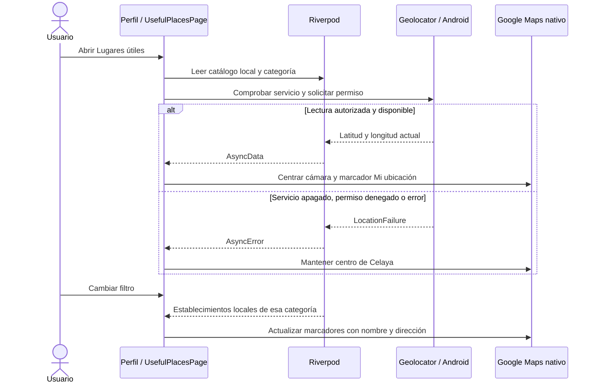

La pantalla empieza con el centro de Celaya mientras espera la ubicación.
Cuando llega la lectura, `ref.listen(deviceLocationProvider)` mueve la cámara.
Si el SDK tarda más, `onMapCreated` consulta el estado actual y centra la cámara
al crearse. Si el usuario está en otra ciudad, se respeta su posición; Ver
Celaya vuelve al catálogo. Mi ubicación invalida únicamente la consulta de
posición. No se sigue al usuario continuamente ni se guardan coordenadas en
Supabase, archivos o preferencias. La posición aproximada es aceptada.

Si el permiso está bloqueado o el servicio apagado, Abrir ajustes facilita
corregirlo; al volver se pulsa Mi ubicación. La lista sigue utilizable ante
fallos, ausencia de resultados o falta de soporte. El SDK conserva su atribución
en el mapa. `GoogleMap` gestiona el ciclo de vida de su vista/controlador; la
pantalla no mantiene un servicio de localización en segundo plano.

Android añade ACCESS_COARSE_LOCATION y ACCESS_FINE_LOCATION. La clave se pasa
con `--dart-define-from-file=maps.local.json`. `android/app/build.gradle.kts`
decodifica `dart-defines` y completa el placeholder `mapsApiKey` del manifest.
Dart comprueba la misma variable antes de construir GoogleMap, evitando abrir
una vista sin clave. El JSON está ignorado por Git y no se crea con una clave
copiada de otro proyecto. La restricción en Google Cloud requiere el paquete
`com.example.casa_en_juego`, su SHA-1 de firma y Maps SDK for Android. No hace
falta Places API ni una nueva Edge Function. La guía [maps_setup.md](maps_setup.md)
incluye la configuración, comandos, fuentes del catálogo y prueba en el RMX3840.

Web e iOS conservan catálogo y filtros. No se configura allí una clave, SDK de
mapa ni permisos de ubicación en esta etapa. La compilación del APK no acredita
por sí sola autorización de Google Maps ni una posición física correcta; esa
comprobación queda pendiente de configurar la clave y ejecutar en el teléfono.

`test/useful_places_test.dart` comprueba permiso inicial/existente, servicio
apagado, denegación temporal/permanente, timeout, errores seguros, filtros,
catálogo vacío y navegación desde Perfil sin ciclo. Las ubicaciones y permisos
de estas pruebas están simulados y no acceden a Google Cloud.

**Diagnóstico de ejecución sin clave.** Se comprobó que `maps.local.json` era
válido, pero el manifest del APK instalado en el RMX3840 tenía vacío el valor
de `com.google.android.geo.API_KEY`. El archivo local solo se incorpora mediante
`--dart-define-from-file=maps.local.json`; la ejecución normal no lo lee.
`.vscode/launch.json` añade dos perfiles: con mapa, que pasa ese argumento, y
sin clave, para ejecutar el resto de la app. No contiene credenciales ni fija
un dispositivo personal. Al cambiar la configuración es necesario recompilar
e instalar el APK, no basta con hot reload o cerrar sesión.
Se recompiló con el JSON y se instaló en el RMX3840. La inspección del manifest
del APK instalado confirmó que ahora contiene la misma clave del archivo local,
sin imprimirla ni incorporarla a Git. Esta comprobación verifica el empaquetado;
el responsable confirmó después que el mapa aparece, verificando también la
aceptación de la clave y la carga de mosaicos en el teléfono.


Verificación local del módulo de lugares: 157 pruebas Flutter aprobadas,
análisis Dart sin hallazgos y compilaciones Android/web completadas con las
dependencias nuevas. Después de recompilar e instalar con la clave, el responsable confirmó que
el mapa aparece en el RMX3840. Esa prueba acredita la carga del mapa y la
autorización de la clave; la exactitud de la posición y de cada establecimiento
se comprueba con los pasos de la guía.


**Revisión cartográfica del catálogo, 21 de noviembre de 2026.** Se amplió de
tres a siete registros: Paper Waste, Lavanita, Easy & Clean Nicolás Bravo,
Aquamatic Parque Celaya y Don Pulcro en Francisco Juárez, La Capilla y Los
Laureles. Se corrigió Paper Waste a Oriente 3 núm. 205 conforme al padrón
estatal y al punto registral de esa dirección; el pin anterior quedaba unos
5.2 km al norte. Se ajustó Lavanita al pin comercial publicado (unos 28 m del
punto registral anterior) y se retiró Vengala 4003 al no corroborar su posición.
Las sucursales de Don Pulcro usan las coordenadas del localizador oficial,
contrastadas con sus fichas Waze. Las lavanderías adicionales tienen puntos
coincidentes en las fichas consultadas. La tabla de fuentes y diferencias queda
en [maps_setup.md](maps_setup.md). La revisión verifica coherencia entre fuentes
públicas; no acredita una visita física ni precisión al metro.

Solo cambia `data/celaya_places.dart`: los providers, filtros, marcadores y
pantallas siguen consumiendo la misma lista constante. No se añaden llamadas
web a la app, dependencias, tablas, permisos o consultas de Places API.

Las diez pruebas del módulo de lugares pasaron tras ampliar el catálogo, y el
análisis Dart terminó sin hallazgos. Se adaptó la prueba del listado para
recorrer también las tarjetas que quedan fuera del primer viewport; comprueba
los tres filtros a 320 y 1100 píxeles con los siete registros. La comprobación
geográfica corresponde a la tabla de fuentes; las pruebas automatizadas
verifican el filtrado y la presentación del catálogo.


### 11.13 Bienvenida guiada (onboarding)

El usuario acordó mostrarla siempre que una cuenta entre sin un ciclo activo,
y mantener un acceso manual. La secuencia es un único `AlertDialog` cuyo
contenido cambia; no se apilan ventanas, no tiene ruta propia y no bloquea
crear/unirse después de cerrarla. Su tema y fuente proceden de MaterialApp.

| Archivo | Funciones y responsabilidad |
|---|---|
| `lib/features/onboarding/providers/onboarding_session_provider.dart` | `OnboardingSessionController.build()` observa `currentUserProvider`. Guarda en memoria el id de la cuenta actual y, como estado, el id pendiente de bienvenida. `markShown(accountId)` consume esa invitación sin modificar la sesión ni el perfil. |
| `lib/features/onboarding/presentation/onboarding_dialog.dart` | `_steps` define icono, título y texto de los seis pasos. `_StepController` controla el índice con Riverpod; `next()` y `previous()` respetan los límites. `showOnboardingDialog()` crea una secuencia con estado nuevo por apertura. `_OnboardingDialog.build()` dibuja paso, contenido y botones, y cierra el diálogo si cambia la cuenta o termina la sesión. |
| `lib/main.dart` | `CasaEnJuegoApp.build()` observa el controlador de bienvenida para inicializar el seguimiento de la sesión desde el arranque, incluso si la primera pantalla es Tareas. No recrea el router ni añade navegación paralela. |
| `lib/features/profile/presentation/profile_page.dart` | `build()` programa la apertura automática tras cargar el perfil de la cuenta elegible. `_presentTutorial()` vuelve a comprobar cuenta y ruta, consume la invitación automática y abre el diálogo. `_openTutorial()` permite abrirlo desde Ver tutorial. `_tutorialBusy` evita aperturas simultáneas o callbacks duplicados; es una guarda imperativa, no estado visual. |

**Regla por sesión.** El controlador no es `autoDispose`: sigue observando Auth
al salir de Perfil. Un primer usuario sin membresía, una identidad diferente o
un ingreso después de un valor nulo generan una invitación si la nueva cuenta
no tiene ciclo. Una cuenta que entra con ciclo no recibe invitación automática.
Los refrescos, cargas y errores temporales no reinician esta decisión. Si la
cuenta adquiere una membresía, se cancela cualquier invitación pendiente.
Cerrar un ciclo en la misma sesión no crea otra bienvenida automática.

Al arrancar o recargar la app se crea un controlador nuevo. Si Supabase restaura
una sesión sin ciclo, se muestra la introducción. No se usa SharedPreferences,
Storage, archivos ni una marca en Supabase: el usuario quiere poder volver a
verla al entrar, incluyendo la presentación académica. No se modifica el flujo
de correo, Google o GitHub; todos terminan en el mismo `currentUserProvider`.

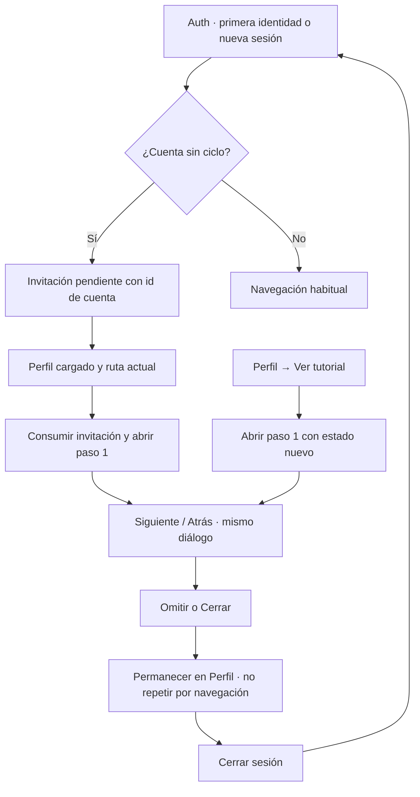

**Contenido.** Bienvenida; crear/unirse con código; registrar/revisar tareas;
agitar en Android para sugerir una tarea sin registrarla; Ranking/Mi actividad;
y cierre por el administrador desde Cuidar del equipo con resultados históricos.
El siguiente ciclo empieza independiente, con catálogo base y código nuevo.

**Presentación y cierre.** El primer paso ofrece Omitir y Siguiente. Los pasos
intermedios añaden Atrás. El sexto solo tiene Cerrar, conforme a lo solicitado.
El fondo no cierra accidentalmente el diálogo; el botón Atrás del sistema puede
cerrarlo y cuenta como una omisión en esa sesión. La invitación se consume al
abrir, de modo que navegar o refrescar no la repita. Cada apertura manual
crea un ProviderScope con un `_StepController` nuevo y empieza en cero.

El cuadro es desplazable y limita su ancho a 500 píxeles. AlertDialog adapta
sus acciones cuando falta ancho. No se programan animaciones, dependencias ni
permisos nuevos. La secuencia únicamente informa: no finaliza ciclos, no envía
tareas, no cambia membresías ni solicita biometría. Al cerrarla se conserva la
pantalla que estaba debajo. El diálogo evita permanecer sobre otra cuenta
cuando Auth informa un cierre o un cambio de identidad.

**Verificación.** `test/onboarding_test.dart` cubre la secuencia completa,
retroceso, omisión, solo Cerrar al final, repetición tras volver a iniciar
sesión, ausencia de repetición al refrescar/navegar, consulta manual con ciclo,
cierre por cambio de sesión y diseño a 320×568 con texto al doble y ambos temas.
Las pruebas existentes de Perfil y Planes omiten la bienvenida antes de continuar
sus recorridos; el registro por correo comprueba que aparece tras confirmar.
No se reemplaza la prueba funcional de bienvenida por un flag deshabilitado.

Para la prueba en el RMX3840: salir de la cuenta, entrar con una sin ciclo,
recorrer los seis pasos y cerrar. Navegar y volver a Perfil no debe abrirla
otra vez. Cerrar sesión y entrar con la misma cuenta sí debe mostrarla de
nuevo. Omitir debe funcionar; Ver tutorial debe iniciar en el paso uno para
cualquier cuenta. La comprobación en el teléfono queda pendiente del responsable.


Verificación local de la bienvenida: 164 pruebas Flutter aprobadas, incluidas
siete pruebas específicas de onboarding, análisis Dart sin hallazgos y
compilación web completada. El tamaño pequeño y el texto grande se comprobaron
con ambos temas. No se añadieron dependencias, migraciones, secretos ni marcas
persistentes para esta funcionalidad.
El APK Android también compiló y se instaló en el RMX3840 con la configuración
local del mapa. Queda pendiente la validación visual del tutorial en ese equipo.
