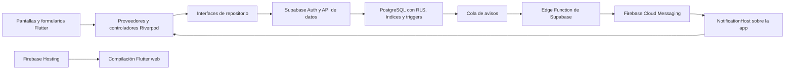
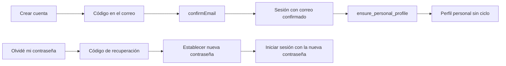
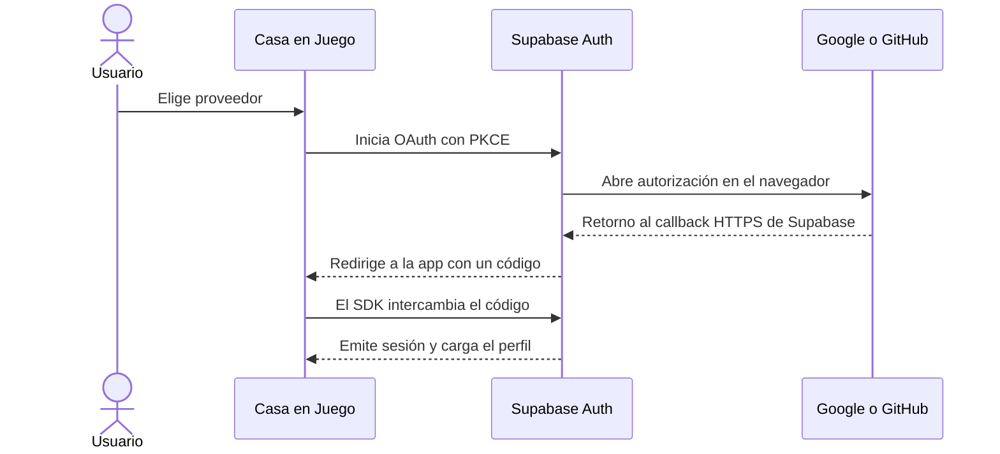
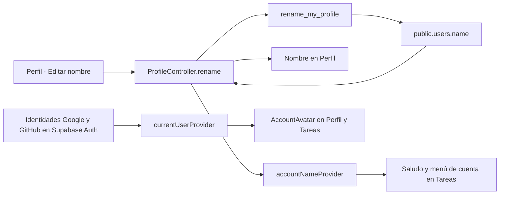
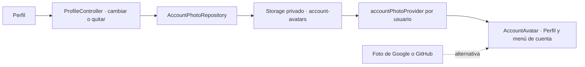
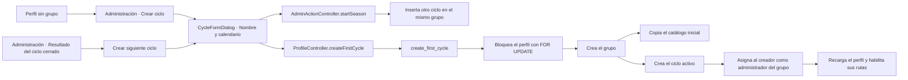
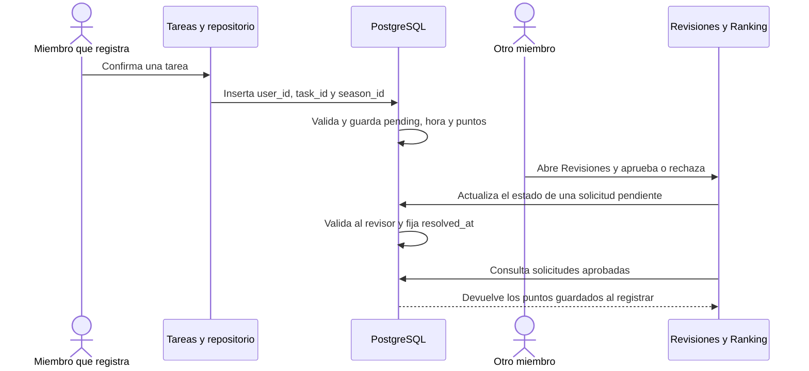
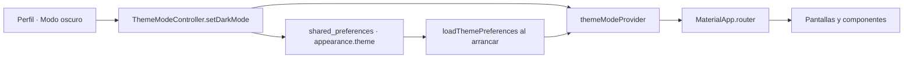

# Manual técnico de Casa en Juego

## 1. Qué resuelve

Casa en Juego organiza las tareas domésticas de un grupo familiar. Un miembro
registra una tarea, otro confirma o rechaza el trabajo y el ranking muestra
los puntos de las tareas aprobadas en el ciclo activo. La administración
define el catálogo y los ciclos. Mi actividad conserva el historial personal.

Los miembros originales conservan el grupo familiar existente. Las cuentas
personales se registran desde la app y pueden crear su propio ciclo.
El maestro aprobó usar Supabase para datos y autenticación, y Firebase para
avisos. La entrega es el domingo 22 de noviembre de 2026. El mapa y el pago
siguen pendientes.

## 2. Arquitectura y tecnologías



| Componente | Responsabilidad | Dónde estudiarlo |
|---|---|---|
| Flutter y Dart | Pantallas para Android, iOS y web. Los módulos se organizan por funcionalidad. | [lib/main.dart](../lib/main.dart), [pubspec.yaml](../pubspec.yaml) |
| Riverpod | Estado de formularios, sesión, consultas, acciones, reintentos e invalidación de datos. | Carpetas `providers/` de cada módulo y proveedores locales de los formularios |
| go_router | Navegación, restauración de sesión y protección de páginas administrativas. | [app_router.dart](../lib/core/router/app_router.dart) |
| Supabase Auth | Sesión con correo y contraseña. El perfil familiar y el rol se leen de PostgreSQL. | [auth_repository.dart](../lib/features/auth/repositories/auth_repository.dart) |
| Supabase PostgreSQL | Datos de negocio y autorización. RLS significa seguridad por fila. Se complementa con permisos por columna, restricciones e índices. | [phase_2.sql](../supabase/phase_2.sql), [migraciones](../supabase/migrations/) |
| Firebase | FCM transporta avisos en móvil y Hosting aloja la compilación web. | [push_gateway.dart](../lib/features/notifications/repositories/push_gateway.dart), [firebase.json](../firebase.json) |
| fl_chart | Barras horizontales de contribución en el ranking. | [contribution_chart.dart](../lib/features/leaderboard/presentation/widgets/contribution_chart.dart) |

`main()` inicializa Supabase, intenta inicializar Firebase para push móvil y
monta `ProviderScope`. El resultado de la inicialización se inyecta con
`pushRuntimeReadyProvider`. `CasaEnJuegoApp` combina el tema, el router y
`NotificationHost`. La guía de push explica los pasos de despliegue.

En `lib/features/`, `presentation/` contiene las pantallas, `providers/`
coordina el estado, `repositories/` encapsula el acceso a datos y `models/`
describe los objetos que intercambian. En `core/` están el router, el tema, la
configuración y el proveedor del cliente Supabase. Las pruebas pueden sustituir
las interfaces de repositorio por implementaciones de prueba.

## 3. Autenticación, rutas y perfil

1. `LoginPage._submit()` valida los campos, quita el foco y llama a
   `AuthController.signIn()`. El controlador usa `AsyncValue` para deshabilitar
   envíos simultáneos y mostrar errores recuperables.
2. `SupabaseAuthRepository.signIn()` llama a `signInWithPassword()`.
   `watchUser()` observa los cambios de sesión, exige un correo confirmado y
   carga el perfil asociado. Si el perfil todavía no existe, llama a la RPC
   `ensure_personal_profile()`. `currentUserProvider` expone el resultado.
3. El router lleva al usuario a `/session` mientras se valida el perfil, a
   `/login` si no hay sesión, a `/tasks` para miembros de un grupo y a
   `/profile` para cuentas personales sin ciclo. Registro y recuperación
   son rutas públicas. Una cuenta sin grupo puede abrir `/admin` para crear
   su primer ciclo. El panel de gestión y las rutas `/admin/tasks` requieren
   el rol de administrador del grupo.
4. `ProfileController.setNotifications()` actualiza la preferencia guardada en
   PostgreSQL y sincroniza el estado de avisos. Perfil muestra nombre, correo,
   rol, avatar e información del grupo cuando corresponde.
5. `AuthController.signOut()` solicita a `NotificationSession.disconnect()`
   desvincular el dispositivo y luego cierra la sesión local de Supabase. Si la
   desvinculación falla, la app muestra un error y permite reintentar.

Enlaces de estudio: [controlador de acceso](../lib/features/auth/providers/auth_providers.dart),
[controlador de perfil](../lib/features/profile/providers/profile_providers.dart)
y [pantalla de perfil](../lib/features/profile/presentation/profile_page.dart).

### Registro, confirmación y recuperación por correo

[EmailAccountPage](../lib/features/auth/presentation/email_account_page.dart)
usa [EmailAccountController](../lib/features/auth/providers/email_account_provider.dart)
para indicar el paso actual, bloquear envíos duplicados y presentar errores.
`signUp()` envía el nombre y las credenciales a Supabase Auth.
`resendSignUpCode()` reenvía la confirmación. `confirmEmail()` valida el
código de un solo uso y abre la sesión. El formulario valida el correo,
ocho caracteres de contraseña como mínimo y coincidencia entre las dos entradas.



La [migración de cuentas personales](../supabase/migrations/20261114000100_add_personal_accounts.sql)
marca como miembros los perfiles existentes y hace que los nuevos nazcan sin
membresía. La RPC toma el identificador y correo de Supabase Auth. El cliente
puede proponer un nombre, pero la base decide el rol. Las políticas RLS solo
dejan que una cuenta sin grupo vea su propio perfil. El grupo existente
mantiene su acceso a datos y sus permisos de administrador.

[PasswordRecovery](../lib/features/auth/repositories/password_recovery.dart)
pide el código a Auth, lo valida con tipo `recovery` y usa la sesión temporal
para cambiar la contraseña. Esas peticiones se hacen aparte del cliente que
mantiene la sesión de la app, para que el código de recuperación no inicie
sesión ni sincronice una sesión temporal entre pestañas. Al terminar se
solicita el cierre de esa sesión y la interfaz vuelve al acceso normal.

#### Activación en Supabase

1. Aplicar la migración de cuentas personales en SQL Editor sobre la base
   existente. Ejecutar solo esa migración para este cambio.
2. En **Authentication → Emails → Set up SMTP**, configurar un proveedor
   SMTP con el remitente y las credenciales que indique el servicio de correo.
   El envío integrado de Supabase solo entrega a direcciones del equipo del
   proyecto. Desde el 3 de junio de 2026, los proyectos gratuitos nuevos
   que usan ese envío también tienen bloqueada la edición de plantillas.
3. Con el SMTP personalizado habilitado, volver a **Templates** y editar
   **Confirm sign up** y **Reset password**. Usar `{{ .Token }}` en el cuerpo
   e indicar que se introduzca el código en Casa en Juego. Retirar
   `{{ .ConfirmationURL }}` de ambas plantillas.
4. En la configuración del proveedor de correo, mantener activada la
   confirmación de correo y después habilitar el registro de usuarios nuevos.
5. En Android o web, crear una cuenta de prueba, verificar que se pueda
   reenviar y confirmar el código, comprobar que solo abra Perfil y probar
   que la contraseña anterior falle y la nueva funcione después de recuperarla.
   Repetir el acceso con una cuenta familiar previa para comprobar su permiso.

Referencias: [restricción de plantillas en el plan gratuito](https://supabase.com/changelog/46599-changes-to-email-template-customisation-on-free-tier),
[configuración SMTP](https://supabase.com/docs/guides/auth/auth-smtp)
y [plantillas de correo de Supabase](https://supabase.com/docs/guides/auth/auth-email-templates).

### Acceso con Google y GitHub

[SocialSignInButtons](../lib/features/auth/presentation/widgets/social_sign_in_buttons.dart)
muestra ambos proveedores en el login. `AuthController.signInWithProvider()`
comparte el estado de carga con el acceso por correo. El
[lanzador OAuth](../lib/features/auth/repositories/oauth_sign_in.dart) abre el
navegador con `signInWithOAuth()`. Al abrirse el navegador la app todavía
espera la sesión de Supabase. Al volver, el SDK intercambia el código
mediante PKCE y `watchUser()` carga el perfil. Una cuenta nueva llega a
Perfil sin ciclo. Supabase puede vincular proveedores a la misma cuenta si
comparten un correo verificado.

Los botones usan `OutlinedButton.icon` con imágenes PNG empaquetadas en
[`assets/brand/`](../assets/brand/). Google usa su G multicolor con fondo
blanco. GitHub usa la versión negra del Invertocat en el tema claro y la
blanca en el oscuro. Las imágenes son decorativas para el lector de pantalla.
El texto del botón identifica la acción y el proveedor. Los archivos vienen
de los [recursos de marca de Google](https://developers.google.com/identity/branding-guidelines)
y del [kit de marca de GitHub](https://brand.github.com/foundations/logo).



#### Activar los proveedores

1. Aplica la migración de cuentas personales descrita arriba. En Supabase,
   abre **Authentication → Sign In / Providers**. Copia la **Callback URL**
   del proveedor. Tiene el formato
   `https://<referencia-del-proyecto>.supabase.co/auth/v1/callback`.
   Mantén activa la opción **Allow new users to sign up** si vas a probar
   con una cuenta que todavía no existe en Supabase Auth.
2. En **Google Cloud**, crea o usa un cliente OAuth de tipo **Aplicación
   web** y registra esa URL en **Authorized redirect URIs**. Si la pantalla
   de consentimiento está restringida a usuarios de prueba, agrega las
   cuentas que usarán la demo. En **GitHub → Developer settings → OAuth
   Apps**, registra la misma URL en **Authorization callback URL**.
3. En **Authentication → Sign In / Providers**, habilita Google y GitHub y
   pega el **Client ID** y el **Client Secret** de cada uno. El secreto se
   configura en Supabase. Flutter usa la clave publicable del proyecto.
4. En **Authentication → URL Configuration**, agrega a **Redirect URLs**
   los destinos que vas a usar. Son las direcciones de regreso que acepta
   Supabase después de autenticar con el proveedor.
   - Android e iOS: `casaenjuego://auth/callback`.
   - Web publicada: `https://casaenjuego.web.app/`.
   - Chrome local: `http://localhost:8080/`. Inicia Flutter con
     `flutter run -d chrome --web-port=8080`.
5. Recompila o reinicia Android después del cambio de manifiesto. Prueba un
   acceso por proveedor y vuelve a la app. Comprueba que una cuenta nueva
   llegue a Perfil sin ciclo y una cuenta familiar existente conserve su
   acceso al iniciar sesión con el mismo correo verificado. Comprueba
   también que puedas volver al login si cancelas en el navegador.

El callback de Google y GitHub apunta al servidor de Supabase. La URL
`casaenjuego://auth/callback` abre la app móvil y está registrada en
[AndroidManifest.xml](../android/app/src/main/AndroidManifest.xml) y
[Info.plist](../ios/Runner/Info.plist). En web, el retorno usa el mismo
origen donde se inició OAuth.

[Configuración de Google](https://supabase.com/docs/guides/auth/social-sign-in/auth-google)
· [Configuración de GitHub](https://supabase.com/docs/guides/auth/social-sign-in/auth-github)
· [URL de retorno en Supabase](https://supabase.com/docs/guides/auth/redirect-urls).

### Nombre editable y foto del proveedor

En **Perfil → Editar nombre**, el formulario valida un nombre de 1 a 100
caracteres. `ProfileController.rename()` envía el nombre al repositorio,
espera la confirmación de Supabase y publica el valor guardado en
`accountNameProvider`. Así se actualizan el saludo de Tareas y las iniciales
del menú de cuenta. El proveedor vuelve a leer el nombre cuando cambia de
cuenta. El guardado en curso termina aunque se navegue a Tareas.



La RPC [`rename_my_profile`](../supabase/migrations/20261114000200_rename_personal_profile.sql)
obtiene el dueño con `auth.uid()`, comprueba que su correo esté confirmado y
actualiza solo `public.users.name` de esa sesión. No toma identificadores de
usuario del cliente. Para habilitar la edición en el ambiente remoto, ejecuta
una vez esa migración en **Supabase → SQL Editor** después de la migración de
cuentas personales.

[`providerAvatarUrl()`](../lib/features/auth/models/provider_avatar.dart)
lee `picture` o `avatar_url` desde las identidades OAuth de Google y GitHub,
con prioridad para el proveedor social principal cuando está disponible.
[`AccountAvatar`](../lib/features/auth/presentation/widgets/account_avatar.dart)
muestra la imagen HTTPS en Perfil y el menú de Tareas. Mientras carga, si no
hay foto o si la petición falla, muestra las iniciales. En web permite
mostrar la imagen con un elemento HTML si el CDN bloquea la descarga directa
por CORS. Google y GitHub pueden iniciar sesión en el mismo perfil cuando
Supabase vincula ambas identidades por correo verificado.

Para comprobarlo, cambia el nombre desde Perfil y abre Tareas con una cuenta
que pertenezca al grupo. Después, vuelve a iniciar sesión con Google o GitHub
y verifica que el nombre se conserve y que la misma foto aparezca en ambos
lugares si el proveedor entregó una.
[Identidades de Supabase](https://supabase.com/docs/guides/auth/identities)
· [Vinculación de identidades](https://supabase.com/docs/guides/auth/auth-identity-linking)
· [Imágenes de red en Flutter](https://api.flutter.dev/flutter/widgets/Image/Image.network.html).

### Foto de perfil personalizada

Desde **Perfil → Agregar foto** puedes elegir un JPG, PNG o WebP de hasta
2 MB. `file_selector.openFile()` abre el selector de documentos de Android
(`ACTION_OPEN_DOCUMENT`) o el diálogo de archivos del navegador. En Android
puede mostrar Descargas y proveedores como Drive, según el dispositivo.
[`ProfilePhoto.pick()`](../lib/features/profile/models/profile_photo.dart)
valida el tamaño, la firma del archivo y que la primera imagen se pueda
decodificar. Cancelar conserva la foto actual. Cuando ya hay una foto propia,
**Cambiar foto** la reemplaza y **Quitar foto** borra el archivo.



[`SupabaseAccountPhotoRepository`](../lib/features/auth/repositories/account_photo_repository.dart)
usa la ruta `<id de usuario>/avatar`. `save()` hace un *upsert* en esa ruta
y `remove()` la elimina mediante la API de Storage. Así el reemplazo
mantiene un solo objeto por cuenta. Al terminar, el controlador invalida
[`accountPhotoProvider`](../lib/features/auth/providers/account_photo_providers.dart).
El proveedor vuelve a descargar los bytes con la sesión autenticada y evita
reutilizar la versión anterior de la caché. `AccountAvatar` prueba primero
la foto propia, después la del proveedor vinculado y por último las iniciales.
Si falla la carga, se muestra la alternativa disponible. Al deslizar hacia
abajo desde Perfil, la actualización general vuelve a consultar la foto.

La [migración de fotos](../supabase/migrations/20261114000300_add_account_avatars.sql)
crea el bucket privado con el límite de 2 MB y los tres tipos MIME. La política
RLS compara la ruta exacta con `auth.uid()` y permite a cada cuenta
autenticada leer, subir, reemplazar y borrar su propio objeto. El archivo se
comparte entre las formas de acceso vinculadas a la misma cuenta.
[Buckets privados de Supabase](https://supabase.com/docs/guides/storage/buckets/fundamentals)
· [Selector de archivos de Flutter](https://pub.dev/packages/file_selector).

1. Ejecuta la migración una vez en **Supabase → SQL Editor → New query**.
   Confirma en **Storage** que aparece el bucket privado `account-avatars`.
2. Ejecuta `flutter pub get` y reinicia la app para cargar el selector. Prueba
   **Agregar foto**, **Cambiar foto** y **Quitar foto** en Chrome y en Android.
3. Cierra sesión y vuelve a entrar antes de quitar la foto para comprobar que
   persiste. Con una cuenta vinculada, prueba el otro proveedor. Si la cuenta
   pertenece al grupo, revisa también el icono en Tareas.
4. Al quitar la foto, comprueba que se recupera la foto del proveedor o las
   iniciales. Prueba cancelar el selector y el rechazo de un archivo que
   supere los 2 MB.

## 4. Tareas, revisiones, historial y ranking

### Crear o iniciar un ciclo

Una cuenta con correo confirmado y sin grupo puede abrir
**Perfil → Administración → Crear ciclo**. El [formulario compartido](../lib/features/admin/presentation/widgets/cycle_form_dialog.dart)
pide nombre y una **fecha de fin prevista** en el calendario de Material,
localizado en español de México con `flutter_localizations`. La selección
empieza en mañana según el calendario del dispositivo. El formulario muestra
los días previstos y **Administración** muestra la fecha y la duración
guardadas. El cierre se confirma manualmente desde ese panel.



[`ProfileRepository.createFirstCycle()`](../lib/features/profile/repositories/profile_repository.dart)
envía `p_name` y `p_planned_end_date` en formato `AAAA-MM-DD`. La RPC obtiene la cuenta con
`auth.uid()` y hace las escrituras en una sola transacción. El bloqueo del
perfil impide asignarle dos grupos aunque pulse desde dos dispositivos.
Al guardar, el controlador invalida `currentUserProvider` para leer la
membresía y el rol de la base. El panel se actualiza con el ciclo activo.

Tras el cierre, Administración muestra los resultados del último ciclo
cerrado. `SeasonSummary.results` suma solo los puntos aprobados y asigna
la misma posición en los empates. La tarjeta identifica al ganador o a
los participantes empatados en primer lugar. Con cero puntos aprobados
indica que no hubo ganador. **Crear siguiente ciclo** abre el mismo
formulario. `AdminActionController.startSeason()` comprueba el rol y que
no haya un ciclo activo. El repositorio inserta el nombre y la fecha prevista.
RLS, el índice único del grupo y `private.validate_season()` aplican las
reglas en el servidor. Tareas enlaza a Administración si el administrador
vuelve a iniciar sesión con el ciclo cerrado.

El grupo es el ámbito de permisos y puede tener ciclos cerrados y como
máximo uno activo. Cada perfil tiene una única columna `cycle_group_id`,
que es nula hasta que obtiene una membresía. El rol `admin` de
`public.users` se aplica únicamente dentro de ese grupo. Por compatibilidad,
`is_household_member` sigue indicando si hay membresía y la base garantiza
que coincida con `cycle_group_id`.

La [migración de creación de ciclos](../supabase/migrations/20261115000100_add_cycle_creation.sql)
asigna las cuentas familiares, los ciclos y las tareas existentes al mismo
grupo y preserva sus identificadores e historial. Las políticas RLS filtran
los perfiles, las temporadas, el catálogo y las solicitudes por el grupo
de la sesión. El trigger `check_task_log_cycle_group()` exige que el autor,
la tarea y el ciclo coincidan antes de calcular puntos. Las funciones de
avisos y recordatorios también limitan los destinatarios por grupo.

La [migración de fecha prevista](../supabase/migrations/20261115000200_add_cycle_planned_end_date.sql)
añade `seasons.planned_end_date` con tipo `date`. El trigger
`private.validate_season()` valida que sea posterior al día de inicio en
`America/Mexico_City` y calcula `planned_duration_days` con la diferencia
entre ambas fechas. `end_date` se asigna al cerrar el ciclo y registra la
fecha y hora reales. Los ciclos existentes conservan los días originales.
La RPC anterior que recibe `p_duration_days` sigue disponible para clientes
que todavía la usan.

La [migración de catálogo inicial y siguiente ciclo](../supabase/migrations/20261115000300_add_next_cycle_and_default_tasks.sql)
guarda una copia del catálogo del grupo original en
`private.cycle_task_templates`. En el proyecto actual, ese catálogo contiene
las cinco tareas iniciales. Se conservan nombre, puntos, icono, estado y
frecuencia. Al insertar un grupo, `private.seed_cycle_group_tasks()` copia
la plantilla dentro de la transacción del primer ciclo. La migración también
completa los grupos que siguen sin tareas y actualiza el permiso de inserción
de la fecha prevista para los ciclos siguientes. El catálogo pertenece al
grupo. Las altas, ediciones y desactivaciones se conservan al cambiar de
ciclo y los puntos de solicitudes anteriores siguen en `points_snapshot`.

Ejecuta las migraciones pendientes una vez en **Supabase → SQL Editor**.
La de creación requiere las de cuentas personales, límites diarios y
recordatorios push. La de fecha prevista se ejecuta después de la de
creación y antes de la de catálogo inicial. Desde una cuenta sin grupo,
abre Administración desde Perfil, crea un ciclo y verifica la fecha y las
tareas iniciales. Edita una tarea, cierra el ciclo e inicia otro. Comprueba
que el nuevo ciclo empieza con cero puntos y conserva la tarea editada.
Comprueba que otra cuenta siga viendo solo los datos de su grupo.
[`personal_accounts_test.cjs`](../supabase/tests/personal_accounts_test.cjs)
comprueba la creación, el aislamiento de los administradores, el catálogo
inicial y los destinatarios de avisos en una base PostgreSQL local.

### Registro y revisión de tareas



| Módulo y métodos | Comportamiento |
|---|---|
| [Tareas](../lib/features/tasks/repositories/tasks_repository.dart), `loadDashboard()`, `submitTask()` | Carga el ciclo activo, el catálogo, las solicitudes relevantes y el estado de los límites diarios con una RPC. El envío solo escribe referencias; la base establece el estado, la hora y los puntos. `TaskSubmissionController.submit()` protege la acción de envíos simultáneos y refresca el tablero. |
| [Revisiones](../lib/features/reviews/repositories/reviews_repository.dart), `loadInbox()`, `resolve()` | Lista las solicitudes pendientes de otros miembros del ciclo activo. Solo cambia solicitudes todavía pendientes. El controlador de revisiones invalida las lecturas afectadas después de resolver. |
| [Mi actividad](../lib/features/activity/repositories/activity_repository.dart), `loadPage()` | Carga el historial del usuario con filtro por estado y paginación. `loadMore()` conserva las páginas ya recibidas y comprueba que el resultado siga perteneciendo a la búsqueda activa al terminar. |
| [Ranking](../lib/features/leaderboard/repositories/leaderboard_repository.dart), `loadLeaderboard()` | Carga los miembros y las solicitudes aprobadas del ciclo activo, paginando consultas. Los puntos se obtienen de `points_snapshot`. La UI muestra podio y gráfica de aportaciones. |
| [Administración](../lib/features/admin/repositories/admin_repository.dart), `loadDashboard()`, `loadTasks()`, `saveTask()`, `closeSeason()`, `startSeason()` | Consulta el resumen y el catálogo, crea y edita tareas, cierra el ciclo activo y permite comenzar otro. `AdminActionController._run()` verifica el rol, serializa acciones e invalida datos relacionados al completarlas. |

### Modelo de datos

| Tabla | Datos y reglas |
|---|---|
| `private.cycle_groups` | Agrupa membresía, catálogo e historial de ciclos y queda fuera del acceso directo del cliente. |
| `users` | Identidad de Supabase Auth, nombre, correo, preferencia de avisos y rol en el grupo asignado. |
| `tasks` | Catálogo del grupo con nombre, icono, puntos, estado activo y opción de una vez al día. Desactivar una tarea la oculta del catálogo y preserva su historial. |
| `seasons` | Ciclo del grupo con nombre, inicio, fin previsto opcional, duración prevista, cierre real y estado. Un índice único parcial permite solo un ciclo activo por grupo. |
| `task_logs` | Solicitud vinculada al usuario, tarea y ciclo. Guarda estados, fechas, revisor, puntos históricos y si se aplicó límite diario. El revisor debe ser otro miembro y una solicitud solo se puede resolver una vez. |
| `push_devices` y `push_jobs` | Registro FCM por usuario/dispositivo y cola de entregas con estado, reintentos y caducidad. El acceso a dispositivos se gestiona con RPC autenticadas. |

`private.validate_task_log()` asegura las reglas de escritura en el servidor.
Para tareas limitadas, el límite es por usuario, tarea y día en
`America/Mexico_City`, incluso al cambiar de ciclo. Una solicitud rechazada
permite volver a registrar. La protección combina bloqueo transaccional e
índices para solicitudes concurrentes. `get_task_submission_status()` devuelve
el estado del usuario actual para que Flutter pueda reflejarlo en el catálogo.

Enlaces de estudio: [esquema base](../supabase/phase_2.sql),
[puntos históricos](../supabase/migrations/20261022_add_points_snapshot.sql)
y [límite diario](../supabase/migrations/20261022_add_daily_task_limits.sql).

## 5. Avisos móviles

1. `FirebasePushGateway` solicita permisos, registra un identificador de
   instalación FCM (FID) y adapta los mensajes a `PushNotice`. Usa
   `onMessage` para el primer plano, `onMessageOpenedApp` cuando se toca un
   aviso en segundo plano y `getInitialMessage()` al abrir desde cerrada.
2. `NotificationSession.start()` activa las suscripciones una vez.
   `syncUser()` coordina cambios de sesión, permiso, preferencia y registro.
   En Supabase, las RPC `register_push_device` y `unregister_push_device`
   vinculan o desvinculan el FID de la cuenta actual.
3. La inserción o resolución de una tarea encola avisos para miembros de su
   grupo. La Edge Function
   `send-task-notifications` reclama trabajos, comprueba nuevamente el estado
   y el destinatario, llama a FCM y registra el resultado. Los recordatorios
   usan la misma cola y se programan a las 18:00 y 20:00 de Ciudad de México.
4. `NotificationHost` comprueba el destinatario y la preferencia. En primer
   plano muestra un aviso de tres segundos e invalida proveedores de tareas,
   revisiones, ranking y actividad. Al tocar un aviso abre la ruta asociada.

Los mensajes actuales son privados y esperan `kind`, `recipient_id` y
`notification_id`. Una notificación genérica de Firebase Console puede
mostrarse en la bandeja de Android con la app en segundo plano, pero la app
descarta ese mensaje en su parser si carece del formato esperado. La prueba de
entrega desde consola todavía está pendiente. También quedan pendientes Topics
y la validación del ciclo de vida en dispositivos. iOS requiere configuración
APNs y el push móvil actual se inicializa solo en Android e iOS.

Enlaces de estudio: [NotificationHost](../lib/features/notifications/presentation/notification_host.dart),
[sesión de avisos](../lib/features/notifications/services/notification_session.dart),
[Edge Function](../supabase/functions/send-task-notifications/handler.ts),
[guía de push](push_notifications_setup.md)
y [guía de recordatorios](inactivity_reminders_setup.md).

## 6. Formularios con Riverpod

En [LoginPage](../lib/features/auth/presentation/login_page.dart) se sustituyó
una llamada a `setState`. `_passwordVisibilityProvider` inicia con contraseña
oculta, y `_PasswordVisibility.toggle()` invierte el estado. El campo se
redibuja mediante `ref.watch`. El flujo de autenticación permanece en
`AuthController`.

```dart
final showPassword = ref.watch(_passwordVisibilityProvider);
// El TextFormField usa obscureText: !showPassword.
ref.read(_passwordVisibilityProvider.notifier).toggle();
```

En [TaskEditorPage](../lib/features/admin/presentation/task_editor_page.dart)
se sustituyeron siete llamadas a `setState`. `_TaskFormController.build()`
inicializa el borrador con la tarea editada o con los valores de alta.
`update()` recibe los cambios de nombre, puntos, icono, estado, frecuencia o
error de validación. Cada formulario tiene su propia instancia del proveedor
`autoDispose`. Esto permite editar una tarea sin compartir el borrador con
otro formulario y liberar el estado cuando se sale. `_save()` valida el
formulario, crea un `TaskDraft` y delega el guardado a administración.

```dart
final form = ref.watch(_formProvider); // Alimenta la vista previa.
final controller = ref.read(_formProvider.notifier);
// En el campo de nombre:
onChanged: (name) => controller.update(name: name),
```

Los formularios conservan claves de Flutter para validar los campos. Tener
un `ConsumerStatefulWidget` permite gestionar el ciclo de vida del formulario.
El estado editable se actualiza por Riverpod.

## 7. Tipografía y apariencia

[AppTheme](../lib/core/theme/app_theme.dart) construye dos instancias de
`ThemeData` con Material 3. `AppTheme._build()` define el esquema de colores
para cada brillo. Las pantallas consumen `context.appColors` para superficies,
texto y errores, y `context.statusColors` para estados aprobados y pendientes.
`AppStatusColors` es una `ThemeExtension` para que Flutter interpole estos
colores junto con el tema principal. Los iconos personalizados y la gráfica
también toman su color del tema activo.

Las dos paletas usan **DM Sans** como familia principal. El archivo variable
está incluido en [assets/fonts/dm_sans](../assets/fonts/dm_sans/) y se registra
en [pubspec.yaml](../pubspec.yaml). Flutter puede cargarlo sin pedir la fuente
a un servidor. El proyecto incluye [su licencia OFL](../assets/fonts/dm_sans/OFL.txt).



El interruptor de [Perfil](../lib/features/profile/presentation/profile_page.dart)
llama a `setDarkMode()`. El controlador actualiza Riverpod de inmediato y
guarda la selección localmente en orden. `loadThemePreferences()` lee el
valor antes de arrancar la interfaz. La preferencia es del dispositivo o
navegador y se mantiene al cambiar de cuenta. La app empieza en oscuro si
todavía no hay una selección guardada o si falla la lectura.

```dart
theme: AppTheme.light,
darkTheme: AppTheme.dark,
themeMode: ref.watch(themeModeProvider),
```

Para revisar el flujo, abre **Perfil → Modo oscuro**, cambia de tema, visita
Tareas o Ranking y vuelve a abrir la app. La prueba en
[`test/profile_test.dart`](../test/profile_test.dart) comprueba el cambio
global, la familia tipográfica y la restauración del valor guardado.

## 8. Rúbrica del proyecto final

| Requisito | Estado en este repositorio |
|---|---|
| Problemática, objetivo y alcance | Parcial. Hay un [planteamiento](../planteamiento.md). Falta incluir evidencia del problema y el alcance acordado con el maestro. |
| Firebase Database y sincronización | Parcial. PostgreSQL guarda los datos y Flutter refresca las consultas al cambiar el estado, navegar o recibir avisos. Pendiente una suscripción a cambios de datos y la decisión del maestro sobre Supabase, Realtime Database o Firestore. |
| Firebase Storage y caché local de imágenes | Pendiente. Perfil usa iniciales y el catálogo usa iconos locales. Falta subir y guardar imágenes para uso sin conexión. |
| FCM desde consola, Topics y tres estados | Parcial. Hay escuchador global y rutas al tocar avisos privados. Faltan Topics, envío de consola en la demo y comprobación en Android. |
| Auth, alta por correo y dos proveedores | Implementado en código. Incluye registro, verificación, reenvío, recuperación por correo y acceso con Google y GitHub mediante Supabase Auth. Falta configurar y validar el entorno remoto. |
| Perfil y avatar sincronizado | Implementado. Nombre editable y foto opcional que se puede subir, reemplazar o quitar. Perfil y Tareas muestran la foto de la cuenta con retorno a la imagen OAuth o a las iniciales. |
| Creación y acceso a ciclos | Creación implementada para cuentas sin grupo. El creador administra su grupo y los datos se aíslan por membresía. Pendientes las invitaciones por código y el flujo de salida y reingreso. |
| Estado con Riverpod | Implementado. Las ocho llamadas explícitas a `setState` fueron sustituidas. La búsqueda en `lib/` tampoco encontró usos explícitos de `ValueNotifier`. |
| Tipografía y tema dinámico | Implementados. DM Sans viene incluida con la app y Perfil permite cambiar y recordar el modo claro u oscuro. |
| Onboarding | Pendiente. |
| Responsividad y widget avanzado | Parcial. Hay límites de ancho y pruebas en pantallas pequeñas. La adaptación a escritorio debe validarse. La gráfica de Ranking es candidata al 10% si el maestro la acepta. |
| Sensor y mapa nativo | Pendiente. Biometría para confirmar el cierre de ciclo es una propuesta. El propósito y la ubicación del mapa dependen del alcance acordado. |
| Pagos o suscripciones | Pendiente. Stripe PaymentSheet es una opción para mostrar un formulario nativo de pago en modo de pruebas. También falta definir si se evaluará pedido simulado o tres planes. |
| Entrega y estabilidad | Parcial. Hay Git, pruebas y documentación. Faltan el reporte final, APK de entrega y ensayo completo. |

## 9. Cómo ejecutar y probar

```powershell
flutter pub get
flutter devices
flutter run -d ID_DEL_ANDROID
flutter test
dart analyze
```

- **Dispositivos.** Usar el Pixel 8 del emulador o el teléfono RMX3840 para
  pruebas nativas, en especial FCM. Para revisar dos sesiones en paralelo,
  usar el Android con la app web en un perfil o navegador distinto de Chrome
  o Edge.
- **Caso principal.** Acceder como un miembro y registrar una tarea. Cerrar
  sesión y entrar con otra cuenta, abrir Revisiones y aprobar. Volver a la
  primera cuenta y revisar Mi actividad y Ranking. Repetir con rechazo.
  Ambas cuentas pueden alternarse en el mismo dispositivo.
- **Servicios.** El proyecto tiene configuración Supabase por defecto.
  `SUPABASE_URL` y `SUPABASE_PUBLISHABLE_KEY` pueden sustituirse mediante
  `--dart-define` si existe un proyecto de pruebas. Los secretos del servidor
  y las claves privadas quedan fuera del cliente. Docker es opcional y se
  usaría para levantar Supabase local. El desarrollo normal usa Supabase remoto.
- **Firebase Console.** La primera prueba puede dirigirse únicamente al
  identificador de la instalación de Android desde el botón de prueba de
  Messaging. Comprobar recepción en la bandeja en segundo plano. Preparar
  después el flujo de Topics y el manejo genérico en primer plano.
- **Pruebas de código.** `test/widget_test.dart` cubre acceso y sesión.
  `test/admin_test.dart` cubre permisos de administrador y edición.
  `test/notifications_test.dart` cubre preferencias, desvinculación y rutas
  de avisos. Estas pruebas usan repositorios o gateways de prueba.

Para la publicación web, consultar [Firebase Hosting](firebase_hosting_setup.md).
Para la activación real de avisos y las pruebas SQL y Deno, consultar las
[instrucciones de push](push_notifications_setup.md).

## 10. Decisiones pendientes y mantenimiento

Supabase se mantiene para base de datos, autenticación y fotos de perfil.
El siguiente minibloque es generar un código y permitir que otra cuenta se
una al ciclo. El ingreso usará la misma regla de una sola membresía por
cuenta y asignará el rol de miembro. El administrador deberá cerrar su ciclo
antes de salir. Para la salida y el reingreso queda pendiente conservar
el acceso al historial personal de los grupos anteriores.

**Registro del 15 de noviembre de 2026.** Se añadió la creación del primer
ciclo desde Perfil y el aislamiento de datos y avisos por grupo.
La fecha de fin prevista se elige en el calendario y se guarda por
separado del cierre real.
Se reunió la creación inicial y la de ciclos siguientes en Administración
con el mismo formulario, se destacó el resultado del último cierre y se
agregó el catálogo inicial por grupo.

**Registro del 14 de noviembre de 2026.** Se migró a Riverpod el estado de
visibilidad de contraseña y del editor de tareas. Después se añadió DM Sans
y el cambio claro/oscuro persistente desde Perfil. También se añadió el flujo
de registro y recuperación por código y la separación entre perfil personal
y acceso al grupo familiar. Se agregó acceso OAuth con Google y GitHub con
retorno a Flutter en móvil y web. Después se incorporaron los iconos oficiales
a los botones de acceso, el nombre editable y la foto de los proveedores en
Perfil y Tareas. Se añadió la foto personal opcional en Supabase Storage
con sustitución y eliminación desde Perfil. Se retiró el botón de reintento
de carga del avatar.

En cada cambio del proyecto, actualizar este archivo en la misma revisión.
Explicar el flujo o método afectado, dónde vive en el código, qué requisito
cubre y cómo se verificó. Actualizar los diagramas, extractos y la tabla de
la rúbrica cuando cambie el comportamiento o su estado.
